# Alpha Progression 竞品调研 v2

> 本轮在 **Android 模拟器**（emulator-5554，1440×3200 @ 600 dpi，与真机同尺寸）上跑，全新从 Play 安装、首次打开。UI 语言英文。
> app 版本 v7.7。整个 UI 是 WebView，无障碍树拿不到元素，目标尺寸多为截图手量（`size` 补录）或 unknown。

## 1. 概况

- **定位**：德国出品的「科学渐进超负荷」力量训练记录器，卖点是自动进阶建议（Progression recommendations）、计划生成器、热身组计算器、10RM/1RM 指标。
- **付费模式**：免费版能完整记录训练；Pro 订阅 **14 天免费试用，之后 $99.99/年（≈$8.33/月）**，另有月付（未点开看价格）。Pro 锁：计划生成器、训练生成器、进阶建议、所有图表、多健身房、热身计算器、动作评估、RIR 追踪、Deload 等。
- **语言**：14 种（丹/德/英/西/法/意/日/荷/挪/波/葡/瑞/土），**无中文**。
- **登录**：**不需要**。以「guest account」运行；账号是可选的（Settings › Account › Sign up）。但冷启动会弹「Create account」劝注册（见 T6）。

## 2. 上手流程（全新安装实测）

| # | 屏幕 | 问什么 | 输入方式 | 必填/可跳过 | 默认 | 点击 |
|---|---|---|---|---|---|---|
| 1 | 启动页 "Stop guessing. Start progressing." | — | 按钮 Start now / Log in | Start now 即可，不需登录 | — | 1 |
| 2 | 性别 | Male / Female（另有 Prefer not to say） | 大卡片单选，点了自动前进 | 必选（可选「不愿透露」） | 无 | 1 |
| 3 | 经验 | Beginner / Intermediate / Advanced / Pro / Elite | 单选自动前进 | 必选，无跳过 | 无 | 1 |
| 4 | 体重 | Weight（+ Health Connect 导入开关） | 点行 → 全屏数值列表 + app 自带数字键盘 | **必填**（Done 置灰直到填） | 单位默认 **lb**（模拟器 en-US 区域），需点 "Switch to kg" | 行 1 + 切 kg 1 + 键 7、5 共 2 + ✓ 1 + Done 1 = 6 |
| 4′ | 同屏页脚 | "By continuing, you accept our terms and privacy policy" | 点 Done 即视为同意（clickwrap，无勾选框） | — | — | 含在 Done |
| 5 | **付费墙** "Try all features for free" | 14 天免费，后 $99.99/年；时间线 Install / Today / Day 12 提醒 / Day 14 | TRY FOR FREE / Show monthly / What's included? / Restore | **右上 X 立刻可见可关** | — | 1 |
| — | 进入首页 | 成就 toast "Ready, Set, Go!" 从顶部滑入 | — | — | — | 0 |

**汇总**
- 屏数：5（另有 1 个体重数值子屏）；字段 3 个必填（性别、经验、体重）+ 1 个可选开关（Health Connect）。
- 跳过：没有任何一屏能整体跳过；付费墙可 X 关闭。
- **onboard 点击 10 次**（+ 1 次启动）。没有打字（体重用 app 键盘）。
- **这 3 个字段对记一组都不是必需的**：性别/经验只影响热身组数量建议（热身计算器还是 Pro）；体重只用于自重动作的计算。记第一组时 0 个字段被用到。
- 付费墙：onboarding 末 1 次（X 关，无延迟）；之后「第一次开始计划训练」又弹 1 次同款（X 关），第二次开始没弹。
- 系统权限：**开始第一个训练时**弹通知权限（点 Don't allow）。没有其它权限请求。
- 没有登录 / 注册墙，也没有必须点的 Agree 按钮。
- **从首次打开到第一组记完**：
  - 按 app 自然流程（先在选择器里勾齐 5 个动作再 Start）：onboard 10 + T1-start 5（Create plan or workout → Workout → Empty workout → Start(5) → 通知 Don't allow）+ 选 5 个动作 14 次点击、5 次打字、1 次收键盘 + 第一组 5 次 = **34 次点击 + 5 次打字 + 1 键**。
  - 只选一个动作就开练的最短路径：约 10 + 3 + 2（搜索框、勾选）+ 1 次打字 + 2（Start、拒通知）+ 5 = **22 次点击 + 1 次打字**。

## 3. 导航结构

底部 4 个图标 tab（无文字标签）：
1. **哑铃 = 训练/首页**：顶部周日期条（点开是月历）；无计划时是大图 + `Create plan or workout` 大按钮；有计划后显示计划名、Week N、计划日列表、All plans / Exercises / Help；右上 `Create`。
2. **曲线 = 统计**：时间范围 1 month、Add chart；卡片 Training / Bench Press 10RM / Quads Sets / Bodyweight，**全部 "Unlock charts now!"**。
3. **人像 = 我的**：奖杯（成就）、训练数/连续周、Gym、体重/体测（+ 快速添加）、Add measurement、Basic info、Settings。
4. **锁 = Pro 付费墙**（整个 tab 就是广告位）。

训练进行中是一个全屏 sheet，下拉可最小化成首页底部的蓝条「Standalone workout · 4:08 min」，可在 app 里自由浏览。

## 4. 功能地图与覆盖率

| 功能 | 路径 | 免费/付费 | 状态 |
|---|---|---|---|
| Onboarding（性别/经验/体重） | 首次启动 | 免费 | 已用 |
| 启动付费墙 | onboarding 末 | — | 已用（X 关） |
| 首页周条 / 月历 | 首页日期条 | 免费 | 已用 |
| 空白训练（先选动作再开始） | Create › Workout › Empty workout | 免费 | 已用 |
| 训练生成器 Workout generator | Create › Workout | Pro | 被锁 |
| 计划（空白，多周，周频次 1–7） | Create › Plan › Empty plan | 免费 | 已用 |
| 计划生成器 Plan generator | Create › Plan | Pro | 被锁 |
| 计划从历史训练导入 | 计划编辑 › Import | 免费 | 已用 |
| All plans | 首页 | 免费 | 已用 |
| 动作库 795 个（视频 + 文字说明） | 首页 Exercises / 选择器 | 免费 | 已用 |
| 动作搜索 / 排序 Most used | 选择器 | 免费 | 已用 |
| 动作筛选（器械/肌群/类型/仅自定义/健身房） | 选择器漏斗 | 免费 | 已用 |
| 自定义动作（照片/名称/器械/主辅肌群/类型/指标/自重%） | 选择器 › Create | 免费 | 已用 |
| 动作详情 Info / Instructions（HD 视频）/ History | 点动作名 | 免费 | 已用 |
| 动作评估 exercise evaluations | 动作详情 Info | Pro | 被锁 |
| 动作历史最佳（重量、10RM）数字 | 动作详情 History | 免费 | 已用 |
| 动作进度图 | 动作详情 History | Pro | 被锁 |
| 记组：KG/REPS 全屏选择器 + app 键盘 | 训练中点格子 | 免费 | 已用 |
| 完成勾 + 自动带下一组 + 自动跳下一个动作 | 训练中 | 免费 | 已用 |
| 组数步进器 / Undo last set | 训练中点 `#` 表头 | 免费 | 已用 |
| 每动作目标次数 / 组数 | `...` 菜单 / 表头 | 免费 | 已用 |
| 热身组计算器（按钮 N warm-up sets） | 训练中 | Pro | 被锁 |
| 热身组规则设置 | Settings › Training › Warm-up sets | 免费 | 已用（只看） |
| Dropsets | `...` 菜单 | 未知 | 未用（时间） |
| Supersets（与上一个动作组超级组） | `...` 菜单 | 免费 | 已用（看到选项，未应用） |
| 动作备注 Add note | `...` 菜单 | 免费 | 未用（时间） |
| 替换 / 移除动作 | `...` 菜单 | 免费 | 已用（移除） |
| 训练中排序动作 | — | — | 进不去（训练中没找到入口） |
| 休息计时（按动作大小预设，过零计负数） | 自动 + Settings › Rest timer | 免费 | 已用 |
| 训练头 sheet：改名、开始时间、时长、Complete、Pause、Reset | 训练中 `Standalone workout 🔧` | 免费 | 已用 |
| RIR 追踪、Deload | 训练头 sheet › Expert settings | Pro | 被锁 |
| 进阶建议 Progression recommendations | 计划训练 | Pro | 被锁 |
| 参考训练（同计划日/上次训练） | Settings › Training | 免费 | 已用（只看） |
| 表现指标列 1RM/10RM/Volume | Settings › Training | 免费 | 已用（只看） |
| 默认组数/次数/RIR、Dropset 降重 %、Deload 参数 | Settings › Training › Defaults | 免费 | 已用（只看） |
| 健身房器械清单（勾选器械 → 过滤动作库） | Settings › Training › Equipment | 免费 | 已用（只看） |
| **每器械重量阶梯**（杠铃 20 kg 杆 + 1.25–20 片、哑铃 0–10 步 1 / 10+ 步 2、绳索 2.5…；可加区间、可切杠+片、可单独设单位） | Settings › Training › Weights | 免费 | 已用 |
| 多健身房 | Switch gym › Create gym | Pro | 被锁 |
| 完成页（星级、时长、连续、肌群覆盖、成就、Workout order） | Complete workout | 免费 | 已用 |
| 历史训练列表 / 详情 / 编辑 / 重复为单次训练 / 删除 / 分享 | 我的 › workouts 卡片 | 免费（图表 Pro） | 已用（看，未删） |
| 体重 / 体测（约 15 种部位） | 我的 | 免费 | 已用 |
| 成就（多类，训练类 11 个…） | 我的 › 奖杯 | 免费 | 已用 |
| 统计 tab 全部图表 | 统计 tab | Pro | 被锁 |
| 主题 Auto/Light/Dark、防息屏、HD 视频 | Settings › Appearance | 免费 | 已用 |
| 通知（训练提醒/新报告/成就/实时通知） | Settings › Notifications | 免费 | 已用（只看） |
| 语言与单位（kg/lb、长度、数字格式、12/24h、周起始） | Settings › Language and units | 免费 | 已用 |
| Health Connect | Settings | 免费 | 未用（规则：不授权） |
| 账号注册 / 云同步 | Settings › Account › Sign up | 免费 | 进不去（规则：不注册） |
| 导出 CSV（Plans/Workouts/Custom exercises/Measurements，分隔符可选；下载/复制/邮件） | Settings › Account › Export data | **免费** | 已用（停在格式选择） |
| 导入（Strong/Hevy 等） | — | — | 进不去（未发现入口） |
| Reset data / Delete guest account | Settings › Account | 免费 | 未用（规则） |
| FAQ（app 内可搜）、Contact、社区链接 | Settings › Help | 免费 | 已用（FAQ） |
| 分享（训练、成就、动作） | 多处 Share | 免费 | 未用（规则） |
| Instagram 抽奖弹窗 | 第一次完成训练后 | — | 已用（关） |
| 评分请求卡片 | 第二次训练后首页 | — | 已用（Later） |

**覆盖率**：共 55 项，已用 38 + 被锁 9 = 47 → **≈85%**（进不去 3：训练中排序、注册、导入；未用 5：Dropsets、Add note 因时间，Health Connect、Reset/删账号、分享按规则跳过）。

## 5. 核心记录交互

- **布局**：一屏一个动作（顶部动作缩略图轮播 + `+`，左右滑换动作），表格列 `# / KG / REPS / 10RM / ✓`，下方是「上次这个动作」参考卡片（完整组表）。
- **输入方式**：点 KG 或 REPS 格子 → **全屏选择器**：上半部是按器械阶梯生成的数值列表（以当前值为中心；杠铃步 2.5，哑铃 0–10 步 1 / 10+ 步 2，自重显示 `+0 / +1 / +1.25…` 附加重量），下半部是 app 自带数字键盘 + ✓。**点列表里的一个值就提交返回（改一格 2 次点击）**；列表视野里没有的值（22.5 kg 哑铃、40 kg、15 次）要用键盘打再按 ✓。全程不弹系统键盘（只有搜索框会）。
- **预填**：第一次做某动作：REPS 预填目标次数（默认 10），KG 为 `-`。完成一组后，下一组自动复制刚完成的值。**第二次（计划或空白训练都一样）：每一组都按上次的实际值逐组预填**（40×10、60×8、60×8、60×7），参考卡片同时显示。
- **完成标记**：每行右侧绿色 ✓（截图量约 48×36 dp），点了行变灰、计时器启动；某动作最后一组完成后 **自动翻到下一个动作**；全部完成后底部计时器变成大按钮 `Complete workout`（无确认）。
- **组数**：默认 3 组（Settings › Defaults）。要第 4 组须点 `#🔧` 表头 → 步进器 `+` → 点空白关闭（3 次）。如果先把 3 组做完，app 已自动跳到下个动作，还得先点缩略图回来（+1）。
- **休息计时**：完成一组自动开始，按动作大小预设（大动作 3:00、中 2:00、小 1:30、稳定性/有氧 1:00），底部绿色胶囊，不挡操作，过零继续计负数（灰色）。
- **组类型**：**没有热身组 / 力竭组 / 降组的逐组标记**。「Warm-up sets」按钮是按经验和规则自动生成热身组的计算器，**Pro 锁**；免费用户只能把热身当普通第 1 组记。Dropset 是动作级设置。
- **自重 + 负重**：Chest Dips 的 KG 列就是附加重量（`+0`、`+10`），原生支持。但 **KG 为 `-` 时点 ✓ 无任何反应、无提示**，必须先选 `+0`。
- **RIR/RPE**：RIR 追踪在 Expert settings 里，Pro 锁。
- **单位**：全局 kg/lb；每器械、每动作都能单独设单位。

## 6. 场景任务

动作序列中「目标尺寸」大多为截图手量（WebView 无树）。tally 原始输出见附录。

### T1 首次训练（空白开始）

自然流程是 **先在选择器里多选所有动作，再点 Start (5)**，按此执行（`T1-E<n>-add` 是在选择器里加动作的成本）。

| 阶段 | 动作 | 目标 | 目标尺寸 dp | 备注 |
|---|---|---|---|---|
| T1-start | tap | Create plan or workout | 353×65 | 弹 Plan / Workout 选择 |
| | tap | Workout | 351×76 | 再弹 Workout generator / Empty workout |
| | tap | Empty workout | 351×76 | 进动作选择器 |
| | tap | Start (5) | 353×65 | 选完 5 个动作后 |
| | tap | 系统通知 Don't allow | ~284×55 | 第一次开训练时 |
| E1-add | tap + text | 搜索框 → `bench` | 353×41 | 系统键盘 |
| | tap | Bench Press / Barbell | 351×66 | 勾选，键盘收起 |
| E2-add | tap ×2 + text + key | ✕ 清空 → 搜索框 → `incline` → 返回键 | 21×21 / 353×41 | 目标被键盘挡住，要先收键盘 |
| | tap | Incline Bench Press / Dumbbells | 351×66 | |
| E3-add | 同上 | `chest press` → Chest Press / Machine | | 3 点 + 11 字 |
| E4-add | 同上 | `dip` → Chest Dips / Bodyweight | | 3 点 + 3 字 |
| E5-add | 同上 | `cable` → High Cable Flys / Cable | | 没有 Cable Crossover 排前面，取最接近 |
| 每组 | — | 见下表 | | 共 94 点（含加组 12） |
| T1-finish | tap | Complete workout | 351×64 | 无确认；完成页彩带 + 成就 |
| | tap | 遮罩（关 Instagram 抽奖 sheet） | 384×430 | 约 4 s 后弹，没看到关闭钮 |
| | tap | Close | 45×21 | 回首页 |

**T1 合计：116 次点击 + 5 次打字（31 字符）+ 1 次按键**（不含 onboarding）。

**每组开销（T1）**

| 组 | 类型 | 点击 | 序列 |
|---|---|---|---|
| E1-s1 40×10 | 热身（无热身类型，按普通组） | 5 | KG 格 → 键盘 4、0 → ✓ → 行 ✓（次数预填 10） |
| E1-s2 60×8 | 改重量 + 次数 | 7 | KG → 6、0、✓ → REPS → 点「8 reps」→ 行 ✓ |
| E1-s3 60×8 | 同上组 | 1 | 行 ✓ |
| E1-s4 60×7 | 只改次数（+ 补第 4 组） | 7 | 已自动跳走：点缩略图回来 → `#` → `+` → 关 → REPS → 7 → ✓ |
| E2 补组 | — | 3 | `#` → `+` → 关 |
| E2-s1 22.5×10 | 首组（哑铃） | 7 | KG → 2、2、.、5、✓ → 行 ✓ |
| E2-s2 | 同上组 | 1 | |
| E2-s3 22.5×9 | 只改次数 | 3 | REPS → 9 → ✓ |
| E2-s4 22.5×8 | 只改次数 | 3 | |
| E3 补组 | — | 3 | |
| E3-s1 50×12 | 首组（器械） | 7 | KG → 5、0、✓ → REPS → 12 → ✓ |
| E3-s2 55×10 | 改重量 + 次数 | 5 | KG → 点 55 → REPS → 点 10 → ✓ |
| E3-s3 | 同上组 | 1 | |
| E3-s4 55×9 | 只改次数 | 3 | |
| E4 补组 | — | 3 | |
| E4-s1 BW×12 | 首组（自重） | 5 | REPS → 12 → KG → 点 `+0 kg` → ✓（空 KG 直接 ✓ 无反应，已作废一次） |
| E4-s2 BW×10 | 只改次数 | 3 | |
| E4-s3 +10×8 | 改附加重量 + 次数 | 7 | KG → 1、0、✓ → REPS → 8 → ✓ |
| E4-s4 | 同上组 | 1 | |
| E5 补组 | — | 3 | |
| E5-s1 15×15 | 首组（绳索） | 9 | KG → 1、5、✓ → REPS → 1、5、✓（15 不在列表视野）→ ✓ |
| E5-s2 | 同上组 | 1 | |
| E5-s3 17.5×12 | 改重量 + 次数 | 5 | KG → 点 17.5 → REPS → 点 12 → ✓ |
| E5-s4 | 同上组 | 1 | |

**按类型平均（T1）**
- 首组（E2/E3/E5）：**7.7 次**（另加每动作 3 次「补第 4 组」，因默认 3 组）
- 同上组：**1 次**（6 组）
- 只改次数：**3 次**（5 组；E1-s4 不计补组的 4 次）
- 改重量（次数也变）：**6 次**（4 组：值在列表视野内 5 次，要打字 7 次）
- 热身：**5 次**（无类型标记）
- 自重首组：**5 次**

### T3 第二天（复制昨天）

最快路径：把昨天的训练变成计划（一次性成本，在 explore 中做：Create › Plan › Empty plan › 1× › Next › Import › Import › Save ≈ 8 次点击），之后首页点计划日 → Start。不建计划的另一条路：历史训练 `...` › Repeat as standalone workout。

| 阶段 | 动作 | 目标 | 目标尺寸 dp | 备注 |
|---|---|---|---|---|
| T3-start | tap | 首页计划日 | 351×68 | 进计划日页 |
| | tap | Start | 118×53 | 第一次开计划训练时这里弹过付费墙（explore 中，X 关），这次没弹 |
| 20 组 | tap ×20 | 行 ✓ | ~48×36 | 全部按上次逐组预填，数值完全一致；每动作做完自动跳下一个 |
| T3-finish | tap | Complete workout | 351×64 | 「Very short workout」确认因测试太快才弹，已作废 |
| | tap | 完成页 Close | 45×21 | 回到计划日页 |
| | tap | 计划日页 Close | 45×21 | 回首页，出现「Would you rate this app 5 stars?」内嵌卡片 |

**T3 合计：25 次点击，0 打字。每组开销：所有类型（首组/同上/只改次数/改重量/热身/自重）均为 1 次。**

### T4 改错

| 动作 | 目标 | 尺寸 dp | 备注 |
|---|---|---|---|
| tap | 已完成组的 KG 格 | ~75×36 | 完成的行仍可直接点改 |
| tap | 列表 62.5 kg | 156×68 | 提交，10RM 自动重算 |
| tap | `#🔧` 表头 | ~45×20 | 删组只能在组数步进器 |
| tap | `−` | 38×38 | **只能删最后一组** |
| tap | 空白处关闭 | — | |
| tap | `#🔧` 表头 | ~45×20 | |
| tap | Undo last set | 351×64 | 只是把最后一组取消完成，不恢复被删的组 |

改值 2 次；删组 3 次；**没有通用撤销**。没有删除任意一组、没有左滑删除；左右滑是切换动作，长按行等同点击。

### T5 中途改计划

| 动作 | 目标 | 尺寸 dp | 备注 |
|---|---|---|---|
| tap | 缩略图轮播 `+` | 48×35 | 打开选择器（按钮变成 Add (n)） |
| tap + text | 搜索框 → `overhead press` | 353×41 | 结果只有 Overhead Curls/Shrugs，**没有 Overhead Press** |
| tap ×2 + text | ✕ → 搜索框 → `shoulder press` | | |
| tap | Seated Shoulder Press / Barbell | 351×75 | |
| tap | Add (1) | 351×64 | 追加到末尾并跳过去 |
| — | 排序 | — | **训练中不能排序**：缩略图不能拖、长按无反应、`...` 菜单无 Move |
| tap | `...` | 48×35 | |
| tap | Remove | 351×50 | |
| tap | 确认 sheet Remove | 351×68 | |

加 6 次点击 + 28 字；删 3 次。

### T6 中断

- Home 键 5 s 后回来：原样，计时器在跑。
- 强杀后冷启动：先弹 **「Create account — Create an account to keep your workout data safe」**（Email/Password，系统键盘自动弹出），点 Later → 再弹「Warning: Without an account, your data may be lost at any time.」→ Okay。随后首页底部是最小化的进行中训练条（时长继续累计），点开后已改的 62.5、删掉的组、撤销状态都完整保留。**数据可恢复，但注册劝诱多占 2 次点击。**

### T7 查看

| 场景 | 序列 | 点击 |
|---|---|---|
| 训练中 | 上次数据就在动作页下方参考卡片（切到该动作 1 次）→ 点动作名 → History 标签 | 3 |
| 训练外 | 首页 Exercises → Bench Press → History | 3 |

History：训练次数、最佳重量 60 kg、最佳 10RM 57（数字免费），**进度图 Pro 锁**；1RM 只能在设置里把指标列换成 1RM。详情会记住上次打开的标签。

### T8 导出

我的 tab → Settings → Account → Export data → Workouts（5 次）→ Download .csv / Copy to clipboard / Send by email。分类：Plans / Workouts / Custom exercises / Measurements，CSV 分隔符可选。**免费，只有 CSV**，无 JSON。停在这一步，没有下载。未发现导入功能。

## 7. 亮点（值得 fitlog 借鉴）

1. **第二次训练逐组预填 + 每组 1 次点击**：T3 全程 25 次点击、0 打字；上次数据以参考卡片显示在同屏，不用离开当前动作。和 fitlog「一击记一组、上次数据在行内」方向一致，可以对照它的参考卡片形式。
2. **按器械阶梯生成数值列表**（My gym › Weights）：杠铃 20 kg 杆 + 1.25–20 片、哑铃分区间步长，每器械可设单位、可切「杠+片」。选择器只列能装出来的重量，改重量常常一点就中。和 fitlog 的 gym-aware 器械设计高度重合，是最直接的对标对象；它的 Min / Max / Interval 区间表是个简洁的配置界面。
3. **全屏选择器 = 数值列表 + app 键盘同屏**：命中列表 1 点提交，不命中直接打字，不弹系统键盘；目标都很大（列表项约 156×68 dp，键盘键约 117×53 dp）。
4. **完成最后一组自动跳到下一个动作**，全部完成后计时器变成 Complete 按钮，省掉手动导航。
5. **休息时长按动作大小预设**（大 3:00 / 中 2:00 / 小 1:30），自动开始、不挡操作、过零计负数。
6. **自重动作的 KG 列天然就是附加重量**（`+0` / `+10`），不需要额外字段。
7. 导出免费、按类别分、分隔符可选。

## 8. 痛点

1. **默认 3 组**：做第 4 组要 3 次点击（表头 → `+` → 关），做完第 3 组 app 已自动跳走还得再点回来。T1 光补第 4 组就花了 16 次点击。
2. **没有热身组类型**；热身计算器 Pro 锁，免费用户的热身组和正式组混在一起（会进 10RM 和下次预填）。
3. **自重动作 KG 留空时点 ✓ 没有任何反馈**，用户不知道为什么完成不了。
4. **只能删最后一组，没有通用撤销**；`Undo last set` 名字像撤销，实际只是取消完成。
5. **训练中不能排序动作**。
6. **打扰密集**：onboarding 付费墙、第一次开计划训练又一次付费墙、第 4 个 tab 就是付费墙、所有图表位都是「Unlock charts now!」、第一次完成后 Instagram 抽奖底 sheet、第二次完成后求 5 星卡片、冷启动注册劝诱 + 「数据随时可能丢」警告、每次完成都有成就 toast 和彩带。
7. **onboarding 问了 3 个记录用不到的字段**，体重默认 lb，要手动切 kg。
8. 搜索不懂同义词：`overhead press` 搜不出推举（库里叫 Standing Shoulder Press）；搜索结果会被系统键盘挡住。
9. 进度图、1RM 曲线全部 Pro，免费用户只有「最佳重量 / 最佳 10RM」两个数字。
10. 无中文；无导入。

## 9. 与 fitlog 定位的对照

1. **记录手感**：Alpha 的稳态（T3）每组 1 次点击，与 fitlog 目标同级；但首次（T1）每个首组约 8 次、改重量约 6 次，而且没有拖动 / ± 连走这类不需精确点击的改值方式，每改一格都要进出一次全屏选择器。
2. **gym-aware 器械**：两边理念最接近。Alpha 有每器械重量阶梯和单位，但**多健身房是 Pro**；fitlog 的「每家健身房的片子库存」在它的免费版里做不到。
3. **数据安全**：Alpha 免费可纯本地用，却反复用「没账号数据随时可能丢」劝注册；fitlog 的本地优先 + 自动备份、无登录，可以直接拿来当差异化卖点。
4. **付费与打扰**：Alpha 核心记录免费，但图表、进阶建议、热身、RIR 全锁，付费墙 / 抽奖 / 评分 / 成就打扰密集；和 fitlog「不锁功能、无社交」对比鲜明。
5. **导出导入**：Alpha 只有 CSV 导出、无导入；fitlog 的免费 CSV/JSON + Strong/Hevy 导入更完整。
6. **组类型**：fitlog 若支持热身组标记且不影响预填和统计，正好补上 Alpha 免费版的空白。

## 留在 app 里的测试数据（模拟器）

- 2 个已完成训练（Standalone workout，今天，各 5 动作 20 组；T1 和 T3）。T4–T6 用的训练已 Reset 丢弃，当前无进行中训练。
- 1 个计划「New plan」（1 天，4 周，Day = Standalone workout）。
- 1 个自定义动作「Test Press」（Machine / Chest）。
- 体测 Body fat 15%；体重 75 kg（onboarding 填）。Basic info：Male / Intermediate。主题已改回 Auto。app 停在首页。

## 最不确定的结论

1. 「第一次开始计划训练才弹付费墙、第二次不弹」——只观察了两次，可能是按次数 / 时间的策略。
2. 「Instagram 抽奖底 sheet 没有关闭按钮」——截图只到 sheet 下部文字，可能有按钮在更下方；点遮罩能关。
3. 「训练中不能排序动作」——缩略图拖拽、长按、`...` 菜单都试过，但完成页的 Workout order 和计划编辑器里的排序没试。
4. 「没有导入功能」——设置、Account、计划 Import（只导入自己的历史训练）里都没看到外部导入。
5. 「只能删最后一组」——没试历史训练编辑模式里删中间组。

## 截图

| 截图 | 内容 |
|---|---|
|  | 启动页 Start now / Log in |
| 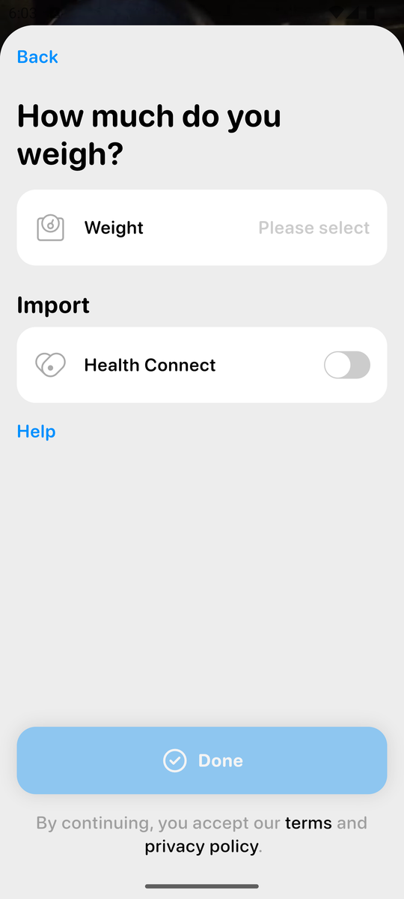 | 体重屏（Done 置灰、clickwrap 页脚） |
| 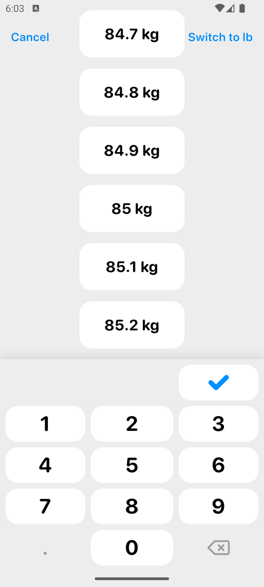 | 体重数值选择器 + app 键盘 |
| 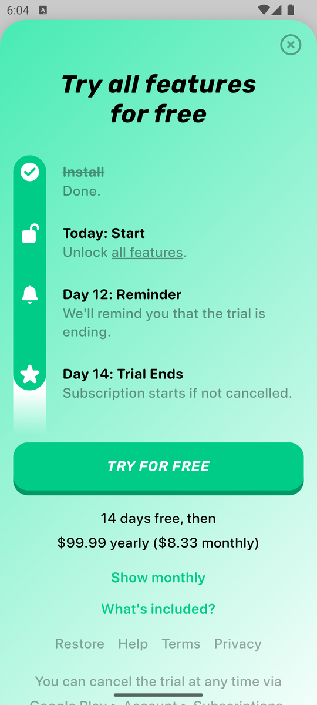 | onboarding 付费墙 14 天 / $99.99 年 |
| 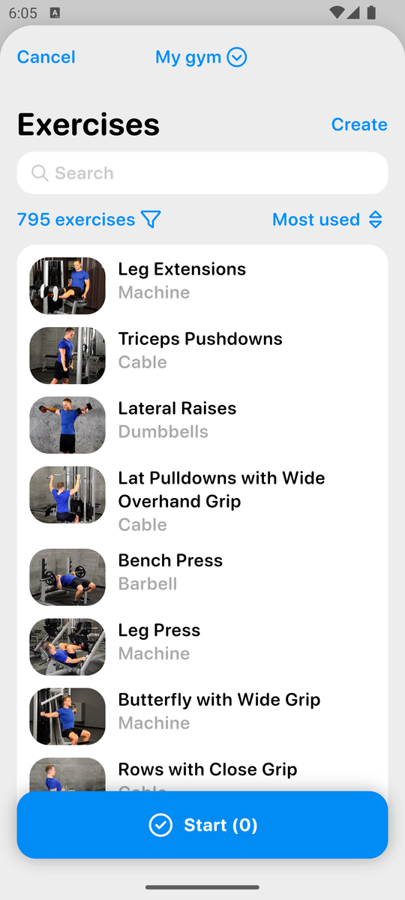 | 空白训练先进动作选择器（795 个） |
| 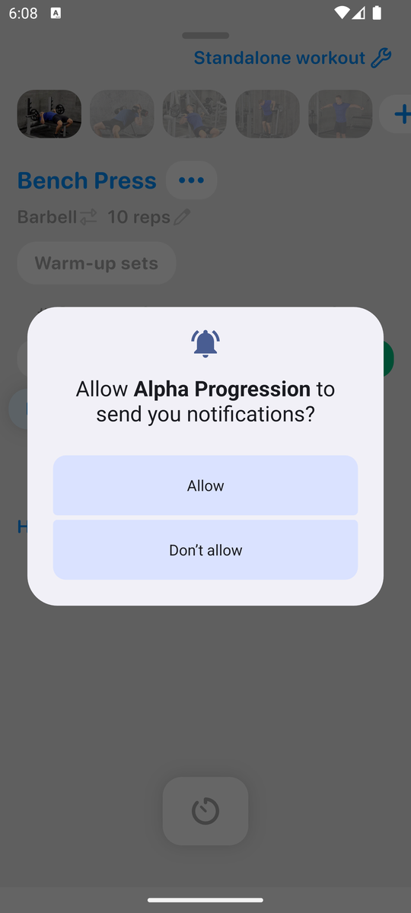 | 训练页（默认 3 组、次数预填 10） |
| 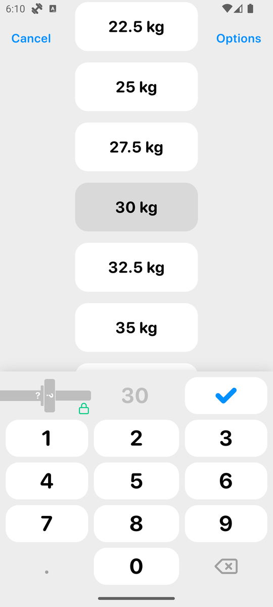 | KG 全屏选择器 |
| 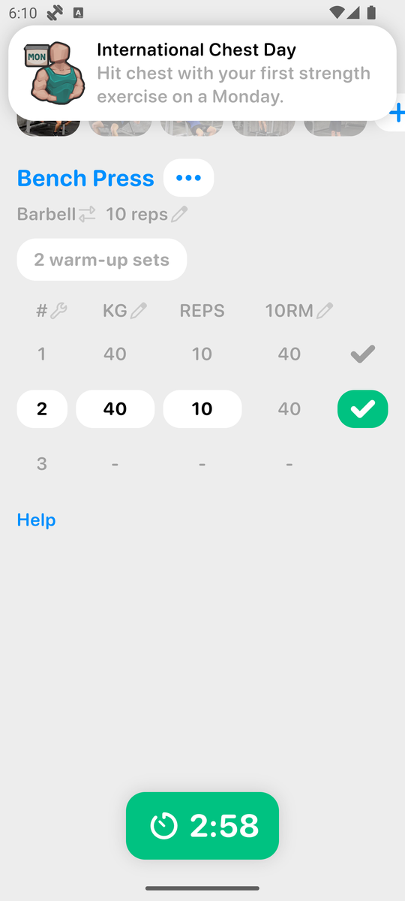 | 完成一组：下一组自动带值、计时器启动 |
| 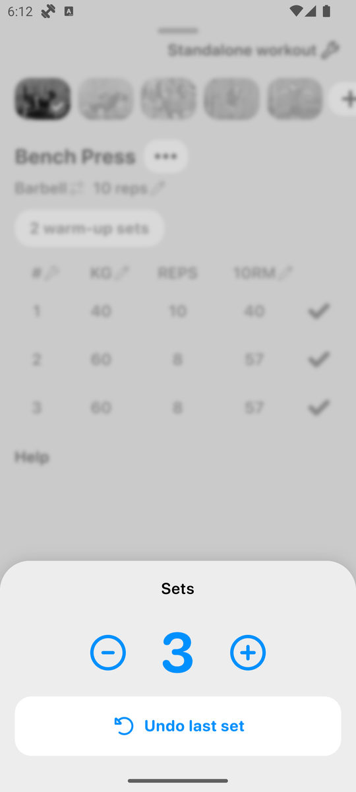 | 组数步进器 + Undo last set |
| 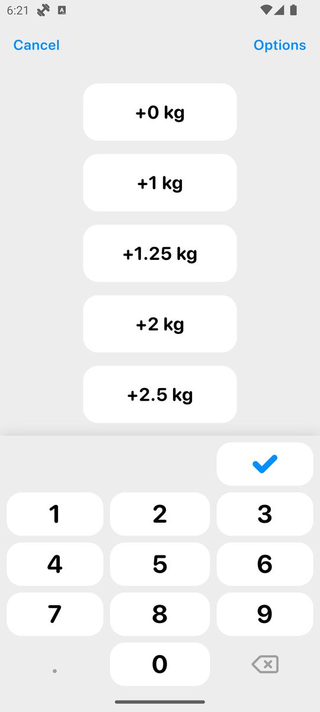 | 自重动作的附加重量列表 +0/+1/+1.25… |
| 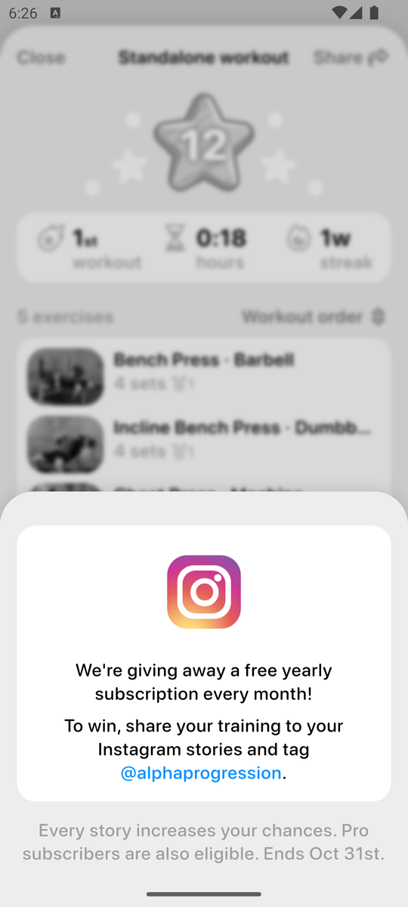 | 完成后 Instagram 抽奖底 sheet |
| 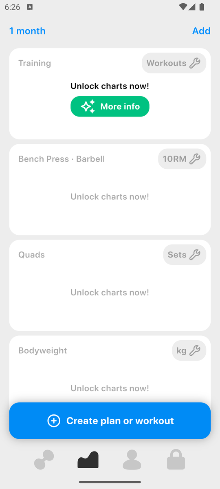 | 统计 tab 全部锁 |
| 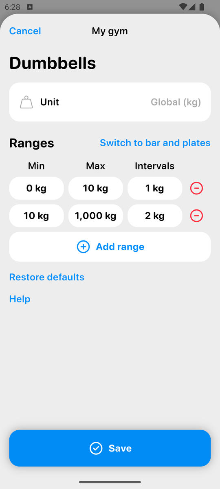 | 每器械重量区间编辑（哑铃） |
| 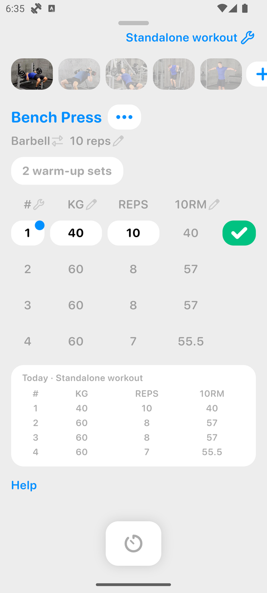 | 第二次训练逐组预填 + 上次参考卡片 |
| 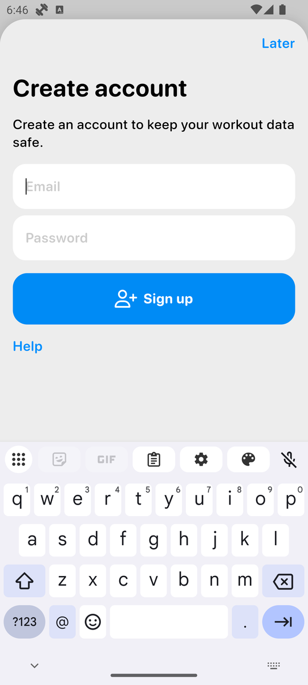 | 冷启动注册劝诱 |
| 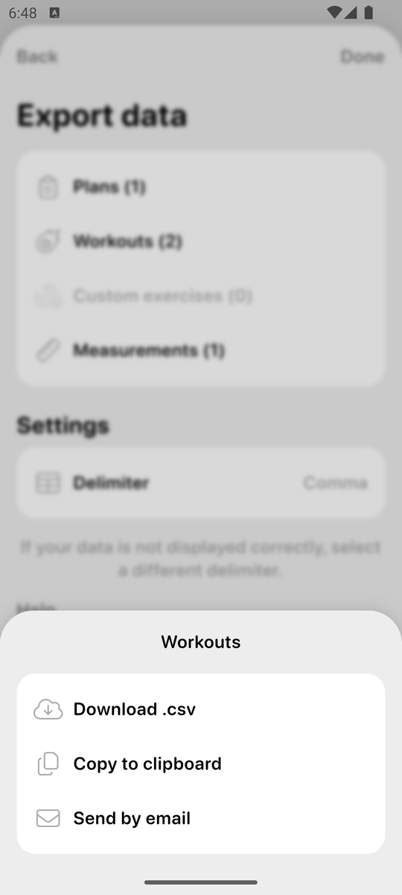 | 导出 CSV 选项 |

## 附录：`tally alpha` 原始输出

```
== alpha / phase explore
   ops: {'tap': 120, 'key': 11, 'scroll': 5, 'swipe': 3, 'long': 2, 'longdrag': 1, 'text': 1}  typed chars: 10  voided: 1
   tap/long target min-side: {'unknown': 123}
   swipe distances (dp): [213, 249, 465]
   note: Warm-up sets button -> sheet 'Unlock the warm-up calculator now!' More info (Pro lock)
   note: Exercise ... menu: N sets / N reps steppers, Dropsets, Supersets, Add note, Replace, Remove, Add exercises, Help. No warm-up set type.
   note: Explore findings: tapping KG opens full-screen picker (scroll list in 2.5 kg steps + app keypad + locked plate visual); tapping a list value commits in 1 tap. Warm-up button turned into '1 warm-up set' (calc locked, Pro). No warm-up set type -> warm-up logged as normal set 1. Explore left set1 KG=30.
   note: E2 add-set attempt silently failed (sheet tap too early?), voided addset+s1 and redoing both
   note: Stats tab: '1 month' range, Add chart; cards Training(Workouts), Bench Press 10RM, Quads Sets, Bodyweight kg -> ALL 'Unlock charts now!' (Pro)
   note: Profile tab: trophy/achievements (+2), 1 workout, 1w streak, Gym 'My gym', Bodyweight 75 kg (+), Add measurement, Basic info, Help, Settings
   note: 4th tab (lock) = paywall with Free vs PRO table: Plan generator, Progression recommendations, Charts, Multiple gyms, Much more -> all PRO only; 14 days free then 99.99/yr
   note: Settings: Training / Appearance / Notifications / Language and units / Pro version / Account / Health Connect toggle / Help: FAQ (searchable, in-app), Contact; Reddit/Facebook/Instagram/TikTok links; Changes; Terms; Privacy; v7.7
   note: My gym > Weights: per-equipment increments: Machine 2.5, Cable 2.5, Smith 0 kg bar + plates 1.25-20, Trap bar 20+plates, Barbell 20 kg + 1.25-20, EZ 10, Dumbbells 1 kg/2 kg, Kettlebells 2, Bands 5, TRX/Bodyweight/Misc 1/1.25/2; Switch to lb
   note: Equipment weight editor (Dumbbells): Unit (Global kg / per equipment), Ranges table Min/Max/Intervals (0-10 by 1, 10-1000 by 2), Add range, 'Switch to bar and plates', Restore defaults, Save. Free (no lock).
   note: Rest timer settings: Enabled, Alarm, Continue past zero, Between exercises; Duration presets by exercise size: Large 3:00, Medium 2:00, Small 1:30, Stability 1:00, Cardio 1:00 (explains 3:00 after bench, 2:00 others)
   note: Warm-up sets settings: Enabled; sets by exercise size Large 1-2/Medium 1/Small 0-1 (depends on experience), reps modifiers, reps & intensity 1 set 8x50% ... (calculator itself Pro-locked in workout). Defaults: Sets 3, Reps 10, RIR No target; Dropsets weight drop 25%; Deloads 50% sets/100% reps/5+ RIR
   note: Reference workout (source of prefill/recommendation): Same plan day | Last workout
   note: Performance metric column choice: 1RM / 10RM / Volume
   note: My gym > Equipment: picture grid of equipment (free weights, benches/racks, ...) with checkmarks; filters exercise library (795 exercises). Switch gym = multiple gyms (Pro per paywall table)
   note: Create gym -> paywall (multiple gyms = Pro)
   note: Appearance: Theme Auto/Light/Dark (dark works, free), Prevent sleep, High-quality videos
   note: Notifications: Training reminders, New reports, Achievements, Live notifications (all on by default)
   note: Language and units: Language English, Weight kg, Length cm/m/km, Numbers format, Time 12h, Week start Sunday; 'Weight units can also be specified per equipment or exercise'
   note: Languages (14): Dansk, Deutsch, English, Espanol, Francais, Italiano, Japanese(NEW), Nederlands, Norsk, Polski, Portugues, Svenska, Turkce -> NO Chinese
   note: Account: Pro version, Export data >, Sign up (optional), Reset data, Delete guest account -> app runs as 'guest account' (no login required; sign-up optional for sync)
   note: History: Profile > workouts card -> 'Training' page: chart locked + list of workouts (Standalone workout Today)
   note: Past workout detail: 5 exercises 20 sets, date/time/duration (editable wrench), 12 stars, muscle map, per-exercise set tables with 10RM
   note: Past workout ... menu: Open (edit), Repeat as standalone workout, Delete, Share, Help
   note: Home date strip tap -> Calendar sheet (months, workouts per month/week, dots), 'Today' panel lists workout + bodyweight
   note: Plan generator -> paywall (Pro)
   note: Empty plan: frequency 1x-7x/week picker -> plan editor Day 1 (rename via ...), Add exercises, Import, Add day, Save
   note: Plan Import from past workout: copies exercises with '4 sets' '10 reps' targets (per-exercise set count/target reps, not per-set weights). Created plan 'New plan' Day 'Standalone workout' (test data)
   note: Home with a plan: plan name + ..., Week 1, plan days list, All plans, Exercises, Help; 'Create plan or workout' button gone; achievement toast 'Peter Plan'
   note: Starting a PLAN workout shows the full paywall EVERY start? (first time at least); X closes and workout starts. Prefill: all 4 sets copied from last session exactly (40x10, 60x8, 60x8, 60x7) + reference table of last workout under the sets. No progression suggestion (Pro).
   note: Workout header (wrench) sheet: rename, Start time, Duration, Complete, Pause, Reset; Expert settings LOCKED (Unlock): Track RIR, Deload; Share; Save
   note: Workout Reset = 'Reset day?' confirm -> discards in-progress workout, back to plan day page
   note: Instructions tab: HD exercise video plays (free) + Setup/Execution text
   note: Exercise picker 'Most used' sort now puts the 5 used exercises on top with usage count badges
   note: Empty standalone workout with previously used exercises also prefills from last session (but default 3 sets, last had 4)
   note: Horizontal swipe on page = switch exercise (pager), not set delete
   note: Long-press on set row = same as tap (opens picker); no per-row context menu / swipe-delete
   note: Rest timer continues past zero showing negative -0:09 (grey)
   note: Supersets: 'Superset with previous exercise' (free, not applied). No reorder in ... menu, no drag on thumbnails; long-press thumbnail does nothing
   note: Pull-down minimizes workout into a blue bar 'Standalone workout - 4:08 min' on home (can browse app mid-workout)
   note: Standalone workout Reset -> discards, back to home (in-progress gone)
   note: Measurement added: Body fat 15% (list of ~15 types: body fat, calves, chest, forearms, hips, neck, shoulder width...); free; shows on profile with + quick add
   note: Achievements page: trophy levels, 11% of achievements, categories e.g. Workouts 2 of 11 (Newbie Gains, International Chest Day, Never Skip Leg Day...), Share
   note: Exercise filters: gym, Equipment, Muscle, Type, Custom only
   note: Custom exercise create: photo, name, equipment grid (12), muscle map grid (19), auxiliary muscles, type, metrics, bodyweight %; free; achievement 'Go Your Own Way'. Library now 796.
   note: Workout generator -> paywall (Pro)
   note: All plans: New plan 1 day - 4 weeks (plan default length 4 weeks), Create plan
== alpha / phase onboard
   ops: {'launch': 1, 'tap': 10}  typed chars: 0  voided: 0
   tap/long target min-side: {'ge48dp': 8, 'lt32dp': 2}
   note: Screen 1 splash: 'Stop guessing. Start progressing.' buttons Start now / Log in (webview UI, no a11y tree)
   note: Screen 2 gender: Male/Female cards, 'Prefer not to say' link; single-tap choice (auto-advance?), Cancel top-left
   note: Screen 3 experience: 5 options Beginner/Intermediate/Advanced/Pro/Elite, auto-advance on tap; no skip
   note: Screen 4 bodyweight: Weight 'Please select' (required, Done disabled until set) + Health Connect import toggle (off, left off). Footer: 'By continuing, you accept our terms and privacy policy' (clickwrap on Done, no separate Agree)
   note: Weight picker: full-screen scroll wheel of values (default lb, starts ~185 lb) + app numeric keypad with check; 'Switch to kg' link top-right (units default lb on en-US emulator locale)
   note: Done enabled after weight=75 kg; tapping Done = implicit acceptance of terms/privacy (clickwrap, no checkbox). Proceeding since it is the only way to logging and not an explicit Agree button
   note: Screen 5 PAYWALL 'Try all features for free': 14 days free then USD 99.99 yearly (8.33 monthly); timeline Install/Today/Day12 reminder/Day14; button TRY FOR FREE; links Show monthly / What's included? / Restore; X close top-right visible immediately. Dismissed with X
   note: Home reached, NO login/registration required. Achievement toast 'Ready, Set, Go! Completed the onboarding process.' slides in top. Home: week date strip, hero image, links Exercises/Help, big button 'Create plan or workout'; bottom nav 4 icons (dumbbell, chart, profile, lock=Pro)
== alpha / phase T1-start
   ops: {'tap': 5}  typed chars: 0  voided: 0
   tap/long target min-side: {'ge48dp': 5}
   note: Chooser sheet: Plan (Popular!, multi-week) vs Workout (Quickstart a workout)
   note: Second chooser 'Start workout': Workout generator (Popular!) vs Empty workout
   note: Empty workout opens exercise picker FIRST (multi-select, button 'Start (0)'), gym selector 'My gym', 795 exercises, filter, sort 'Most used', Create custom. Natural flow = build list first, then Start. Following that.
   note: Start (5) tap counted in T1-start (list built first)
   note: System notification permission prompt on workout start; tapped Don't allow
   note: Workout screen: one exercise per page, thumbnails carousel on top (+ to add), 'Standalone workout' header w/ wrench; Bench Press: Barbell, target '10 reps'; 'Warm-up sets' button; table # / KG / REPS / 10RM; 3 sets default, set1 reps prefilled 10 (from target reps), KG '-'; green check per set; tooltip 'How to find the best starting weight'; rest timer button bottom
== alpha / phase T1-E1-add
   ops: {'tap': 2, 'text': 1}  typed chars: 5  voided: 0
   tap/long target min-side: {'32-47dp': 1, 'ge48dp': 1}
   note: system keyboard opened for search; results live-filter
   note: tap selects (check badge), keyboard closes, query stays; Start (1)
== alpha / phase T1-E2-add
   ops: {'tap': 3, 'text': 1, 'key': 1}  typed chars: 7  voided: 3
   tap/long target min-side: {'lt32dp': 1, '32-47dp': 1, 'ge48dp': 1}
   note: 'Incline Bench Press / Dumbbells' was hidden behind the keyboard (8th result), closed keyboard with back
== alpha / phase T1-E3-add
   ops: {'tap': 3, 'text': 1}  typed chars: 11  voided: 0
   tap/long target min-side: {'lt32dp': 1, '32-47dp': 1, 'ge48dp': 1}
== alpha / phase T1-E4-add
   ops: {'tap': 3, 'text': 1}  typed chars: 3  voided: 0
   tap/long target min-side: {'lt32dp': 1, '32-47dp': 1, 'ge48dp': 1}
== alpha / phase T1-E5-add
   ops: {'tap': 3, 'text': 1}  typed chars: 5  voided: 0
   tap/long target min-side: {'lt32dp': 1, '32-47dp': 1, 'ge48dp': 1}
   note: No 'Cable Crossover' at top of 'cable' results; picked 'High Cable Flys / Cable' (closest standing crossover)
== alpha / phase T1-E1-s1
   ops: {'tap': 5}  typed chars: 0  voided: 0
   tap/long target min-side: {'32-47dp': 3, 'unknown': 2}
   note: Picker centered on current value 30 (highlighted); 40 not visible -> typed on app keypad
   note: keypad digit keys measured 117x53dp (two digit taps above logged as UNKNOWN size)
   note: reps 10 prefilled from target reps -> no reps input needed
   note: Set done: row greys out, next set auto-filled with same values (40x10), rest timer auto-starts 3:00 as green pill at bottom (non-blocking). Achievement toast 'International Chest Day' slides in. ONBOARDING END = first set logged.
== alpha / phase T1-E1-s2
   ops: {'tap': 7}  typed chars: 0  voided: 0
   tap/long target min-side: {'32-47dp': 3, 'ge48dp': 4}
   note: reps picker: list centered on current 10 reps (7..12 visible) + keypad; tap '8 reps' commits
== alpha / phase T1-E1-s3
   ops: {'tap': 1}  typed chars: 0  voided: 0
   tap/long target min-side: {'32-47dp': 1}
   note: After last planned set (3 default), app auto-advances to next exercise (Incline Bench Press); set 3 was same as set 2 -> 1 tap (check only). Rest timer restarts.
== alpha / phase T1-E1-s4
   ops: {'tap': 7}  typed chars: 0  voided: 0
   tap/long target min-side: {'32-47dp': 4, 'lt32dp': 1, 'ge48dp': 2}
   note: Sets sheet: - 3 + stepper and 'Undo last set' button
   note: E1 set4 needed: go back to Bench thumbnail, # header -> Sets sheet + , tap outside to close, then reps 7, check -> auto-advance again to Incline. Lesson: add 4th set BEFORE finishing set 3 (default plan is 3 sets)
== alpha / phase T1-E2-addset
   ops: {'tap': 3}  typed chars: 0  voided: 3
   tap/long target min-side: {'lt32dp': 1, '32-47dp': 1, 'ge48dp': 1}
== alpha / phase T1-E2-s1
   ops: {'tap': 7}  typed chars: 0  voided: 6
   tap/long target min-side: {'32-47dp': 2, 'ge48dp': 5}
   note: Dumbbell weight list starts at 0 kg in 1 kg steps (no 22.5) -> typed 22.5 on keypad
   note: Dumbbell list around 20 kg goes 18/20/22/24 (2 kg steps, default dumbbell inventory) -> 22.5 must be typed
== alpha / phase T1-E2-s2
   ops: {'tap': 1}  typed chars: 0  voided: 0
   tap/long target min-side: {'32-47dp': 1}
== alpha / phase T1-E2-s3
   ops: {'tap': 3}  typed chars: 0  voided: 0
   tap/long target min-side: {'32-47dp': 2, 'ge48dp': 1}
== alpha / phase T1-E2-s4
   ops: {'tap': 3}  typed chars: 0  voided: 0
   tap/long target min-side: {'32-47dp': 2, 'ge48dp': 1}
== alpha / phase T1-E3-addset
   ops: {'tap': 3}  typed chars: 0  voided: 0
   tap/long target min-side: {'lt32dp': 1, '32-47dp': 1, 'ge48dp': 1}
== alpha / phase T1-E3-s1
   ops: {'tap': 7}  typed chars: 0  voided: 0
   tap/long target min-side: {'32-47dp': 3, 'ge48dp': 4}
== alpha / phase T1-E3-s2
   ops: {'tap': 5}  typed chars: 0  voided: 0
   tap/long target min-side: {'32-47dp': 3, 'ge48dp': 2}
== alpha / phase T1-E3-s3
   ops: {'tap': 1}  typed chars: 0  voided: 0
   tap/long target min-side: {'32-47dp': 1}
== alpha / phase T1-E3-s4
   ops: {'tap': 3}  typed chars: 0  voided: 0
   tap/long target min-side: {'32-47dp': 2, 'ge48dp': 1}
== alpha / phase T1-E4-addset
   ops: {'tap': 3}  typed chars: 0  voided: 0
   tap/long target min-side: {'lt32dp': 1, '32-47dp': 1, 'ge48dp': 1}
== alpha / phase T1-E4-s1
   ops: {'tap': 5}  typed chars: 0  voided: 1
   tap/long target min-side: {'32-47dp': 3, 'ge48dp': 2}
   note: Check with KG '-' does nothing (no message): bodyweight sets need KG filled (0 = bodyweight). Voided that tap.
   note: Bodyweight exercise KG picker shows ADDED weight: +0 kg, +1, +1.25, +2, +2.5 ... (bodyweight+added supported natively)
== alpha / phase T1-E4-s2
   ops: {'tap': 3}  typed chars: 0  voided: 0
   tap/long target min-side: {'32-47dp': 2, 'ge48dp': 1}
== alpha / phase T1-E4-s3
   ops: {'tap': 7}  typed chars: 0  voided: 0
   tap/long target min-side: {'32-47dp': 3, 'ge48dp': 4}
== alpha / phase T1-E4-s4
   ops: {'tap': 1}  typed chars: 0  voided: 0
   tap/long target min-side: {'32-47dp': 1}
== alpha / phase T1-E5-addset
   ops: {'tap': 3}  typed chars: 0  voided: 0
   tap/long target min-side: {'lt32dp': 1, '32-47dp': 1, 'ge48dp': 1}
== alpha / phase T1-E5-s1
   ops: {'tap': 9}  typed chars: 0  voided: 0
   tap/long target min-side: {'32-47dp': 3, 'ge48dp': 6}
   note: reps 15 not visible in reps list (7..12) -> typed
== alpha / phase T1-E5-s2
   ops: {'tap': 1}  typed chars: 0  voided: 0
   tap/long target min-side: {'32-47dp': 1}
== alpha / phase T1-E5-s3
   ops: {'tap': 5}  typed chars: 0  voided: 0
   tap/long target min-side: {'32-47dp': 3, 'ge48dp': 2}
== alpha / phase T1-E5-s4
   ops: {'tap': 1}  typed chars: 0  voided: 0
   tap/long target min-side: {'32-47dp': 1}
   note: All sets of all exercises done -> rest timer replaced by big 'Complete workout' button
== alpha / phase T1-finish
   ops: {'tap': 3}  typed chars: 0  voided: 1
   tap/long target min-side: {'ge48dp': 2, 'lt32dp': 1}
   note: Complete workout: no confirm dialog; summary sheet with confetti, star '12', 1st workout / 0:18 hours / 1w streak, per-exercise medals, muscle 'Chest 100% 20 sets', achievements 'Newbie Gains'
   note: ~4 s after summary a bottom sheet pops up: Instagram giveaway 'share your training to your Instagram stories and tag @alphaprogression' (no close button visible; dismissed by tapping the dimmed area)
   note: T1 finish -> Close returns to Home (Workout tab); home shows only a dot on today in date strip
== alpha / phase T3-start
   ops: {'tap': 2}  typed chars: 0  voided: 0
   tap/long target min-side: {'ge48dp': 2}
   note: T3 path chosen: plan created in explore by importing T1 (one-time ~8 taps: Create plan or workout > Plan > Empty plan > 1x > Next > Import > Import > Save). Alternative without plan: Home date > workout > ... > Repeat as standalone workout (4 taps).
   note: No paywall on this (2nd) plan start. Workout opens on Bench with all 4 sets prefilled from last session; no exercise add needed (T3-E*-add phases skipped).
== alpha / phase T3-E1-s1
   ops: {'tap': 1}  typed chars: 0  voided: 0
   tap/long target min-side: {'32-47dp': 1}
== alpha / phase T3-E1-s2
   ops: {'tap': 1}  typed chars: 0  voided: 0
   tap/long target min-side: {'32-47dp': 1}
== alpha / phase T3-E1-s3
   ops: {'tap': 1}  typed chars: 0  voided: 0
   tap/long target min-side: {'32-47dp': 1}
== alpha / phase T3-E1-s4
   ops: {'tap': 1}  typed chars: 0  voided: 0
   tap/long target min-side: {'32-47dp': 1}
== alpha / phase T3-E2-s1
   ops: {'tap': 1}  typed chars: 0  voided: 0
   tap/long target min-side: {'32-47dp': 1}
== alpha / phase T3-E2-s2
   ops: {'tap': 1}  typed chars: 0  voided: 0
   tap/long target min-side: {'32-47dp': 1}
== alpha / phase T3-E2-s3
   ops: {'tap': 1}  typed chars: 0  voided: 0
   tap/long target min-side: {'32-47dp': 1}
== alpha / phase T3-E2-s4
   ops: {'tap': 1}  typed chars: 0  voided: 0
   tap/long target min-side: {'32-47dp': 1}
== alpha / phase T3-E3-s1
   ops: {'tap': 1}  typed chars: 0  voided: 0
   tap/long target min-side: {'32-47dp': 1}
== alpha / phase T3-E3-s2
   ops: {'tap': 1}  typed chars: 0  voided: 0
   tap/long target min-side: {'32-47dp': 1}
== alpha / phase T3-E3-s3
   ops: {'tap': 1}  typed chars: 0  voided: 0
   tap/long target min-side: {'32-47dp': 1}
== alpha / phase T3-E3-s4
   ops: {'tap': 1}  typed chars: 0  voided: 0
   tap/long target min-side: {'32-47dp': 1}
== alpha / phase T3-E4-s1
   ops: {'tap': 1}  typed chars: 0  voided: 0
   tap/long target min-side: {'32-47dp': 1}
== alpha / phase T3-E4-s2
   ops: {'tap': 1}  typed chars: 0  voided: 0
   tap/long target min-side: {'32-47dp': 1}
== alpha / phase T3-E4-s3
   ops: {'tap': 1}  typed chars: 0  voided: 0
   tap/long target min-side: {'32-47dp': 1}
== alpha / phase T3-E4-s4
   ops: {'tap': 1}  typed chars: 0  voided: 0
   tap/long target min-side: {'32-47dp': 1}
== alpha / phase T3-E5-s1
   ops: {'tap': 1}  typed chars: 0  voided: 0
   tap/long target min-side: {'32-47dp': 1}
== alpha / phase T3-E5-s2
   ops: {'tap': 1}  typed chars: 0  voided: 0
   tap/long target min-side: {'32-47dp': 1}
== alpha / phase T3-E5-s3
   ops: {'tap': 1}  typed chars: 0  voided: 0
   tap/long target min-side: {'32-47dp': 1}
== alpha / phase T3-E5-s4
   ops: {'tap': 1}  typed chars: 0  voided: 0
   tap/long target min-side: {'32-47dp': 1}
== alpha / phase T7-in
   ops: {'tap': 3}  typed chars: 0  voided: 0
   tap/long target min-side: {'32-47dp': 2, 'lt32dp': 1}
   note: Last session numbers: shown inline under the set table on the exercise page (reference card) - visible with 0 extra taps when on that exercise; 1 tap on thumbnail to navigate
   note: Exercise detail (tap name): tabs Info/Instructions/History; Info: 'Unlock exercise evaluations now!' (Pro), Equipment, muscles map, Type Large exercise, Metrics Weight+reps, per-exercise Weight unit kg, Bodyweight %, Similar (62)
   note: Exercise History tab: 1 workout / best 60 kg / best 10RM 57 (free numbers), progress chart LOCKED ('Unlock charts now!'), past sessions tables. 1RM as metric only via Settings>Performance metric
== alpha / phase T3-finish
   ops: {'tap': 3}  typed chars: 0  voided: 1
   tap/long target min-side: {'ge48dp': 1, 'lt32dp': 2}
   note: 'Very short workout - Did this workout really take 4:03 min? Yes / No, edit duration' sheet: artifact of test speed (real session would not trigger) -> tapped Yes, voided
   note: T3 summary: no Instagram popup this time; achievements 'Lift Up the Week', 'Two Good to Quit'
   note: After summary Close, lands on the plan-day page (completed workout); one more Close to home
   note: Home after T3: inline card 'Would you rate this app 5 stars? Sure / No / Later' (non-modal); plan day shows green check
== alpha / phase T4-edit
   ops: {'tap': 2}  typed chars: 0  voided: 0
   tap/long target min-side: {'32-47dp': 1, 'ge48dp': 1}
   note: Edit done set: tap its KG cell (still editable, greyed row) -> picker -> tap 62.5 (2 taps); 10RM recalculated
== alpha / phase T4-delete
   ops: {'tap': 3}  typed chars: 0  voided: 0
   tap/long target min-side: {'lt32dp': 1, '32-47dp': 1, 'ge48dp': 1}
   note: Delete set: only via Sets stepper '-' (removes LAST set), no delete for an arbitrary set; 3 taps (header, -, close)
== alpha / phase T4-undo
   ops: {'tap': 2}  typed chars: 0  voided: 0
   tap/long target min-side: {'lt32dp': 1, 'ge48dp': 1}
   note: 'Undo last set' = un-marks the last completed set (set 2 back to active); it does NOT restore the deleted set. No general undo exists.
== alpha / phase T5-add
   ops: {'tap': 6, 'text': 2}  typed chars: 28  voided: 0
   tap/long target min-side: {'32-47dp': 3, 'lt32dp': 1, 'ge48dp': 2}
   note: Search 'overhead press' returns Overhead Curls/Shrugs, no Overhead Press at top -> retry with 'shoulder press' (kept as real-user friction)
   note: picked 'Seated Shoulder Press / Barbell' (Standing Shoulder Press Barbell = true OHP exists further down); mid-workout picker button reads 'Add (1)'
   note: New exercise appended at end, app jumps to it
== alpha / phase T5-remove
   ops: {'tap': 3}  typed chars: 0  voided: 0
   tap/long target min-side: {'32-47dp': 1, 'ge48dp': 2}
   note: Remove exercise: ... > Remove > confirm sheet Remove (3 taps)
== alpha / phase T6
   ops: {'key': 1, 'launch': 2, 'tap': 4}  typed chars: 0  voided: 0
   tap/long target min-side: {'ge48dp': 1, 'unknown': 3}
   note: T6 home+relaunch: exact same screen, timer running
   note: After force-stop relaunch: 'Create account - Create an account to keep your workout data safe' (Email/Password, Sign up) with keyboard auto-opened; 'Later' top-right skips (skippable nag, appeared on 2nd cold start)
   note: Later -> second sheet 'Warning: Without an account, your data may be lost at any time.' Okay (2 taps to skip sign-up nag)
   note: After cold start: home with minimized bar 'Standalone workout - 5:45 min' (timer kept running); plan now shows Week 2
   note: Workout fully recovered after force-stop: edited 62.5, deleted set, undone state all intact
== alpha / phase T7-out
   ops: {'tap': 5}  typed chars: 0  voided: 0
   tap/long target min-side: {'lt32dp': 1, 'ge48dp': 1, '32-47dp': 1, 'unknown': 2}
   note: Exercise detail from library opens on last-used tab (Instructions)
== alpha / phase T8
   ops: {'tap': 5}  typed chars: 0  voided: 0
   tap/long target min-side: {'32-47dp': 1, 'lt32dp': 1, 'ge48dp': 3}
   note: Export data: Plans (1) / Workouts (2) / Custom exercises (0) / Measurements (1), CSV delimiter Comma; free (no lock)
   note: Workouts export sheet: Download .csv / Copy to clipboard / Send by email. Stopped here (no file downloaded). Export is free, CSV only (no JSON), no import feature seen.
```
