# Gym WP（Gym Workout Planner）竞品调研 v2

> 包名 `com.lealApps.pedro.gymWorkoutPlan`，2026-10-26 在 **Android 模拟器**（emulator-5554，1440×3200 @ 600 dpi = 384×853 dp，界面语言英文）上按 brief v2 实测。
> **全新安装**（从 Play 装好、从未打开），所以上手流程是完整实测的。没有登录（选了「Continue without an account」）、没有开试用，全程是免费版。
> 模拟器上的广告是 AdMob **测试广告**（带「Test Ad」角标），广告的位置、出现时机和关闭方式与真机一致，但素材不同。

## 1. 概况

- **定位**：「AI 计划 + 引导式跟练」型力量训练 app。卖点是问卷生成的分阶段计划（3 个阶段 × 4 周）、肌肉疲劳图、动作插图和说明。记录界面不是表格，而是**一次只显示一个动作的跟练页**：组列表 + 底部大按钮「Next」+ 准备 / 执行 / 休息三段计时，默认「Hands-Free Mode」开启，休息结束自动进入下一组。
- **付费**：免费 + 广告；Premium 订阅。上手付费墙价格（美元）：**12 个月 $59.99/年（折 $5.00/月，标「Best Option」，默认选中）、3 个月 $29.99/季、1 个月 $12.99/月**，另有「Activate 7-day free trial」开关（默认关）。第二个付费墙是限时折扣：**首年 $47.99**（原价 $59.99，带倒计时）。Premium 卖点：完整动作库、表现报告、去广告。
- **免费版实测上限**：
  - **动作库**：任何列表（全部、按肌群筛选、搜索结果）都只显示**前 5 个动作**，其后全部模糊 +「Access blocked! Subscribe now and unlock the exercise list.」。T1 里 Cable Crossover 就因此搜不到，只能换「Standing Fly - neutral grip (cable)」。
  - 统计里**次数、重量总量、时间分布、1RM 曲线、最佳训练量 / 最佳 1RM、动作数 / 组数 / 次数 / 重量周统计、最常练肌群**全部上锁。
  - **导出**（两个入口）都直接弹 Premium 付费墙。
  - 自定义动作能存名字和说明，但选**主肌群**就弹付费墙。
  - AI 计划里的训练能开始，但点动作想编辑就弹付费墙。
  - 训练报告里的**日期**带锁，不能改。
- **广告**：插页广告（全屏视频）会在**添加训练日（workout split）后**和**完成训练后**出现，各复现 2 次，共 4 次；X 在出现后约 5 秒内可见，没有被迫看完。横幅广告出现在「My Workouts」、例程页、动作详情页顶部，**有时出现有时不出现，出现时下面的列表会整体下移约 100 px**，容易点错。
- **语言**：葡、西、英、德、法、意 6 种，没有中文。
- **登录**：不强制。上手末尾有注册墙（Google / Email / 小号链接「Continue without an account」），页脚写着「By continuing, you agree to our Terms of Use and Privacy Policy」（隐式同意，没有勾选框）。

## 2. 上手流程（全新安装，实测）

| # | 屏 | 问什么 / 内容 | 输入方式 | 必填 / 可跳过 | 默认值 |
|---|---|---|---|---|---|
| 1 | 欢迎页 | 「Start improving with every workout.」「5M+ people training」 | Get started / Sign In | 必须点 | — |
| 2 | What's your goal? | 5 选 1（Build muscle…） | 单选卡片，点了自动进下一屏 | 必填，无跳过 | 无 |
| 3 | What's your biggest challenge? | 6 选 1 | 单选，自动前进 | 必填 | 无 |
| 4 | 说服页 | 「46% of people who join a gym have no specific goal…」 | Next | — | — |
| 5 | Which muscle do you want to focus on? | 7 选 1（Balanced、Chest…） | 单选 | 必填 | 无 |
| 6 | Want to include cardio? | 2 选 1 | 单选 | 必填 | 无 |
| 7 | Training experience | 4 选 1 | 单选 | 必填 | 无 |
| 8 | What's your gym like? | Basic / Fully equipped | 单选 | 必填 | 无 |
| 9 | How many days do you want to train? | 「Specific days」7 个勾选框 / 「Days per week」 | 多选 + Next | 必填（不选 Next 是灰的） | 无 |
| 10 | What time do you want to train? | 时 / 分 / AM-PM 三个滚轮，可「Set each day separately」 | 滚轮 + Next | 可直接 Next | 当前时间（11:06 PM） |
| 11 | 过渡页 | 「The foundation of your plan is ready」「87% of people…」 | Next | — | — |
| 12 | What's your gender? | Female / Male / Prefer not to say | 单选 | 必填（有不回答选项） | 无 |
| 13 | When were you born? | 月 / 日 / 年滚轮 | **必须拨动滚轮**，否则 Continue 是灰的；点滚轮上的数字没反应，只能滑 | 必填 | Jan 01 2000 |
| 14 | How tall are you? | NumberPicker，kg/cm ↔ lb/ft 切换 | 滑 2 次 + 点 1 次才到 178 | 可直接 Continue | 170 cm |
| 15 | Current weight | 整数 + 小数两个 NumberPicker | 滑 1 次 + 点 1 次 | 可直接 Continue | 70.0 kg |
| 16 | Target weight | 同上 | — | 可直接 Continue | 80.0 kg（推测 = 当前体重 + 5） |
| 17 | 通知预请求 | 「Turn on notifications…」「3x faster results」，开关**默认开** | 关掉开关后按钮从「Allow notifications」变「Continue」 | 可拒绝 | 开 |
| 18 | 假加载页 | 「Analyzing male profile, age 28…」5 行动画 | 自动前进 | — | — |
| 19 | 计划摘要 | 4x/周、28 个动作、~200 kcal、3 个阶段 × 4 周 | Continue | — | — |
| 20 | 过渡页 | 「Your goal is now a plan」+ 曲线图 | Continue | — | — |
| 21 | 承诺页 | 🤝「Every transformation starts with a decision. Are you making yours?」 | 只有一个按钮「I'm committing」 | 必须点（不是法律条款） | — |
| 22 | **付费墙 1** | 年 / 季 / 月三档 + 7 天试用开关 | **右上 X 立即可见**（40 dp） | 可关 | 年度选中、试用关 |
| 23–27 | 产品导览 5 屏 | 「Before you decide, see how it actually works」→ 计划 → 记录 → 恢复 →「I'm ready to start」 | Next ×5 | 无跳过 | — |
| 28 | **付费墙 2** | 「Start your Premium journey 👑」，倒计时，首年 $47.99 | 右上 X 立即可见（56 dp） | 可关 | — |
| 29 | 挽留弹层 | 「Are you sure? You will lose this exclusive promotion.」 | 大按钮「Get my discount」/ 文字按钮「Discard discount」 | 可关 | — |
| 30 | **注册墙** | Continue with Google / Email；小号链接「Continue without an account」（201×35 dp） | 选了不登录 | 可跳过 | — |
| 31–33 | 首页教学气泡 3 个 | Your workout plan → Your workout routines → Workout on the spot | Next / Skip / Close | 可 Skip | — |

之后**每个页面第一次进入**还会再弹教学气泡：Quick 页 3 个、例程编辑页 2 个、添加动作后 2 个、动作编辑页 2 个、History 页 1 个；Activities 页第一次进入弹「Gym WP Widget」添加桌面小组件的底部弹层。

**汇总**

- 屏数：**30 屏**（含 2 个付费墙、1 个挽留弹层、1 个注册墙）+ 首页 3 个教学气泡。
- 要回答的字段：**14 个**（目标、挑战、重点肌群、有氧、经验、器械、训练日、训练时间、性别、生日、身高、体重、目标体重、通知开关），其中 4 个有默认值可直接过（时间、身高、体重、目标体重），**问卷题本身没有一个能跳过**。
- **真正记一组需要的字段：0 个**。这 14 个字段只服务于 AI 计划和卡路里估算，记录一组只需要动作、次数、重量，与问卷无关。
- 点击：上手阶段 **39 次点击 + 4 次滑动**（不含作废），其中 13 次是「Next / Continue」类纯翻页。
- 从首次启动到**第一组记完**（按实际路径，一次建好 5 个动作的例程）：onboard 39 + 建例程 9 + 加 5 个动作 21 + 开始 2 + 第一组 5 = **76 次点击、9 次滑动、11 次键盘输入、2 次按键**。如果只加卧推一个动作，最短约 **60 次点击 + 4 次滑动 + 4 次输入**。
- 付费墙：**2 次 + 1 个挽留弹层**，都是右上 X 立即可见，没有延迟出现的关闭按钮；返回键未测。
- 系统权限：上手中没有弹系统权限框，只有 app 自己的通知预请求（拒了）。之后**每次点「Start workout」都会再弹**一次「Enhance your experience with notifications during workouts」（After / Allow），3 次训练弹了 3 次。

## 3. 导航结构

底部 4 个标签（只有图标，没有文字）：

- **Workouts**（默认首页）：中间悬浮的三段切换「Plan / My Workouts / Quick」。
  - **Plan**：AI 计划。阶段卡（1: Strength / 2: Hypertrophy / 3: …，各 4 周），每周展开是周一 / 二 / 四 / 五的训练卡，卡上有 ▶。右上 ⋮ = Create new Plan（重跑问卷）/ Restart Plan / View details。
  - **My Workouts**：自建例程（Routine）→ 训练日（Workout split，可勾选星期）→ 动作列表 → Start workout。三层结构。
  - **Quick**：按 Duration / Equipment / Level / Goal / Muscles 自动生成的一次性训练。
- **Activities**：子标签 Activities（肌肉疲劳人体图、上月总结、7/14/28/90 天统计卡、最常练肌群、器械占比饼图、Export）/ History（月历 + 训练与身体记录列表，右下 Add 可补记训练或身体数据）。
- **Exercises**：人体肌群图（可旋转前后）+ 搜索 + 筛选（Muscle Groups、Equipment）+ Create Exercise。
- **Body**：体重 / 围度 / 进阶（BMI、体脂、身体成分）、进度照片、Diagnosis（BMI、体脂、理想体重）、历史记录。
- 右上头像 = My Account（设置页）。

训练进行中：全屏跟练页，左上 X（结束 → Report 页）、右上 Statistics；正文是当前动作（插图、Replace、Note、组列表、+ Add set）和下方整场动作列表；底部固定面板显示阶段（Do the warm-up / Get ready! / Perform the exercise / Rest!）+ 计时 + Back / Next。

## 4. 功能地图与覆盖率

| 功能 | 路径 | 免费/付费 | 状态 |
|---|---|---|---|
| 上手问卷 + AI 计划生成 | 首次启动 | 免费 | 已用 |
| 上手付费墙 ×2 + 挽留弹层 | 问卷末尾 | 付费 | 被锁（看了价格，关掉） |
| 注册 / 登录（Google、Email） | 上手末尾；My Account → Log in | 免费 | 未用（规则禁止登录） |
| 教学气泡（每页首次） / Restart Guided Tutorial | 各页；My Account | 免费 | 已用 |
| AI 计划：阶段 / 周 / 训练卡浏览 | Plan | 免费 | 已用 |
| AI 计划训练中编辑动作 | Plan → 训练 → 点动作 | **Premium** | 被锁 |
| Create new Plan / Restart Plan / View details | Plan ⋮ | 免费 | 已用（Create new Plan 进了问卷后退出） |
| 自建例程（Routine → Workout split → 动作） | My Workouts | 免费 | 已用（Chest Day） |
| 例程 ⋮：Edit / Duplicate / Delete | My Workouts 列表 | 免费 | 已用（删过 Test 例程） |
| Quick 自动生成训练 + 筛选 | Quick | 免费 | 已用（看了筛选项，没开练） |
| 空白训练（不选动作直接开练） | — | — | 不存在（0 个动作时 Start workout 是灰的） |
| 动作搜索 + 多选添加（「Add N exercises」） | 例程 / 训练中「Add exercise」 | 前 5 个结果免费 | 已用 |
| 动作库完整列表 | Exercises；添加动作页 | **Premium**（每个列表只放前 5 个） | 被锁 |
| 筛选：Muscle Groups / Equipment / 排序 / 网格-列表切换 | 添加动作页 | 免费 | 已用 |
| 自定义动作（名称、说明、照片） | Exercises → Create Exercise | 免费 | 已用（Cable Crossover） |
| 自定义动作选主 / 副肌群 | 同上 | **Premium** | 被锁 |
| 动作详情：插图动画 + 说明（Preparation / Execution / Tips） | 点动作 → Instructions | 免费 | 已用 |
| 动作详情：训练量曲线 | Statistics → Total Volume | 免费 | 已用 |
| 动作详情：Weight / Repetitions 曲线 | Statistics | 未确认 | 未用（没点开，免费与否不确定） |
| 动作详情：1RM 曲线 | Statistics → 1RM | **Premium** | 被锁 |
| 动作详情：History（每次每组次数×重量，可编辑 ✏） | History | 免费 | 已用 |
| 最佳训练量 / 最佳 1RM | 动作 History 底部 | **Premium** | 被锁 |
| 跟练页：组列表、+ Add set、Replace、Note | 训练中 | 免费 | 已用 |
| 输入：系统数字键盘，→\| 跳到下一格 | 点次数 / 重量 | 免费 | 已用 |
| 改一组后自动填充后面的组 | 训练中 | 免费 | 已用 |
| 准备 / 执行 / 休息计时 + Hands-Free 自动前进 | 训练中；Workout settings | 免费 | 已用 |
| 每个动作的休息时长 | 例程 → 点动作 → ⏱ | 免费 | 已用（打开设置页，输入没生效，取消） |
| 组后感受「Light / Ideal / Hard」+ Smart Suggestion | 每组完成后 | 免费 | 已用（点过一次 Ideal） |
| 组类型 | 例程 → 点动作 → 下拉 | 免费 | 已用：只有「计量方式」（Reps and weight / Repetitions / Weight / Time），**没有热身 / 递减 / 力竭组** |
| 热身阶段（Free reps · Light load，不记录） | 每场第一个动作前 | 免费 | 已用 |
| 超级组 | 例程动作 ⋮ → Super Set | 免费 | 已用 |
| 训练中改顺序（长按拖动）+「Keep changes for future workouts?」 | 训练中动作列表 | 免费 | 已用（T5） |
| 训练中删组（组行慢速左滑） / 删动作（左滑 → 🗑） | 训练中 | 免费 | 已用（T4/T5） |
| 撤销 | — | — | 不存在 |
| 训练中 Statistics（完成度、时长、卡路里） | 训练页右上 | 次数 / 重量总量被锁 | 已用 |
| 结束报告（照片、日期、勾选完成的动作、备注） | 训练页 X | 改日期需 Premium | 已用 |
| 完成分享卡（AI 文案、滤镜、Share） | 完成后 | 免费 | 已用（只看，没分享） |
| 训练历史 + 月历 | Activities → History | 免费 | 已用 |
| 历史详情（次数 / 重量 / 时间图表） | History → 训练 | **Premium** | 被锁 |
| 「Workout Again」重开历史训练 | History → 训练 | 免费 | 已用（看到，T3 走的是例程入口） |
| 补记过去的训练 | History → Add → Workouts | 免费 | 已用（打开没保存） |
| 肌肉疲劳人体图 | Activities → View details | 免费 | 已用 |
| 周期统计：时长 / 卡路里 | Activities | 免费 | 已用 |
| 周期统计：动作 / 组 / 次 / 重量、最常练肌群 | Activities | **Premium** | 被锁 |
| 器械占比饼图 | Activities | 免费 | 已用 |
| 上月总结卡 | Activities | 免费 | 未用（只看到卡片） |
| 导出 | My Account → Export statistics；Activities → Export | **Premium** | 被锁 |
| 导入 | — | — | 不存在（没找到入口） |
| 备份 / 同步 | 登录后 | — | 未用（要登录） |
| 体重记录 + 目标对比曲线 | Body | 免费 | 已用 |
| 围度（肩、胸、前臂、上臂…） | Body → Add → Measurements | 免费 | 已用（胸围 100） |
| 进阶：BMI、体脂、身体成分 / Diagnosis | Body | 免费 | 已用（只看） |
| 进度照片 | Body 照片卡 | 免费 | 未用（要相册权限） |
| Workout settings（Hands-Free、声音、振动、准备时间、Smart Suggestion） | My Account | 免费 | 已用（只看，保持默认） |
| 提醒与通知（频率、每天训练时间） | My Account | 免费 | 已用（只看） |
| 单位（只有全局 Metric / Imperial） | My Account → Measurement Units | 免费 | 已用（只看） |
| 主题（Light / Dark / System） | My Account → Theme | 免费 | 已用（只看） |
| 语言（6 种） | My Account → Language | 免费 | 已用（只看） |
| 桌面小组件 | My Account → Widget；Activities 首次弹层 | 免费 | 已用（只看，取消） |
| FAQ / Contact / Social networks / Share / Rate | My Account | 免费 | 已用（FAQ），其余未用（会跳出 app） |
| Restore Purchases / Become Premium | My Account | 付费 | 未用 |
| 插页广告 / 横幅广告 | 加训练日后、完成训练后；多个页面顶部 | 免费版 | 已用（记录了 4 次插页） |
| 杠铃片计算器 / 器械档位 / 每台器械单位 | — | — | 不存在 |
| RPE / RIR 数值 | — | — | 不存在（只有 Light / Ideal / Hard 三档） |
| 社交动态 / 好友 | — | — | 不存在（只有分享卡） |

**覆盖率**：表中共 65 项。扣掉「不存在」的 6 项，剩 59 项；已用 44 + 被锁 9 = 53，**覆盖率 53 / 59 ≈ 90%**。未用的 6 项：注册登录、备份同步（都要登录）、动作 Weight / Repetitions 曲线（没点开）、上月总结、进度照片（要相册权限）、Restore / Become Premium。

## 5. 核心记录交互

- **结构**：先建「例程 → 训练日 → 动作」，再 Start workout。**没有空白训练**，Quick 是系统生成的。T1 只能「先建清单」。
- **跟练页**：一屏一个动作，「Exercise 1/5」。每组是一张卡：`10 reps · 40 kg`。当前组橙色描边，完成后左侧变绿 ✓。
- **输入**：点次数或重量数字 → 系统数字键盘（Gboard 数字盘），原值全选，直接输入即替换；右下键在次数格是「→|」（跳到重量格），在重量格是「✓」（收起）。所以「次数 + 重量」= 点格子 + 输 + →| + 输 + ✓，「只改次数」= 点格子 + 输 + →| + ✓（或收起键）。没有 ± 步进按钮，没有自家键盘。
- **预填**：①第一组输入后**自动复制到本动作后面所有组**；改中间某组也会覆盖它后面没做的组。②**训练结束后（甚至中途放弃）把本场数值写回例程模板**，所以下次开练每组都是上次的值（T3 全部命中）。③「+ Add set」新增的组复制上一组。
- **完成标记**：底部大按钮「Next」（228×48 dp）。完成 → 自动 60 秒休息（可选「How was your last set? Light / Ideal / Hard」卡片，点了之后会出「Smart Suggestion」提示）→ 10 秒「Get ready!」准备倒计时 → 「Perform the exercise」。Hands-Free 默认开，**休息和准备都自动走，组间不需要任何点击**；最后一组的休息结束后自动跳到下一个动作。所以**数值对的话每组只要点 1 次 Next**。
- **代价**：输入框藏在倒计时面板后面——休息时下一组常被底部面板挡住，只能等休息结束（自动滚到当前组）再改，或者先滚动。准备倒计时 10 秒是强制的（可点 Next 跳过）。
- **热身**：每场第一个动作前有「Warm-up · Free reps · Light load」阶段卡，按 Next 结束，**不记录任何数据**。没有「热身组」类型，T1 的 40×10 只能当正式组记。
- **自重**：Chest Dip 默认是「repetitions」单格，**没有重量格**，+10 kg 记不了。要记附加重量得先去例程里把计量方式改成「Reps and weight」。
- **哑铃**：单个 kg 格，不区分单只 / 一对。
- **单位**：全局 Metric / Imperial，没有按动作或按器械设置。
- **休息计时**：每个动作单独设（默认 01:00），声音 / 振动在 Workout settings 里设置。

## 6. 场景任务

目标尺寸说明：跟练页一直在走计时动画，uiautomator 抓不到树，这些尺寸是在截图上量的（换算 540 px = 384 dp）：次数 / 重量数字格约 40×48 dp（估计值），键盘「→| / ✓」键 90×44 dp，「Next」228×48 dp（有 Back 时）/ 312×48 dp（没有 Back 时），「+ Add set」约 100×40 dp。其余尺寸取自 UI 树。

### T1 第一次训练（无模板、无历史）

开始前没有任何历史，没有数值是预填的。

| 阶段 | 动作序列（动作 \| 目标 \| 尺寸 dp \| 备注） | 合计 |
|---|---|---|
| T1-start | 点 My Workouts \| 分段钮 80×40 · 点「+ Add workout routine」\| 230×39 · 点名称框 \| 277×56 · 输「Chest Day」\| 系统键盘 · Save \| 64×48 · 点 Chest Day \| 384×96 · 「+ Add workout split」\| 165×39 · Add（默认名 Workout A）\| 64×48 · **插页广告** X \| 25×25 · 点 Workout A \| 344×97 | 9 点 + 1 输入 |
| T1-E1-add | 「Add exercises」\| 178×68 · 点搜索栏 \| 352×56（第一下只展开，**输入框没获得焦点**，打的字丢了）· 再点输入框 \| 328×56 · 输 bench · 选 Bench Press (barbell) \| 344×104 | 4 点 + 1 输入 |
| T1-E2-add | 清空 ✕ \| 56×56 · 点输入框 · 输 incline · **列表停在旧滚动位置**，上滑 2 次才看到前 5 个 · 选 Incline Bench Press (dumbbell) | 3 点 + 1 输入 + 2 滑 |
| T1-E3-add | 清空 · 点框 · 输「chest press」→ 列表**没刷新，全模糊**· 清空重输 · 按键盘搜索键才刷新 · 选 Chest Press (machine) | 5 点 + 2 输入 + 1 键 |
| T1-E4-add | 清空 · 点框 · 输 dip · 又停在被锁区域，上滑 2 次 · 选 Chest Dip | 3 点 + 1 输入 + 2 滑 |
| T1-E5-add | 清空 · 点框 · 输 cable（前 5 个里没有夹胸）· 清空 · 点框 · 输「cable fly」+ 搜索键 · 选 Standing Fly - neutral grip (cable) · 「Add 5 exercises」\| 344×48 | 6 点 + 2 输入 + 1 键 |
| T1-go | 页面停在列表底部，上滑 · Start workout \| 344×48 · 通知预请求「After」\| 53×39 | 2 点 + 1 滑 |
| 每组 | 见下表（20 组共 65 点 + 21 次输入） | |
| T1-finish | Finish workout \| 228×48 · Report 页 Finish Workout \| 344×48 · **插页广告** X \| 25×25 · 分享卡 X \| 48×48 | 4 点 |

**tally 汇总（T1 全部阶段）**：tap 101、text 29（100 字符）、swipe 5、key 2，作废 7；目标最短边：≥48 dp 51 次、32–47 dp 48 次、<32 dp 2 次（两次都是广告的 X）。

**每组开销（T1）**——「点」不含键盘输入，「输」= 一次键盘输入：

| 类别 | 组 | 点 / 输 | 平均 |
|---|---|---|---|
| 首组（次数 + 重量都要输） | E2-s1、E3-s1、E5-s1 | 4/2 ×3（格子、→\|、✓、Next） | **4 点 + 2 输** |
| 同上组（预填正确） | E1-s3、E2-s2、E3-s3、E5-s2 | 1/0 ×4 | **1 点** |
| 只改次数 | E2-s3（4/1）；E1-s4、E2-s4、E3-s4（5/1，含「+ Add set」，因为例程默认 3 组） | | **4.75 点 + 1 输**（不算 Add set 是 4 点 + 1 输） |
| 改重量（同时改次数） | E1-s2、E3-s2、E5-s3 | 4/2 ×3 | **4 点 + 2 输** |
| 热身（40×10） | E1-s1 | 5/2（多 1 次结束热身阶段的 Next；热身无法标记） | **5 点 + 2 输** |
| 自重 | E4-s1、E4-s2、E4-s3（+10 kg 记不了，只记次数）3/1；E4-s4 2/0（Add set + Next） | | **2.75 点 + 0.75 输** |
| 其他 | E5-s4（Add set 后预填正确）2/0 | | 2 点 |

T1 的 20 组合计 **65 点 + 21 次输入**，平均每组 3.25 点 + 1.05 次输入；整场 T1 共 101 点（从首页到保存）。组间休息 + 准备全部自动走，没算点击。

### T3 第二天同一训练

路径：My Workouts（80×40）→ Chest Day（384×96）→ Workout A（344×106）→ Start workout（344×48）→ 通知预请求 After（53×39）= **5 点**。也可以走 Activities → History → 那场训练 →「Workout Again」，点击数相同。

**20 组全部预填为上次的数值**（例程模板被上一场写回），完全吻合，每组只点 Next：

| 类别 | 组数 | 每组开销 |
|---|---|---|
| 首组 | 5 | 1 点（E1-s1 是 2 点：多一次结束热身阶段的 Next） |
| 同上 / 只改次数 / 改重量 / 自重 | 15 | 1 点（全部预填命中，没有改动） |

结束：Finish workout → Report「Finish Workout」→ **插页广告** X（25×25）→ 分享卡 X = 4 点。

**tally 汇总（T3）**：tap 30、text 0、swipe 0；≥48 dp 27 次、32–47 dp 2 次、<32 dp 1 次（广告 X）。每组平均 **1.05 点**（21 / 20），0 次输入。

### T4 改错（训练中）

| 步骤 | 动作 | 目标 | 尺寸 dp | 备注 |
|---|---|---|---|---|
| 1 | 点已完成第 2 组的重量格 | 60 → 62.5 | ~40×48 | 休息中也能改 |
| 2 | 输 62.5 | 系统键盘 | — | |
| 3 | ✓ | 收起 | 90×44 | **62.5 被自动写进后面没做的第 3、4 组**（原 60 被覆盖） |
| 4 | 慢速左滑组行（600 ms） | 删一组 | 319×68 | 300 ms 的快滑没反应（已作废）。**立即删除，无确认、无提示** |
| 5 | 撤销 | — | — | **不存在**；底部「Back」只是把计时流程退回上一阶段 |

tally：tap 2、text 1、swipe 1（作废 1）。副作用（探索时发现）：删掉第 1 组后，剩余组的完成 ✓ 被重新分配（已完成的组显示成未完成）；这场训练最后放弃了（Leave Workout），**但改动仍写回了例程**：卧推变成「1 set • 8 reps • 62.5 kg」。

### T5 训练中改计划

| 步骤 | 动作 | 尺寸 dp | 备注 |
|---|---|---|---|
| 1 | 动作列表底部「+ Add exercise」 | ~120×40 | |
| 2–3 | 点搜索栏 → 再点输入框 | 352×56 / 328×56 | 同样要点两下 |
| 4–5 | 输「overhead press」+ 搜索键 | — | 前 5 个里没有杠铃推举 |
| 6 | 选 Standing Overhead Press (dumbbell) | 344×104 | |
| 7 | Add 1 exercise | 344×48 | 加到末尾 |
| 8 | 长按拖到 Chest Press 上面 | 行 344×88 | 没有 Squat，以 Chest Press 代替 |
| 9 | 弹窗「Keep changes for future workouts?」→ No | 64×48 | 有「不再提示」勾选 |
| 10 | 左滑该行 | 344×88 | 露出黄色 Replace 和红色 🗑 |
| 11 | 点 🗑 | ~55×55 | 立即删除，toast「Saved」，无确认 |

tally：tap 7、text 1、key 1、longdrag 1、swipe 1。

### T6 中断

- Home 键 5 秒后重开：直接回到跟练页，状态完整。
- 强制停止后重开：直接回到跟练页并弹「Exit workout?」（Discard / Continue，带「不再提示」）。点 Continue，训练完整恢复，包括 T4/T5 的改动。重开时还弹了一次 **Google Play 应用内更新**底部弹层（「Update available」，点 X 关掉，没更新）。

### T7 查看历史

- **训练中**（3 点）：动作名旁 ⓘ（~34 dp）→ 动作详情 Statistics 页，默认显示 Total Volume 曲线（同一天两场合计 3560 kg）→ 点「1RM」（62×31）**被锁**（模糊 + 挂锁）→ 点「History」（115×48）看到上次 10×40、8×60、8×60、7×60；底部「Best Volume / Best 1RM」被锁。返回键回到训练。
- **训练外**（6 点 + 1 输入）：Exercises 标签（96×56）→ 搜索栏（要点两下）→ 输 bench → Bench Press（344×104）→ 1RM（被锁）→ History。

### T8 导出

My Account → Export statistics，或 Activities → Statistics → Export，**两个入口都直接弹 Premium 付费墙**（「Improve Your Workout, Optimize Your Results!」→ Continue）。免费版拿不到任何导出文件，格式不明。也没找到导入入口。

## 7. 亮点（值得 fitlog 借鉴）

1. **预填命中后每组只要点 1 次**：结束一场训练就把每组的实际数值写回模板，下次开练 20 组全部预填正确，T3 每组 1.05 点、0 次输入。fitlog「上次数值显示在行里」可以更进一步：直接预填为默认值，一次点击确认。
2. **改一组自动填充后面的组**：首组输入或中途改重量后，后面没做的组一起变，「同上组」的成本降到 1 点。和 fitlog 想要的「不用精确点、不强制键盘」方向一致。不过要注意它的坑（见痛点 5）。
3. **Hands-Free 计时流**：完成 → 休息 → 准备 → 执行全自动，组间 0 点击，屏幕上永远只有一个大「Next」（228–312×48 dp，在拇指区）。fitlog 可以考虑「休息结束自动聚焦下一组」，但不要强制准备倒计时。
4. **训练被杀后能恢复**：强制停止后重开直接回到训练并询问 Continue / Discard，数据完整。
5. **训练中改计划时问一句「Keep changes for future workouts?」**：把「只改这次」和「改模板」分开，概念很清楚（可惜只在拖动排序时问，见痛点 5）。

## 8. 痛点

1. **上手极重**：30 屏、14 个问题、2 个付费墙 + 挽留、注册墙、5 屏导览、假加载动画；生日滚轮必须拨一下才能继续。这些字段**与记一组完全无关**，从安装到记完第一组至少 60 次点击。
2. **没有空白训练**：必须先建「例程 → 训练日 → 动作」三层结构才能开练，加训练日后还会插一个全屏广告。
3. **免费版动作库只给每个列表的前 5 个**：搜「cable」找不到夹胸，搜「overhead press」找不到杠铃推举，只能换近似动作；还会滚到被锁区域、多词搜索不自动刷新、第一下点搜索栏不聚焦，T1 加 5 个动作花了 21 点 + 7 次输入 + 4 次滑动。
4. **广告和打扰多**：完成训练必弹全屏视频广告，加训练日也弹；横幅时有时无导致列表跳动；每次开练都弹通知预请求；每个新页面都有教学气泡；完成后还有分享卡要关。
5. **改动悄悄写进模板**：中途放弃的训练、改错的重量、误删的组都会覆盖例程，下次开练就是错的（T4 后卧推变成 1 组 62.5 kg）。删组无确认、无撤销，删除后完成状态错乱。
6. **数据能力上锁**：1RM、PR、次数 / 重量统计、历史详情图表、导出全部 Premium；改历史训练的日期也要付费。
7. **记录模型简陋**：没有热身 / 递减 / 力竭组类型；自重动作默认没有重量格（附加重量记不了）；哑铃不分单只；只有全局 kg/lb；没有 RPE 数值、杠铃片计算器、器械档位。

## 9. 与 fitlog 定位的对照

1. **轻量 vs 问卷**：Gym WP 用 30 屏问卷换 AI 计划，fitlog 主张零上手，这是最大的差异化点。可以直接对比「首次安装到第一组：60+ 点 vs fitlog」。
2. **一键记一组**：Gym WP 在「数值预填正确」时也能 1 点一组，但前提是先建好模板、并且模板没被意外改坏；首次记录要 4 点 + 2 次系统键盘输入。fitlog 的「不强制键盘」在首组和改重量场景有明显优势，在稳态场景要做到同样 1 点。
3. **免费导出 / 无锁**：Gym WP 的导出、1RM、PR 全锁，fitlog 免费 CSV/JSON 导出 + 无锁功能是直接卖点。
4. **器械感知**：Gym WP 的器械只是 4 类筛选标签（No equipment / Machine / Dumbbell-Barbell / Pulley），没有片重、档位、按器械单位；fitlog 的健身房配置在这里没有对手。
5. **可靠性**：Gym WP 的被杀恢复做得好，但「放弃也写回模板」「删组无撤销」会悄悄改坏数据。fitlog 的自动备份和顶栏全局撤销可以作为对比点。
6. **无广告**：Gym WP 每场训练至少 1 个全屏视频广告，fitlog 没有广告，可以直接拿来对比。

## 截图

| | | |
|---|---|---|
| 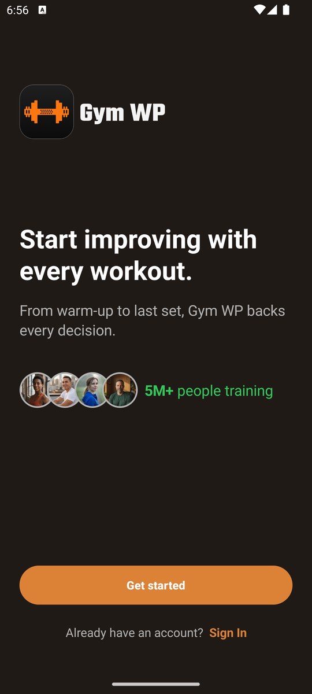 欢迎页 | 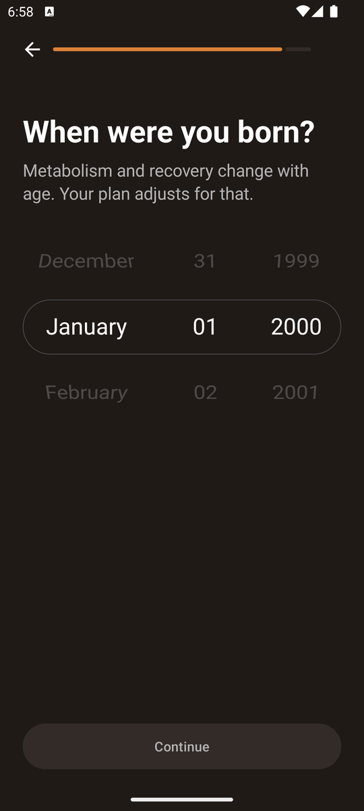 生日滚轮（必须拨动） | 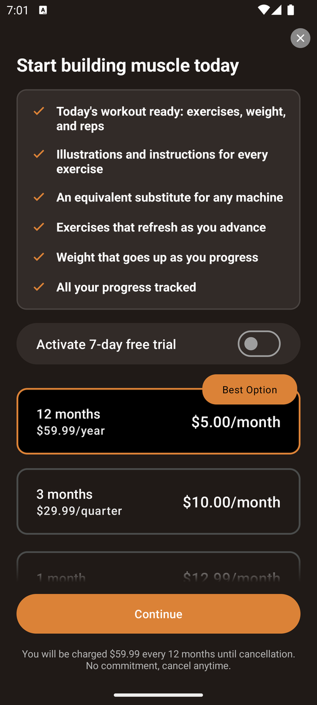 付费墙 1 |
|  限时折扣付费墙 | 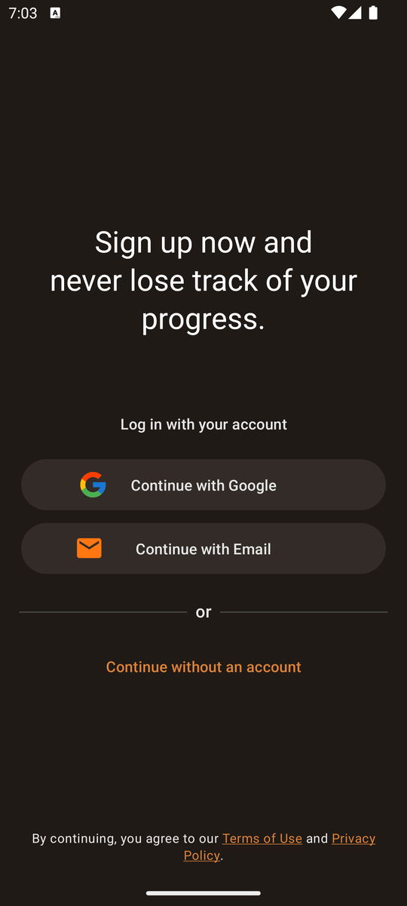 注册墙 | 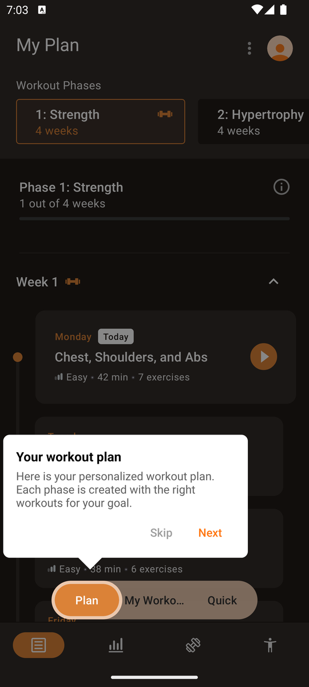 首页 + 教学气泡 |
|  加训练日后的插页广告 | 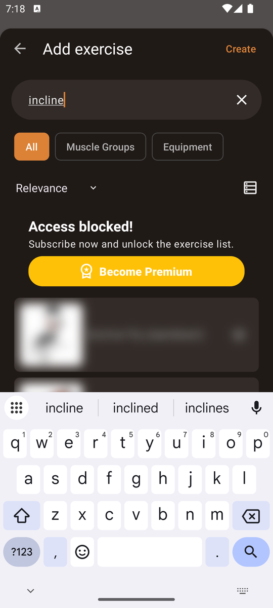 搜索只给前 5 个 | 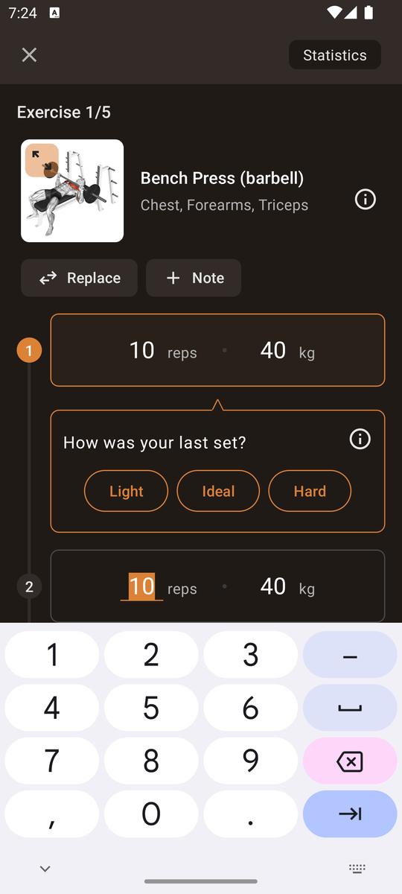 系统数字键盘输入 |
| 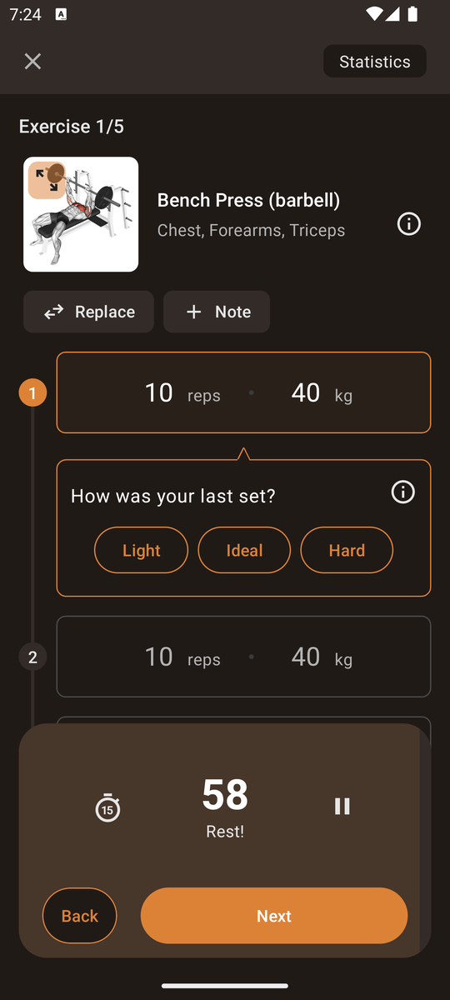 完成后休息 + 感受评价 | 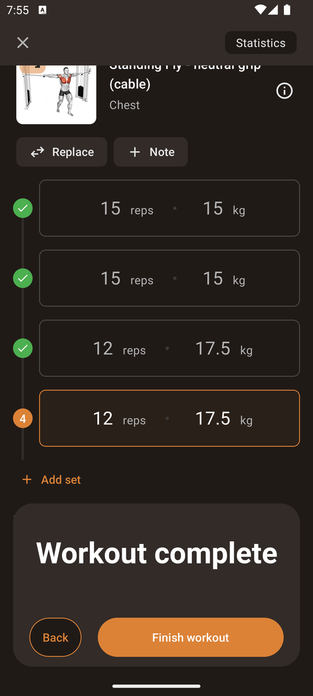 Workout complete | 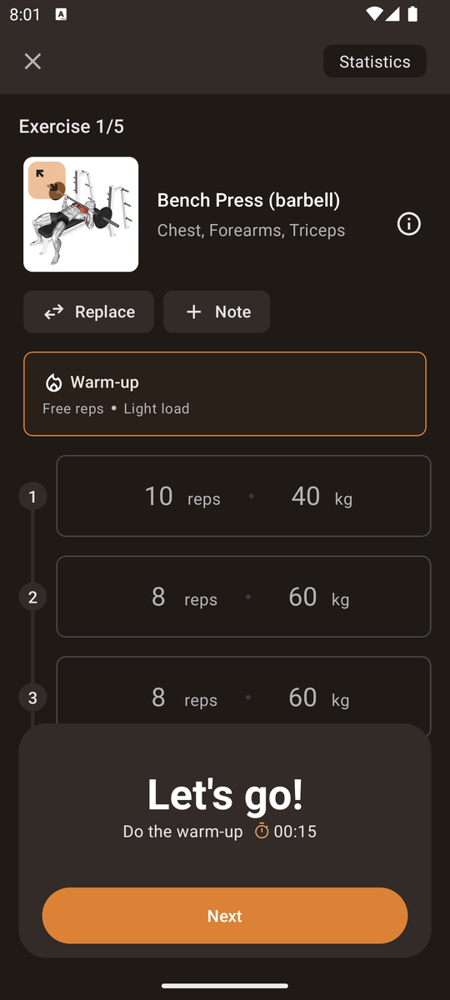 T3 全部预填 |
| 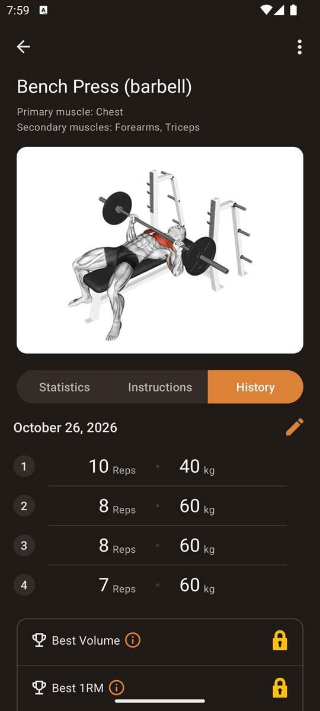 动作 History + PR 锁 | 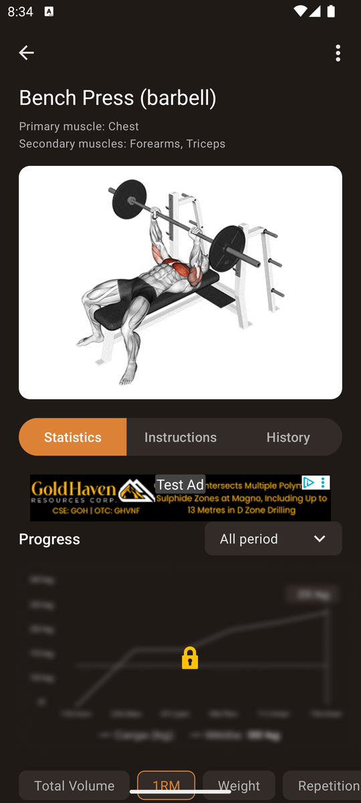 1RM 曲线被锁 | 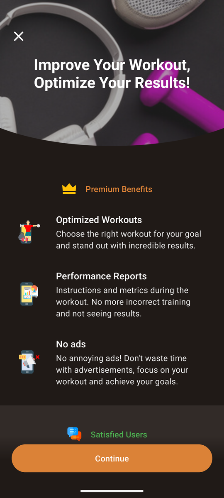 导出 = 付费墙 |
| 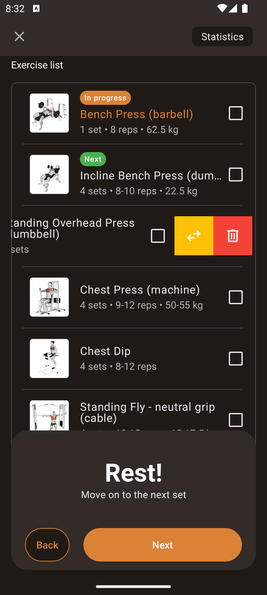 左滑动作：替换 / 删除 | 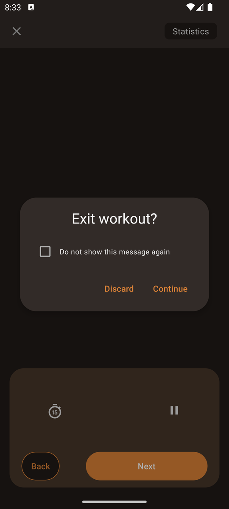 被杀后重开的恢复弹窗 | 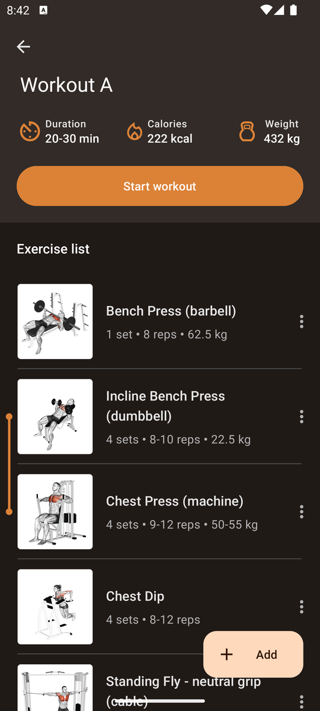 超级组括线 |

## 附录：tally 原始输出

> 注：tally 里的 note 文本中出现「D:/tools/git/Git/」是 Git Bash 把我笔记里的「 / 」当成路径转换造成的，原意是斜杠「/」，不影响计数。explore 阶段不计入任务开销。

```
== gymwp / phase explore
   ops: {'tap': 180, 'key': 44, 'scroll': 13, 'text': 13, 'swipe': 9, 'long': 1}  typed chars: 68  voided: 0
   tap/long target min-side: {'unknown': 181}
   swipe distances (dp): [213, 270, 299, 285, 498, 498, 427, 427, 498]
   note: banner ad ('Test Ad' on emulator) at top of My Workouts
   note: bottom sheet upsell 'Gym WP Widget' add home-screen widget, on first visit to Activities; Cancel
   note: Quick tab first visit: coach-mark tour 'Freestyle Workout'
   note: FULL-SCREEN INTERSTITIAL AD after adding a workout split in routine (video ad 'Watch Now')
   note: ad X visible by ~5s (screenshot taken ~5s after it appeared), sound on
   note: Start workout disabled while routine has 0 exercises -> no empty-workout start
   note: free tier: search shows first 5 results, rest blurred 'Access blocked! Subscribe now and unlock the exercise list' + Become Premium
   note: first Start workout: notification pre-prompt dialog 'Enhance your experience with notifications' After/Allow
   note: entering set 1 values auto-copies to following sets (2,3)
   note: rest skip Next -> 'Get ready!' 10s prep countdown, auto -> Perform
   note: in-workout Statistics: Repetitions and Weight totals LOCKED (premium padlock); time pie (warm-up/prep/in progress/rest)
   note: values entered during workout written back into the routine template (Bench 3 sets 10 reps 40 kg) even after Leave Workout
   note: Leave Workout discards session (nothing in History)
   note: banner ad slot appears or not between visits -> list items shift ~100px (mis-tap risk)
   note: template auto-updated after T1: 4 sets, '7-10 reps 40-60 kg' (session values written back)
   note: history detail: Repetitions, Weight totals and Time chart LOCKED (premium); per-exercise list with check marks
   note: exercise History tab shows per-set reps x kg per date with edit pencil; Best Volume and Best 1RM LOCKED
   note: explore discovery: swipe-left on a set row deletes it instantly (no confirm). Swiping deleted done set 1 (40x10); also editing set 2 kg to 62.5 had propagated 62.5 to later undone sets 3-4; done checkmarks now lost on remaining rows
   note: swipe-left (slow, 600ms) on set row deletes the set, no confirmation; fast 300ms swipe did nothing. Done-checkmarks get re-assigned oddly after deletion
   note: CONFIRMED: discarded (Leave Workout) session still overwrote template: Bench now '1 set 8 reps 62.5 kg' (T4 edits+deletes leaked into routine)
   note: AI Plan workout: tapping an exercise to edit -> Premium paywall
   note: 'Type of set' = measurement mode only: Reps and weight, Repetitions, Weight, Time (no warm-up/drop/failure set types); per-exercise rest timer 01:00 and Note
   note: Super Set via exercise menu links with next exercise (orange bracket), free; menu also Replace, Move, Statistics, Delete
   note: Measurement Units: global Metric or Imperial only (no per-exercise unit)
   note: Language: PT, ES, EN, DE, FR, IT (6, no Chinese)
   note: Reminders: notification frequency (Moderate recommended) + per-weekday workout schedule times from onboarding
   note: library: every list (All, filtered) shows only top 5 exercises free, rest blurred 'Access blocked'
   note: custom exercise: name + instructions + photo saved free (in 'My Exercises' chip); choosing Primary Muscle Groups -> Premium paywall
   note: Plan menu: Create new Plan reruns goal questionnaire; Restart Plan; View details
   note: AI plan: 3 phases (Strength, Hypertrophy, Hypertrophy+...) x 4 weeks, all weeks browsable free; exercise editing inside plan workouts is premium
   note: Quick workout filters: Duration, Equipment (No equipment, Machine, Dumbbell-Barbell, Pulley), Level, Goal, Muscles Edit
   note: exercise Instructions: animated illustration + Preparation, Execution, Tips text (free), banner ad
== gymwp / phase onboard
   ops: {'launch': 1, 'tap': 39, 'swipe': 4}  typed chars: 0  voided: 2
   tap/long target min-side: {'ge48dp': 34, '32-47dp': 5}
   swipe distances (dp): [142, 171, 277, 285]
   note: screen1 welcome: Get started D:/tools/git/Git/ Sign In (optional)
   note: screen2 goal single-choice 5 options no skip, progress bar ~10pct
   note: screen3 biggest challenge single-choice 6 options auto-advance
   note: screen4 info/persuasion page (stat), Next button
   note: screen5 focus muscle single-choice 7 options
   note: screen6 cardio yes/no
   note: screen7 experience 4 options
   note: screen8 gym type basic/full
   note: screen9 training days: toggle Specific days (7 checkboxes, multi) D:/tools/git/Git/ Days per week; Next disabled until selection; progress ~70pct
   note: screen10 training time picker (hour/min/AMPM number pickers, default 11:06 PM = current time?), option Set each day separately; accepted default
   note: screen11 interstitial 'foundation of your plan is ready', Next
   note: screen12 gender 3 options (has Prefer not to say)
   note: screen13 birth date wheel picker (month/day/year) default Jan 01 2000, Continue looks disabled until wheel moved
   note: wheel taps don't move; must swipe
   note: 1998 selected, Continue enabled only after wheel interaction
   note: screen14 height NumberPicker default 170 cm, units toggle kg/cm vs lb/ft
   note: height 178 took 2 swipes + 1 tap on NumberPicker
   note: screen15 weight NumberPicker default 70.0 kg (integer + decimal wheels)
   note: screen16 target weight picker, default 80.0 kg (current+5 for build muscle?), accepted default
   note: screen17 notification pre-prompt, toggle default ON, button 'Allow notifications'
   note: toggled notifications off -> button becomes Continue
   note: screen18 fake 'Analyzing profile' loading animation (5 lines), auto-advance
   note: screen19 plan summary (4x/wk, 28 exercises, 3 phases x 4 weeks)
   note: screen20 'Your goal is now a plan' chart interstitial
   note: screen21 motivational commitment pledge 'I'm committing' (only button; not a legal agreement)
   note: screen22 PAYWALL: 12mo $59.99/yr ($5/mo, Best Option, preselected), 3mo $29.99, 1mo $12.99; toggle 'Activate 7-day free trial' default OFF; X close visible immediately top-right (40dp)
   note: screen23 after paywall close: 'Before you decide, see how it actually works' (demo tour), Next
   note: screen24 tour 'Your plan, your way'
   note: screen25 tour 'Your workout tracked, set by set'
   note: screen26 tour 'workout doesn't end at the last set' (recovery/progress)
   note: screen27 tour end 'This is how you get in shape', button I'm ready to start
   note: screen28 PAYWALL 2: 'Start your Premium journey' countdown timer discount $47.99/yr (was $59.99) first year; X visible immediately (56dp)
   note: screen29 confirm-shaming bottom sheet 'Are you sure? You will lose this exclusive promotion' -> Discard discount
   note: screen30 sign-up wall: Google D:/tools/git/Git/ Email D:/tools/git/Git/ 'Continue without an account' (small link 201x35dp); footer 'By continuing, you agree to Terms' (implicit). Chose without account
   note: home reached (My Plan tab). coach-mark tooltip tour with Skip/Next; going through with Next
   note: coach mark 2 'Your workout routines' (switches segmented to My Workouts)
   note: coach mark 3 'Workout on the spot' on Quick Workout (generated chest/triceps/shoulders list), Close
   note: onboard ends at home (My Plan). Onboarding-to-first-set = onboard + T1-start + T1-E1-add + T1-E1-s1
== gymwp / phase T1-start
   ops: {'tap': 9, 'text': 1}  typed chars: 9  voided: 0
   tap/long target min-side: {'32-47dp': 3, 'ge48dp': 5, 'lt32dp': 1}
   note: no empty-workout option exists: Start workout disabled with 0 exercises; Quick is auto-generated. Path: My Workouts > new routine > split > exercises (build list first)
   note: routine name dialog: system keyboard, typed 'Chest Day'
   note: split dialog: name prefilled 'Workout A', weekday checkboxes optional; accepted defaults
   note: FULL-SCREEN INTERSTITIAL AD again after adding workout split (2nd time, reproducible)
   note: ad X close visible immediately (<=5s), ~24dp
== gymwp / phase T1-E1-add
   ops: {'tap': 4, 'text': 1}  typed chars: 5  voided: 2
   tap/long target min-side: {'ge48dp': 4}
   note: natural flow: build list first, multi-select add sheet; all 5 selected in one sheet
   note: previous tap actually hit search bar 352x56dp (stale tree). First tap opens search mode + keyboard but field NOT focused: typed text lost, need 2nd tap on field
== gymwp / phase T1-E2-add
   ops: {'tap': 3, 'text': 1, 'swipe': 2}  typed chars: 7  voided: 0
   tap/long target min-side: {'ge48dp': 3}
   swipe distances (dp): [221, 221]
   note: result list kept old scroll position -> top results hidden behind 'Access blocked' banner; must scroll up
== gymwp / phase T1-E3-add
   ops: {'tap': 5, 'text': 2, 'key': 1}  typed chars: 22  voided: 4
   tap/long target min-side: {'ge48dp': 5}
   note: glitch: after 3rd search results list rendered all blurred/stuck scroll; retyping search
   note: multi-word query only refreshed after pressing keyboard search/enter key
== gymwp / phase T1-E4-add
   ops: {'tap': 3, 'text': 1, 'swipe': 2}  typed chars: 3  voided: 1
   tap/long target min-side: {'ge48dp': 3}
   swipe distances (dp): [221, 221]
   note: again list opened scrolled past the free top-5; scroll up needed
== gymwp / phase T1-E5-add
   ops: {'tap': 6, 'text': 2, 'key': 1}  typed chars: 14  voided: 0
   tap/long target min-side: {'ge48dp': 6}
   note: 'cable' top-5 free results contain no fly/crossover; refining query
   note: picked 'Standing Fly - neutral grip (cable)' as closest to Cable Crossover (Cable Crossover not in free top-5)
== gymwp / phase T1-go
   ops: {'swipe': 1, 'tap': 2}  typed chars: 0  voided: 0
   tap/long target min-side: {'ge48dp': 1, '32-47dp': 1}
   swipe distances (dp): [427]
   note: after adding, screen is scrolled to the list bottom; scroll up to reach Start workout
   note: notification pre-prompt dialog appears again on every Start workout (2nd time); After
== gymwp / phase T1-E1-s1
   ops: {'tap': 5, 'text': 2}  typed chars: 4  voided: 0
   tap/long target min-side: {'32-47dp': 3, 'ge48dp': 2}
   note: E1 set1 40x10 = warm-up: app has a 'Warm-up' stage card (Free reps, Light load) that is NOT logged; logging 40x10 as regular set 1 (gap)
   note: system numeric keyboard opens (Gboard number pad), field value 0 selected
   note: Next ends warm-up stage -> 'Get ready!' 10 s preparation countdown (auto, waited)
   note: after Next: 60 s rest countdown + optional 'How was your last set? Light/Ideal/Hard' card (ignored)
== gymwp / phase T1-E1-s2
   ops: {'tap': 4, 'text': 2}  typed chars: 3  voided: 0
   tap/long target min-side: {'32-47dp': 3, 'ge48dp': 1}
   note: waited out rest + prep (hands-free auto-advance, no tap)
   note: set 3 auto-filled 8x60 from edited set 2
== gymwp / phase T1-E1-s3
   ops: {'tap': 1}  typed chars: 0  voided: 0
   tap/long target min-side: {'ge48dp': 1}
   note: set 3 prefilled 60x8 matches; just wait rest+prep and tap Next
== gymwp / phase T1-E1-s4
   ops: {'tap': 5, 'text': 1}  typed chars: 1  voided: 0
   tap/long target min-side: {'32-47dp': 4, 'ge48dp': 1}
   note: routine had 3 sets: tapping '+ Add set' before finishing set 3 (else Next on last set moves to next exercise)
   note: added set 4 is prefilled with previous set values (8x60)
== gymwp / phase T1-E2-s1
   ops: {'tap': 4, 'text': 2}  typed chars: 6  voided: 0
   tap/long target min-side: {'32-47dp': 3, 'ge48dp': 1}
   note: auto-advanced to Exercise 2/5 after rest (hands-free); no warm-up stage for 2nd exercise
   note: dumbbell weight: single kg field, no per-hand indication
== gymwp / phase T1-E2-s2
   ops: {'tap': 1}  typed chars: 0  voided: 0
   tap/long target min-side: {'ge48dp': 1}
== gymwp / phase T1-E2-s3
   ops: {'tap': 4, 'text': 1}  typed chars: 1  voided: 0
   tap/long target min-side: {'32-47dp': 3, 'ge48dp': 1}
== gymwp / phase T1-E2-s4
   ops: {'tap': 5, 'text': 1}  typed chars: 1  voided: 0
   tap/long target min-side: {'32-47dp': 4, 'ge48dp': 1}
== gymwp / phase T1-E3-s1
   ops: {'tap': 4, 'text': 2}  typed chars: 4  voided: 0
   tap/long target min-side: {'32-47dp': 3, 'ge48dp': 1}
== gymwp / phase T1-E3-s2
   ops: {'tap': 4, 'text': 2}  typed chars: 4  voided: 0
   tap/long target min-side: {'32-47dp': 3, 'ge48dp': 1}
== gymwp / phase T1-E3-s3
   ops: {'tap': 1}  typed chars: 0  voided: 0
   tap/long target min-side: {'ge48dp': 1}
== gymwp / phase T1-E3-s4
   ops: {'tap': 5, 'text': 1}  typed chars: 1  voided: 0
   tap/long target min-side: {'32-47dp': 4, 'ge48dp': 1}
== gymwp / phase T1-E4-s1
   ops: {'tap': 3, 'text': 1}  typed chars: 2  voided: 0
   tap/long target min-side: {'32-47dp': 2, 'ge48dp': 1}
   note: Chest Dip is reps-only ('repetitions' field, no kg): bodyweight/added weight (+10) cannot be recorded (gap)
== gymwp / phase T1-E4-s2
   ops: {'tap': 3, 'text': 1}  typed chars: 2  voided: 0
   tap/long target min-side: {'32-47dp': 2, 'ge48dp': 1}
== gymwp / phase T1-E4-s3
   ops: {'tap': 3, 'text': 1}  typed chars: 1  voided: 0
   tap/long target min-side: {'32-47dp': 2, 'ge48dp': 1}
== gymwp / phase T1-E4-s4
   ops: {'tap': 2}  typed chars: 0  voided: 0
   tap/long target min-side: {'32-47dp': 1, 'ge48dp': 1}
== gymwp / phase T1-E5-s1
   ops: {'tap': 4, 'text': 2}  typed chars: 4  voided: 0
   tap/long target min-side: {'32-47dp': 3, 'ge48dp': 1}
== gymwp / phase T1-E5-s2
   ops: {'tap': 1}  typed chars: 0  voided: 0
   tap/long target min-side: {'ge48dp': 1}
== gymwp / phase T1-E5-s3
   ops: {'tap': 4, 'text': 2}  typed chars: 6  voided: 0
   tap/long target min-side: {'32-47dp': 3, 'ge48dp': 1}
== gymwp / phase T1-E5-s4
   ops: {'tap': 2}  typed chars: 0  voided: 0
   tap/long target min-side: {'32-47dp': 1, 'ge48dp': 1}
== gymwp / phase T1-finish
   ops: {'tap': 4}  typed chars: 0  voided: 0
   tap/long target min-side: {'ge48dp': 3, 'lt32dp': 1}
   note: Report screen: photo, date (locked earlier), exercise checkboxes, summary, notes; Finish Workout
   note: FULL-SCREEN INTERSTITIAL AD after Finish Workout (3rd interstitial)
   note: after ad: 'Workout complete!' social share card (photo, AI suggested caption, filters, Share); closed with X
== gymwp / phase T3-start
   ops: {'tap': 5}  typed chars: 0  voided: 0
   tap/long target min-side: {'32-47dp': 2, 'ge48dp': 3}
   note: T3 path: My Workouts > Chest Day > Workout A > Start workout (alt: History > entry > Workout Again, same tap count)
   note: notification pre-prompt again (3rd workout start)
== gymwp / phase T3-E1-s1
   ops: {'tap': 2}  typed chars: 0  voided: 0
   tap/long target min-side: {'ge48dp': 2}
   note: all 20 sets prefilled from last session (written-back template), exact match
== gymwp / phase T3-E1-s2
   ops: {'tap': 1}  typed chars: 0  voided: 0
   tap/long target min-side: {'ge48dp': 1}
== gymwp / phase T3-E1-s3
   ops: {'tap': 1}  typed chars: 0  voided: 0
   tap/long target min-side: {'ge48dp': 1}
== gymwp / phase T3-E1-s4
   ops: {'tap': 1}  typed chars: 0  voided: 0
   tap/long target min-side: {'ge48dp': 1}
== gymwp / phase T3-E2-s1
   ops: {'tap': 1}  typed chars: 0  voided: 0
   tap/long target min-side: {'ge48dp': 1}
== gymwp / phase T3-E2-s2
   ops: {'tap': 1}  typed chars: 0  voided: 0
   tap/long target min-side: {'ge48dp': 1}
== gymwp / phase T3-E2-s3
   ops: {'tap': 1}  typed chars: 0  voided: 0
   tap/long target min-side: {'ge48dp': 1}
== gymwp / phase T3-E2-s4
   ops: {'tap': 1}  typed chars: 0  voided: 0
   tap/long target min-side: {'ge48dp': 1}
== gymwp / phase T3-E3-s1
   ops: {'tap': 1}  typed chars: 0  voided: 0
   tap/long target min-side: {'ge48dp': 1}
== gymwp / phase T3-E3-s2
   ops: {'tap': 1}  typed chars: 0  voided: 0
   tap/long target min-side: {'ge48dp': 1}
== gymwp / phase T3-E3-s3
   ops: {'tap': 1}  typed chars: 0  voided: 0
   tap/long target min-side: {'ge48dp': 1}
== gymwp / phase T3-E3-s4
   ops: {'tap': 1}  typed chars: 0  voided: 0
   tap/long target min-side: {'ge48dp': 1}
== gymwp / phase T3-E4-s1
   ops: {'tap': 1}  typed chars: 0  voided: 0
   tap/long target min-side: {'ge48dp': 1}
== gymwp / phase T3-E4-s2
   ops: {'tap': 1}  typed chars: 0  voided: 0
   tap/long target min-side: {'ge48dp': 1}
== gymwp / phase T3-E4-s3
   ops: {'tap': 1}  typed chars: 0  voided: 0
   tap/long target min-side: {'ge48dp': 1}
== gymwp / phase T3-E4-s4
   ops: {'tap': 1}  typed chars: 0  voided: 0
   tap/long target min-side: {'ge48dp': 1}
== gymwp / phase T3-E5-s1
   ops: {'tap': 1}  typed chars: 0  voided: 0
   tap/long target min-side: {'ge48dp': 1}
== gymwp / phase T3-E5-s2
   ops: {'tap': 1}  typed chars: 0  voided: 0
   tap/long target min-side: {'ge48dp': 1}
== gymwp / phase T3-E5-s3
   ops: {'tap': 1}  typed chars: 0  voided: 0
   tap/long target min-side: {'ge48dp': 1}
== gymwp / phase T3-E5-s4
   ops: {'tap': 1}  typed chars: 0  voided: 0
   tap/long target min-side: {'ge48dp': 1}
== gymwp / phase T3-finish
   ops: {'tap': 4}  typed chars: 0  voided: 0
   tap/long target min-side: {'ge48dp': 3, 'lt32dp': 1}
   note: interstitial ad after Finish Workout again (reproducible)
== gymwp / phase T4
   ops: {'tap': 2, 'text': 1, 'swipe': 1}  typed chars: 4  voided: 1
   tap/long target min-side: {'32-47dp': 2}
   swipe distances (dp): [299]
   note: T4a: change done set 2 60x8 -> 62.5x8 during rest
   note: T4b: delete set via swipe-left on set 3 row
   note: T4c: no undo anywhere (no snackbar after delete; bottom 'Back' only steps the timer flow back)
== gymwp / phase T5
   ops: {'tap': 7, 'text': 1, 'key': 1, 'longdrag': 1, 'swipe': 1}  typed chars: 14  voided: 0
   tap/long target min-side: {'32-47dp': 1, 'ge48dp': 7}
   swipe distances (dp): [299]
   note: no Squat in this workout: target = move Overhead Press above Chest Press (machine)
   note: first tap in T5 actually hit search bar 352x56dp (stale tree recorded 344x733); again needed 2nd tap to focus field. Barbell OHP not in free top results; picked Standing Overhead Press (dumbbell)
   note: long-press-drag reorder works on exercise list; dialog 'Keep changes for future workouts? YES permanent, NO only this workout' (+ do not show again)
   note: swipe-left on exercise row reveals Replace (yellow) and Delete (red trash) buttons
   note: delete exercise: immediate, no confirm, toast 'Saved'
== gymwp / phase T6
   ops: {'key': 1, 'launch': 2, 'tap': 2}  typed chars: 0  voided: 1
   tap/long target min-side: {'ge48dp': 2}
   !! 1 actions landed in another app
   note: home+relaunch: workout screen intact, same state
   note: after force-stop: app relaunches into workout screen with dialog 'Exit workout?' Discard or Continue (+do not show again)
   note: Google Play in-app update sheet 'Update available' popped up over the relaunch (flexible update; closed with X, not updated)
   note: workout recovered after Continue (state preserved incl. edits)
== gymwp / phase T7-in
   ops: {'tap': 3}  typed chars: 0  voided: 0
   tap/long target min-side: {'32-47dp': 3}
   note: (i) icon opens exercise detail: Statistics chart (Total Volume default) with banner ad; volume aggregated per day (3560 = 2 sessions same day)
   note: 1RM chart LOCKED (blurred + padlock); History tab shows last session sets (10x40, 8x60, 8x60, 7x60)
== gymwp / phase T7-out
   ops: {'tap': 6, 'text': 1}  typed chars: 5  voided: 0
   tap/long target min-side: {'ge48dp': 5, 'lt32dp': 1}
   note: first tap again hit search bar (352x56) though tree says container; field then needs 2nd tap
== gymwp / phase T8
   ops: {'tap': 5, 'key': 1}  typed chars: 0  voided: 1
   tap/long target min-side: {'32-47dp': 2, 'ge48dp': 3}
   note: Export statistics -> Premium paywall ('Improve Your Workout', Continue); export is premium-only
   note: Activities > Statistics > Export -> same Premium paywall
```
