# Hevy 竞品调研 v2

> 包名 `com.hevy`，2026-10-26 在小米真机（384×853 dp）上按 brief v2 实测。账号已登录、引导已走完。
> **用户以为已开通 Pro 试用，复核确认这个账号是免费版**（设置 →「管理订阅」显示「免费订阅」）：训练页顶部常驻黄色 `PRO` 徽章、设置页顶部有「解锁」，图表「年 / 所有时间」、热身计算器、高级统计、多数身体测量、第 5 个计划都会弹付费墙。所以本报告里的「被锁」是**真实的免费版体验**，不是推断（见文末「最不确定」）。
> 开测前账号里没有训练（个人资料「锻炼 0」），T1 是真正的「无历史」。偏好设置保持默认：默认休息计时器 = Off、上次锻炼数值 = 默认（任意一项锻炼）、RPE 追踪 = 关、杠铃片计算器 = 开。

## 1. 概况

- **定位**：主流「记录 + 社交」力量训练 app。记录界面是经典表格（组 / 之前的锻炼 / KG / 次 / ✓），外围是关注动态、发现流、点赞评论、排行榜、计划库，以及付费的 AI 式「Hevy Trainer」自动排课。
- **付费**：免费 + **Hevy Pro**。付费墙价格（加元）：**月度 CA$3.99、年度 CA$31.99（节省 33%）、终身 CA$104.99**，按钮「订阅年度计划」，下方「暂不」+ 右上 X，都可直接关闭。付费墙列出的 Pro 内容：无限图表历史记录（免费版限制：3 个月）、无限训练计划、Hevy Trainer、无限自定义训练动作、高级统计、跟踪所有测量数据、热身计算器、「支持我们的小团队」。没有广告。
- **免费版实测上限**：计划（routine）**4 个**（第 5 个弹「Free accounts have a limit of 4 routines」）；自定义动作 **7 个**（动作库显示「自定义训练 (1/7)　解锁更多」）；单个动作图表只能看**最近 3 个月**；身体测量只有**体重、腰围**免费，其余（体脂、去脂体重、颈、肩、胸、二头、前臂…）带锁。
- **语言**：完整简体中文界面（动作名也是中文：「卧推（杠铃）」），但搜索**认英文关键词**（bench / incline / dip / cable 都能搜到），Trainer 问卷选项是英文（Build Muscle…）。另有英西德法意葡土繁俄日等。
- **登录**：必须账号，数据在云端。**训练默认可见性 = 「所有人」（公开）**，每次保存都要手动改成私密（设置 → 隐私与社交 → 默认锻炼可见性 可以改全局默认，本次未改）。

## 2. 上手流程（未实测）

账号早已走完引导，无法重跑。能反推的：
- 引导收集了性别（男）、出生日期（2005-10-02）、体重：测量页里有一条 **10 月 25 日 85 kg** 的体重记录，就是引导时填的。
- 个人资料页「您的个人资料已经完成 80%」提示条，说明引导后还有资料没填（名字、简介、链接）。
- 屏数、字段数、是否有付费墙及其关闭方式都**未实测**。

## 3. 导航结构

底部 3 个标签：
- **首页**：动态流，左上「主页 ▾」切换「主页（关注中）/ 发现」；右上 🔍（搜索用户 / 联系人 / 推荐健身达人）和 🔔 通知。流里插着创始人欢迎卡（带「关注」按钮）、「推荐的健身达人」横向卡片（关注 / 邀请一位好友）、「与健身房朋友一起玩 Hevy 更有趣」横幅（与朋友联系 / 忽略）。每张训练卡：点赞 / 评论 / 分享，⋯ 菜单 = 分享锻炼 / 保存为计划 / **复制锻炼** / 编辑锻炼 / 删除锻炼。
- **锻炼**：两个子标签「训练计划 / Trainer」。训练计划页 =「开始空白锻炼」+ 计划区（新计划、探索 26 个官方方案、我的计划列表，每个计划卡上「开始计划」）。Trainer 页是 Pro 的自动排课。
- **个人资料**：头像、锻炼 / 关注者 / 关注数，时长 / 训练量 / 次 柱状图（最近 3 个月），「面板」4 格：统计数据、运动（动作库）、测量、日历；下面是自己的训练列表。右上 ✏ 编辑资料、分享、⚙ 设置。
- 训练进行中：左上 ∨ 可最小化，各页底部常驻「锻炼 6min27s / 当前动作 / 🗑」浮条。

## 4. 功能地图与覆盖率

| 功能 | 路径 | 免费/付费 | 状态 |
|---|---|---|---|
| 上手引导（性别、生日、体重…） | 首次启动 | 免费 | 进不去（账号已完成引导；第二轮在模拟器上重新登录也直接进首页） |
| 关注动态 / 发现流 | 首页 ▾ | 免费 | 已用（只看，不互动） |
| 点赞 / 评论 / 分享训练 | 训练卡底部 | 免费 | 排除（社交） |
| 搜索用户 / 联系人 / 推荐达人 / 邀请好友 | 首页 🔍、推荐卡 | 免费 | 已用（只看） |
| 通知（休息计时器、关注、月报、点赞、评论…） | 首页 🔔；设置 → 通知 | 免费 | 已用 |
| 开始空白锻炼 | 锻炼 → 开始空白锻炼 | 免费 | 已用 |
| 复制锻炼（整场带数据重开） | 首页训练卡 ⋯ | 免费 | 已用（T3） |
| 动作搜索 + 多选添加 | 训练中「+ 添加运动」 | 免费 | 已用 |
| 动作库筛选（所有器械 / 所有肌肉）、近期动作 | 添加运动页、个人资料 → 运动 | 免费 | 已用 |
| 动作详情：总结（图表 + 个人纪录）/ 历史记录 / 怎么做（动画 + 步骤）/ 排行榜（关注者间） | 点动作名；个人资料 → 运动 | 图表超 3 个月需 Pro | 已用 |
| 自定义动作（素材、名称、器械、主肌群、副肌群、7 种以上运动类型） | 动作库 → 创建 | 免费 7 个，再多需 Pro | 已用（建了又删 Test Press） |
| 单动作重量单位（默认 / 公斤 / 磅） | 动作详情 ⋯ → 重量单位 | 免费 | 已用 |
| 自家数字键盘（含 ± 2.5、收起键、→ / ✓） | 点重量 / 次数格 | 免费 | 已用 |
| 组类型：热身组 / 正式组 / 力竭组 / 递减组 / 删除组 | 点组号 | 免费 | 已用 |
| 「之前的锻炼」列 + 上次数值预填 | 训练中每行 | 免费 | 已用 |
| 上次锻炼数值来源（任意一项锻炼 / 相同的计划） | 锻炼设置 | 免费 | 已用（只看） |
| 添加组（复制上一组为灰色占位） | 卡片底部 | 免费 | 已用 |
| 左滑删除组 | 组行左滑 | 免费 | 已用 |
| 休息计时器：每个动作单独设、默认时长、底部非阻塞条（−15 / +15 / 跳过） | 卡片「休息：--」；锻炼设置 | 免费 | 已用 |
| 顶栏计时器（秒表 / 倒计时） | 训练页 ⏱ | 免费 | 已用（只开过） |
| 杠铃片计算器（可管理片子和杆） | 输入杠铃重量时浮出「杠铃片计算器」 | 免费 | 已用 |
| 热身计算器 | 锻炼设置 → 热身计算器 | **Pro** | 被锁 |
| 热身组计入统计开关 | 锻炼设置 → 热身组 | 免费 | 已用（只看） |
| RPE 追踪（6–10 滑选） | 锻炼设置开关 | 免费 | 已用（开了又关） |
| 超级组、智能超级组翻页 | 动作 ⋮ → 添加到超级组；锻炼设置 | 免费 | 已用（第二轮，记了 2 轮） |
| 动作备注（固定备注 / 本次备注两种） | 卡片「备注」→ 点图标切类型 | 免费 | 已用（第二轮，写后删除） |
| 训练描述 | 保存页 Description | 免费 | 已用（第二轮） |
| 训练照片 / 视频 | 保存页「Add a photo / video」 | 免费 | 进不去（拒绝相机权限；图库走系统选择器，模拟器无照片） |
| 替换运动 / 对训练重新排序 / 删除运动 | 动作 ⋮ | 免费 | 已用（T5） |
| 实时 PR 标记（组号变奖牌） | 记录时自动 | 免费 | 已用（T4 出现） |
| 内嵌定时器（时长类动作的秒表） | 锻炼设置（默认开） | 免费 | 已用（第二轮，平板支撑） |
| 训练时屏幕常亮 | 锻炼设置（默认关） | 免费 | 已用（第二轮，开后验证再关回） |
| 计划（routine）创建 / 复制 / 编辑 / 删除 / 分享，「保存为计划」 | 锻炼 → 新计划；训练卡 ⋯ | 免费 4 个 | 已用（建到上限后删回 1 个） |
| 计划文件夹、按住拖动排序 / 移入文件夹 | 锻炼页 📁+；按住计划卡拖 | 免费 | 已用（第二轮，建后删除） |
| 保存页「健身房」位置标签（附近健身房 / Home gym） | 保存页 Gym → Select | 免费 | 已用（第二轮，拒绝定位权限，只看到 Home gym） |
| 探索官方方案（26 个，按水平 / 目标 / 器械筛） | 锻炼 → 探索 | 免费 | 已用（只看） |
| Hevy Trainer（问卷生成个性化方案、渐进超负荷） | 锻炼 → Trainer | **Pro** | 已用（走完问卷，未保存方案） |
| 编辑过往训练 | 训练卡 ⋯ → 编辑锻炼 | 免费 | 已用（只打开） |
| 日历（连续周数、休息天数） | 个人资料 → 日历 | 免费 | 已用 |
| 统计：过去 7 天人体图、肌肉分布（图表）、肌肉分布（人体）、主要练习、排行榜训练、月度报告 | 个人资料 → 统计数据 | 免费 | 已用 |
| 每个肌肉群的组数（高级统计） | 统计数据 | **Pro** | 被锁 |
| 图表范围「年 / 所有时间」 | 动作详情 / 个人资料图表 | **Pro** | 被锁 |
| 身体测量：体重、腰围 + 进度照片 | 个人资料 → 测量 → + | 免费 | 已用（记了 75 kg） |
| 其余身体围度、体脂 | 同上 | **Pro** | 被锁 |
| 单位（重量 kg/lb、距离 km/mi、身体 cm/in） | 设置 → 单位 | 免费 | 已用（只看） |
| 主题（跟随系统等）、语言 | 设置 | 免费 | 已用（只看） |
| 隐私：私密资料、隐藏推荐用户、默认锻炼可见性 | 设置 → 隐私与社交 | 免费 | 已用（只看） |
| 集成：Health Connect、Strava、ChatGPT 插件 | 设置 → 集成 | 免费 | 排除（授权） |
| 导出 CSV（训练 / 测量分开） | 设置 → 导出和导入数据 | 免费 | 已用（停在分享面板） |
| 导入：只支持 Strong CSV、只能导入一次 | 同上 → 导入数据 | 免费 | 已用（只看） |
| 保存后庆祝 / 分享卡（第 N 次锻炼、日历图、Instagram 快拍等） | 每次保存后 | 免费 | 已用 |
| 管理订阅 / 帐户 | 设置 → 帐户 | — | 排除（授权 / 订阅） |
| 指南、常见问题、Hevy Coach（教练版） | 设置下部 | 免费 | 已用（第二轮，Coach 只看介绍未注册） |

共 53 项（按表格逐行重数；第一轮写的「47 项、被锁 5」是数错了）：已用 44、被锁 4、进不去 2、排除 3（社交 1、授权 / 订阅 2）。**覆盖率 =（44 + 4）/（53 − 3）= 96%**；不扣排除项为（44 + 4）/ 53 ≈ 91%。动作库总数没数（列表无计数）。

## 5. 核心记录交互

- **一行一组**：`组 | 之前的锻炼 | KG | 次 | ✓`（开 RPE 后多一列 RPE）。✓ 方块约 36×34 dp，重量 / 次数格约 72×34 dp，都低于 48 dp。
- **输入**：点格子弹 app 自家数字键盘（键 94×50 dp），右列 = 收起键盘 / `+` / `−` / 大蓝 `→`。在重量格按 `→` 跳到次数格；在次数格右下键变成 ✓，按下即完成该组并收起键盘。`+` / `−` 按器械步进（杠铃 +2.5 kg，次数 ±1）。选中重量格时上方浮出「杠铃片计算器」入口。
- **预填**：
  - 无历史时新动作只带 1 组，数值是灰色 0 / 0 占位，「之前的锻炼」为「-」。
  - 「添加组」生成的新行把**上一组的数值做成灰色占位**，直接点 ✓ 就按占位值记下 → 同上一组只要 2 下（添加组 + ✓）。只改次数 = 添加组 + 点次数格 + 数字 + ✓。
  - **有历史时**（哪怕只是在空白训练里单独加一个动作）：自动按上次的组数建好全部组，含 W 热身组类型，数值是灰色占位，「之前的锻炼」列显示上次的每组。点 ✓ 即接受。
  - 「复制锻炼」重开整场：所有动作、组数、组类型和数值都已填好（白色实值），每组只需点 ✓。
- **组类型**：点组号 → 底部表单「热身组 W / 正式组 / 力竭组 F / 递减组 D / 删除组」。新加的组默认正式组。热身组默认计入训练量（可在设置改）。
- **休息计时**：默认关，第一次 ✓ 后**什么也不弹**。给动作设了时长后，✓ 后底部出现非阻塞计时条（−15 / 00:43 / +15 / 跳过），可以继续操作。
- **自重**：「双杠臂屈伸」是纯次数；「双杠臂屈伸（负重）」列名是 `+KG`。负重类训练量 =（**最新的**体重测量 + 附加重量）× 次数，而且**会回溯重算**：记了 75 kg 体重后，之前保存的训练量从 9,067.5 变成 8,687.5 kg。
- **单位**：全局 kg/lb；单个动作可单独设公斤 / 磅。
- **PR**：编辑成 62.5 kg 后组号立刻变成奖牌图标（实时 PR）。

## 6. 场景任务

动作序列里的尺寸：`hit: UNKNOWN`（训练计时在跑，uiautomator 抓不到树）时，按截图量出的尺寸用 `size` 补录：✓ 36×34、重量 / 次数格 72×34、键盘键 94×50（→ / ✓ 键 73×50）、添加组 351×40、添加运动 351×40、完成 55×37、组号 36×34、组类型选项 351×63。

### T1 首次训练（空白开始，边练边加动作）

Hevy 的自然流程是**边练边加**，每个动作都走「添加运动 → 点搜索框 → 打英文词 → 点结果 → 添加 1 项运动」。无历史，没有任何预填。

| 阶段 | 动作序列 | 目标尺寸 dp | 备注 |
|---|---|---|---|
| T1-start | 点「开始空白锻炼」 | 352×48 | 立刻进入，计时开始，无弹窗 |
| T1-E1-add | 添加运动 → 搜索框 → `bench` → 卧推（杠铃）→ 添加 1 项运动 | 351×40 / 312×27 / 384×80 / 352×40 | 添加后自动滚到新卡片 |
| T1-E1-s1（热身） | 组号 → 热身组 → 重量格 → 4 0 → `→` → 1 0 → ✓ | 36×34 / 351×63 / 72×34 / 键 94×50 | 9 下 |
| T1-E1-s2（改重量和次数） | 添加组 → 重量格 → 6 0 → `→` → 8 → ✓ | 351×40 / 72×34 / 94×50 | 7 下；新组是正式组 |
| T1-E1-s3（同上组） | 添加组 → ✓ | 351×40 / 36×34 | 2 下 |
| T1-E1-s4（只改次数） | 添加组 → 次数格 → 7 → ✓ | | 4 下 |
| T1-E2-add | 同 E1，关键词 `incline`，第一个结果上斜卧推（哑铃） | | 5 步 |
| T1-E2-s1（首组 22.5×10） | 重量格 → 2 2 . 5 → `→` → 1 0 → ✓ | | 9 下 |
| T1-E2-s2 / s3 / s4 | 2 / 4 / 4 下 | | s4 有一次误点已作废 |
| T1-E3-add | 关键词 `chest press`，第一个结果胸推（器械） | | 5 步 |
| T1-E3-s1（50×12） / s2（55×10） / s3 / s4 | 7 / 8 / 2 / 4 下 | | |
| T1-E4-add | 关键词 `dip`，负重版排第 6，被系统键盘挡住 → 先划一下列表 → 点双杠臂屈伸（负重）→ 添加 | +1 次划动 | 自重版只有次数列，选了负重版用 +0 记自重组 |
| T1-E4-s1（BW×12） | 次数格 → 1 2 → ✓ | | 4 下（`+KG` 留空即 0） |
| T1-E4-s2（BW×10） | 添加组 → 次数格 → 1 0 → ✓ | | 5 下 |
| T1-E4-s3（+10×8） / s4（同上） | 7 / 2 下 | | |
| T1-E5-add | 关键词 `cable`，第一个结果绳索夹胸交叉 | | 5 步 |
| T1-E5-s1（15×15） / s2 / s3（17.5×12） / s4 | 7 / 2 / 10 / 2 下 | | |
| T1-finish | 完成 → 可见性 → 私密 → 返回键 → 保存 → 分享页「完成」 | 55×37 / 352×60 / 320×98 / — / 56×36 / 352×48 | 可见性默认「所有人」，改私密多 3 步；不改则 3 下 |

**汇总**：点击 127 次（含 finish 5）、文字输入 5 次共 31 个字符、划动 1 次、返回键 1 次；没有弹窗、没有付费墙打断。按尺寸：键盘键 ≥48 dp，其余几乎都在 32–47 dp（✓、输入格、组号），搜索框 27 dp 高。

**每组开销（T1）**：

| 类别 | 组 | 点击数 | 平均 |
|---|---|---|---|
| 首组（正式组，无预填） | E2-s1 9、E3-s1 7、E5-s1 7 | 23 | **7.7**（带小数的重量多 2 下） |
| 热身组 | E1-s1 | 9 | **9** |
| 同上一组（添加组 + ✓） | E1-s3、E2-s2、E3-s3、E4-s4、E5-s2、E5-s4 | 各 2 | **2** |
| 只改次数 | E1-s4 4、E2-s3 4、E2-s4 4、E3-s4 4、E4-s2 5 | 21 | **4.2** |
| 改重量（本方案里都连次数一起改） | E1-s2 7、E3-s2 8、E4-s3 7、E5-s3 10 | 32 | **8** |
| 自重 | E4-s1 4、E4-s2 5 | 9 | **4.5** |

加动作：每个 4 次点击 + 1 次打字（负重臂屈伸多 1 次划动）。

### T3 第二天（复制昨天的训练）

最快路径：首页昨天的训练卡 ⋯ → 复制锻炼。整场 5 动作 × 4 组全部带数值（含 W 热身组），每组只点 ✓。

| 阶段 | 动作序列 | 备注 |
|---|---|---|
| T3-start | 训练卡 ⋯（24×24）→ 复制锻炼（320×56） | 2 下，直接进入训练 |
| T3-E1…E5 每组 | 点 ✓（36×34） | 20 组 = 20 下 |
| 中途滚动 | 2 次上划（E2 → E3、E3 → E4） | 勾选靠下的组时列表会自动上移一行，害我误点一次（已作废） |
| T3-finish | 完成 → 可见性 → 私密 → 返回 → 保存 → 分享页完成 | **可见性又回到「所有人」**，上次选的私密不会记住 |

**汇总**：点击 27 次（start 2 + 组 20 + finish 5）、划动 2 次、返回键 1 次、零输入。**每组开销：所有类别都是 1 下**（首组 / 同上组 / 只改次数 / 改重量 / 热身 / 自重 均 1）。如果用计划（「保存为计划」后「开始计划」）路径也是 2 下起步；免费版计划限 4 个。

另测（explore）：在空白训练里单独加一个有历史的动作，也会按上次建好全部组（灰色占位 + W 类型），每组 1 下 ✓。

### T4 改错

| 步骤 | 序列 | 备注 |
|---|---|---|
| 60×8 → 62.5×8 | 点已完成组的重量格（72×34，值被全选）→ 键盘 `+`（+2.5）→ 收起键 | 3 下；组保持完成状态，训练量即时更新，组号变奖牌（新 PR） |
| 删一组 | 组行左滑 → 红色「删除」 | 1 划 + 1 点；**无确认、无撤销** |
| 撤销 | 全 app 没找到撤销 | — |

汇总：点击 4、划动 1。

### T5 中途改计划

添加运动（底部）→ 搜索 `overhead press` → 肩推（杠铃）→ 添加；动作 ⋮ → 对训练重新排序 → 按住把手拖到最上 → 完成；回到列表后**视图停在底部**，要往上划回去 → 肩推 ⋮ → 删除运动（无确认）。

汇总：点击 9、打字 1 次（14 字符）、拖动 1 次、划动 7 次（到底部 3 次 + 排序后回顶部 4 次，后者可能 2 次就够）。重排页本身也能直接删（每行左侧红色 ⊖）。

### T6 中断

- Home 键后 5 秒再打开：直接回到训练页，所有数据和计时都在，计时没停。
- 强制停止后再打开：落在**首页**，底部浮条「● 锻炼 6min27s　上斜卧推（哑铃）　🗑」，点 ^ 展开后全部恢复（含编辑过的 62.5 kg），计时连续。1 下即可回到训练。

### T7 查看

- **训练中**：上次每组的数字就在「之前的锻炼」列里，**0 操作**。看图表：点动作名 → 动作详情（默认「最重的重量」图表，包含进行中的值）→ 点「单次最大重量（1RM）」chip → 返回。2 下 + 1 返回。1RM 估算值显示为 77.16 kg（进行中）/ 74.07 kg（已保存，60×8）。
- **训练外**：个人资料 → 运动 → 搜索框 → `bench` → 卧推（杠铃）→ 1RM chip → 历史记录 标签。6 下 + 1 次打字。其实动作库首屏「近期的训练」里卧推就排第一，**不搜索只要 4 下**。
- 图表范围只能「最近 3 个月」，「年 / 所有时间」带 PRO，点了弹付费墙。

### T8 导出

个人资料 → ⚙ → 下划 → 导出和导入数据 → 导出数据 → 导出锻炼 → 系统分享面板（`workout_data.csv`）。从首页算 6 下 + 1 划动。**只有 CSV，免费**；测量数据单独「导出测量结果」。页面写明「导出的数据无法再导入 Hevy」；导入只支持 Strong 的 CSV，且只能导入一次。

## 7. 亮点（值得 fitlog 借鉴）

1. **「添加组」把上一组变成可直接确认的占位**：同上一组只要 2 下、只改次数 4 下，而且不用确认弹窗。fitlog 的「一下记一组」可以对照：Hevy 的稳态是 2 下（加组 + ✓），我们若能做到 1 下就是实打实的优势。
2. **有历史就整套带出**：哪怕在空白训练里单独加动作，也按上次的组数、组类型和数值建好全部组；复制昨天的训练后每组只点 1 下。T3 整场 27 次点击。fitlog「行内显示上次」的方向是对的，Hevy 进一步把上次的结构也带出来了。
3. **非阻塞休息计时条**：计时在底部一条里显示，±15 秒和跳过都在手边，不挡记录。
4. **强杀后恢复干净**：首页浮条一点即回，数据和计时都在。
5. **自家数字键盘的 `+ / −` 按器械步进**：改 60 → 62.5 只要 1 下 `+`，不用删了重打。
6. **实时 PR 标记**和「之前的锻炼」列都在行内，不用跳页。
7. **时长动作的行内秒表**（第二轮）：▶ 开始、✓ 停表并记下用时，一组 2 下、不碰键盘。fitlog 若支持平板支撑这类动作可以照搬。
8. **固定动作备注**（第二轮）：一条备注挂在动作上、每次记都显示，适合写座椅档位、握距这类器械设置。

## 8. 痛点

1. **点击目标偏小**：✓ 36×34 dp、输入格 72×34 dp、组号 36×34 dp，主力操作都在 48 dp 以下；勾选靠下的组时列表会自动上移，容易点错行（实测误点一次）。
2. **首组和改重量很贵**：首组 7–9 下，改重量（含次数）平均 8 下，带小数的重量（22.5、17.5）还要多按「.」。没有滚轮或按上次 ± 步进的快捷方式（`+` 只在已有值上加）。
3. **加动作每次 5 步**（含打字），自重 / 负重变体被键盘挡住还要多划一下；搜索要英文关键词，界面却是中文名。
4. **隐私默认公开且不记忆**：每次保存都要 3 步改成私密；保存后固定弹「好样的！」分享页，再多 1 下。
5. **社交打扰**：首页常驻创始人卡、推荐达人、「与朋友联系」横幅；动作详情有关注者排行榜。
6. **免费版限制多**：计划 4 个、自定义动作 7 个、图表 3 个月、身体测量只有体重和腰围、热身计算器和高级统计要 Pro；训练页常驻 PRO 徽章。
7. **删组 / 删动作无确认也无撤销**，误删只能手动补回。
8. **负重动作训练量按最新体重回溯重算**，老记录的数字会悄悄变。
9. **导出是单向的**：CSV 不能再导回 Hevy，导入只认 Strong 且只能一次。
10. **健身房场景辅助默认没开**（第二轮）：训练时屏幕常亮默认关，休息完回来要先解锁；内嵌定时器的 ▶ 约 24 dp，比 ✓ 还小。

## 9. 与 fitlog 定位的对照

1. **记录稳态成本**：Hevy 稳态（复制训练）每组 1 下 ✓，但 ✓ 只有 36×34 dp，要精确点；fitlog「不需要精准点击、一下记一组」在**目标尺寸**上能拉开差距，而不只是次数。
2. **首组 / 改重量**：Hevy 靠数字键盘打字（7–10 下），fitlog「不强制键盘」的设计正好打在它最贵的环节上，值得在评分里突出。
3. **免费 vs 付费**：Hevy 把图表历史、计划数、自定义动作数、热身计算器、大部分身体测量都锁了；fitlog 全免费、无锁，这是可以直接写进对比表的差异。
4. **数据可携**：Hevy 免费 CSV 导出但不能回导、导入只认 Strong；fitlog 免费 CSV / JSON 导出 + Strong / Hevy 导入，正好接住想离开 Hevy 的用户（应确认能读 Hevy 的 `workout_data.csv`）。
5. **器械感知**：Hevy 有杠铃片计算器（可管理片子和杆）和单动作单位，但没有「按健身房」的片子库存、也不会把重量取整到能装出来的值；保存页的「Gym」只是地点标签。Hevy 自己的 FAQ 承认换健身房后器械数据对不上，建议「固定用同一台器械或给新器械建自定义动作」（自定义动作免费版只有 7 个）。fitlog 的按健身房器械档案正好补这个缺口。
6. **社交与隐私**：Hevy 默认公开、首页社交为主；fitlog 本地优先、无社交，对只想安静记录的人更省事。

## 留在 app 里的测试数据

- 2 场已保存训练（均为私密）：T1（04:22）与 T3（04:52）「晨间锻炼 ☀️」，各 5 动作 × 4 组。
- 1 个计划「晨间锻炼 ☀️」（由 T3 训练「保存为计划」得到；复制出的 3 个副本已删）。
- 1 条体重测量：10 月 26 日 75 kg（另有引导时的 10 月 25 日 85 kg，不是我建的）。
- 第二轮（模拟器）没留下新数据：超级组 / 平板支撑那场训练已丢弃，测试文件夹 Push 已删，备注已删，屏幕常亮和智能超级组翻页已关回默认；Hevy Coach 问卷答了一次「I'm just curious」。
- 自定义动作 Test Press 已删除；RPE 追踪开过后已关回；无进行中的训练，停在首页。
- **意外操作**：走 Hevy Trainer 问卷时，连点「继续」误按了一次「接受并继续」（Trainer 的医疗免责声明 / 健康条款）。生成的方案**没有保存**，直接关掉了。

## 最不确定的结论

1. **Pro 状态**：已复核成立——「管理订阅」显示「免费订阅」，「所有时间」图表弹「免费版限制：3 个月」。
2. **「改重量」类的 8 下**：本方案里改重量的组同时也改了次数；只改重量时，按 `→` 后在次数格直接 ✓ 是否接受占位次数，没单独验证。
3. **免费计划上限 4 个**来自弹窗原文；自定义动作上限 7 个只来自「(1/7)」计数，没建满验证。（复核：只改重量就点 ✓ 时，占位次数会保留，所以「只改重量」实际是 首组式打重量 + ✓。）
4. **负重训练量回溯重算**：只观察到一次数值变化（9,067.5 → 8,687.5），推断原因是新记的体重，未做对照。
5. 目标尺寸多为截图量出（UI 树抓不到），误差约 ±2 dp。

## 截图

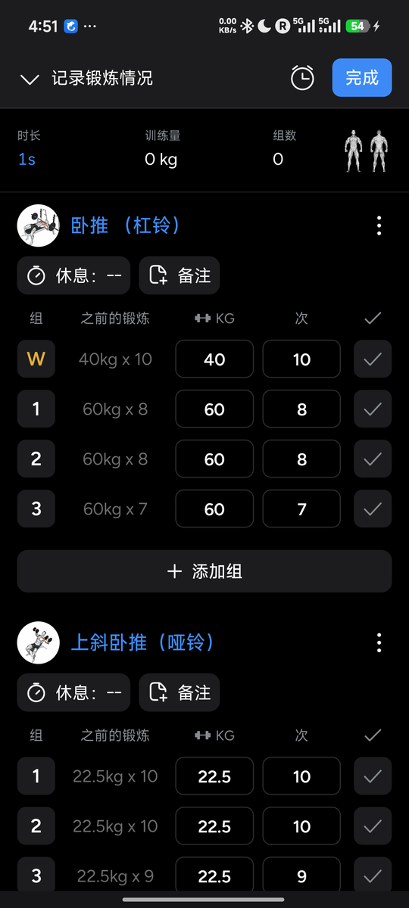
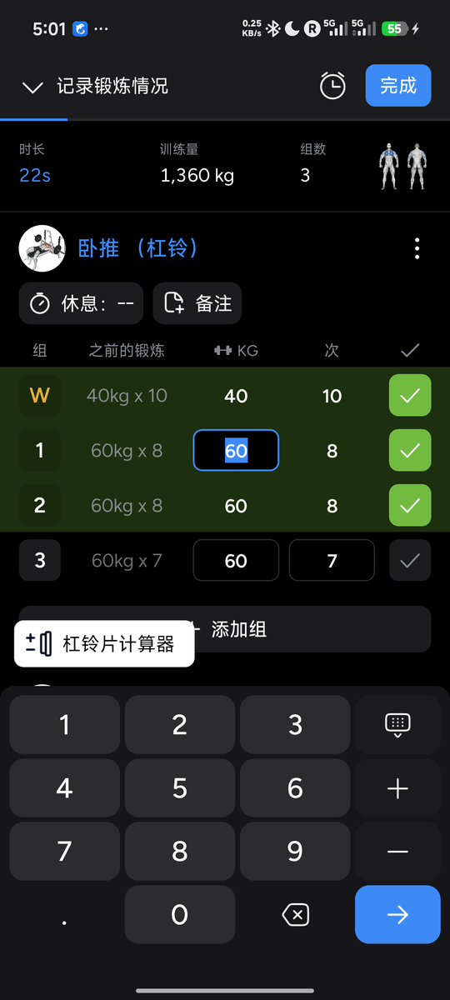
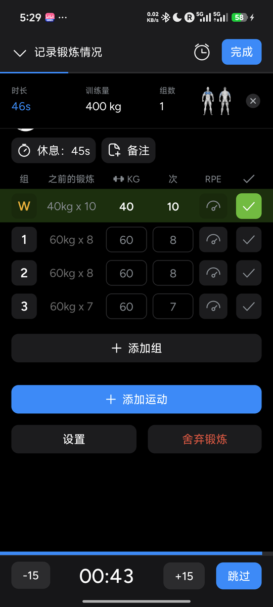
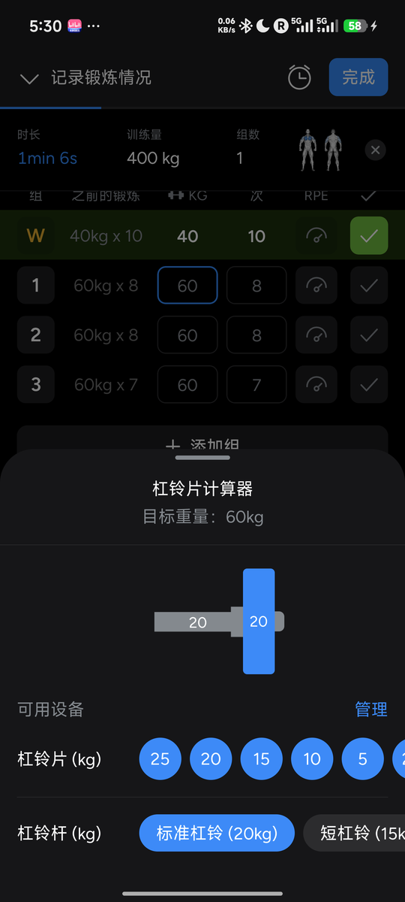
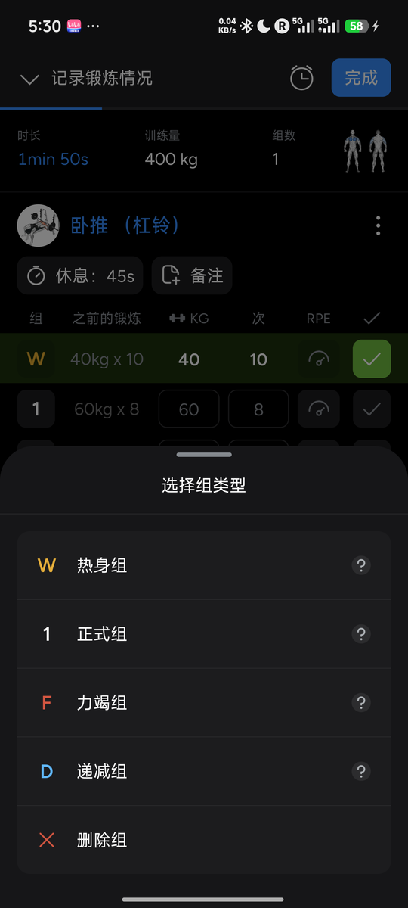
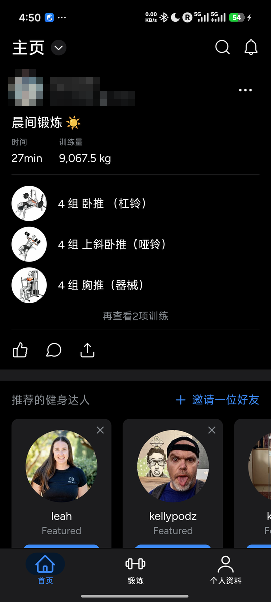
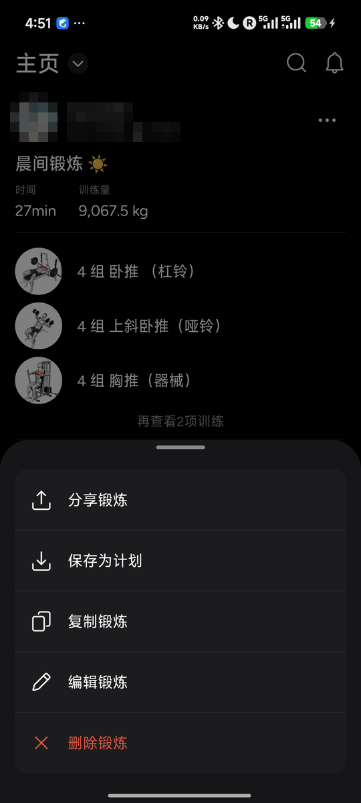
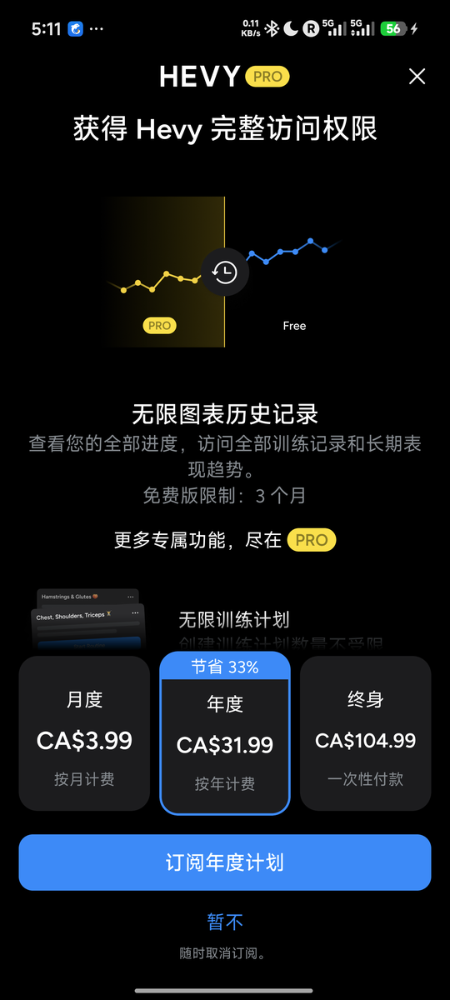
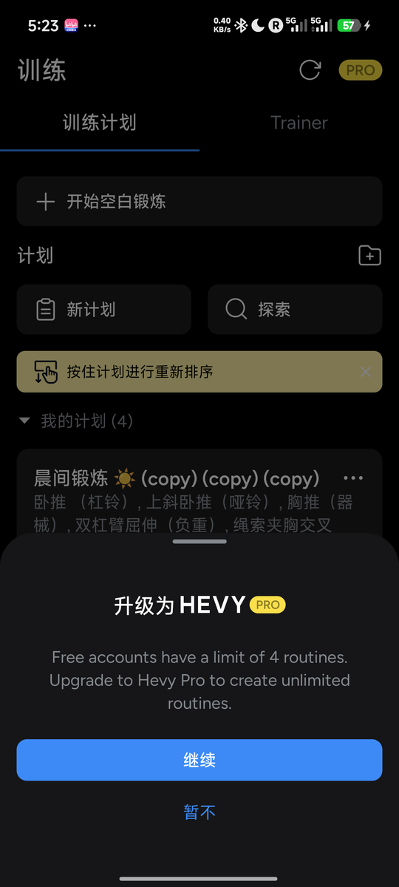
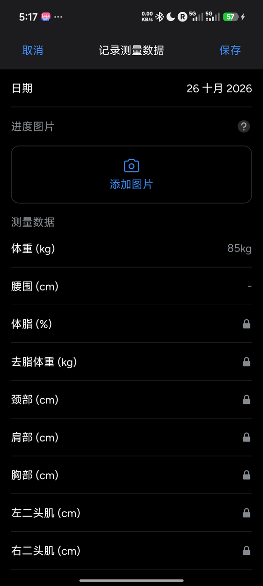
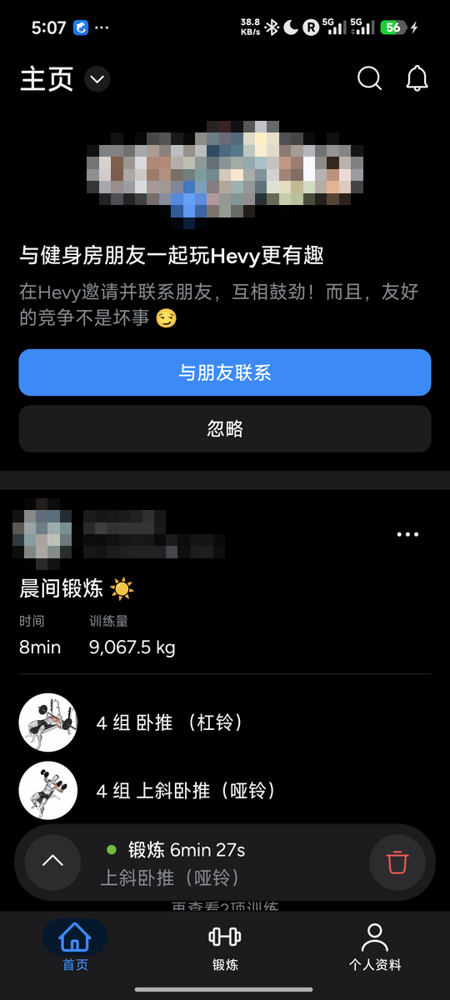
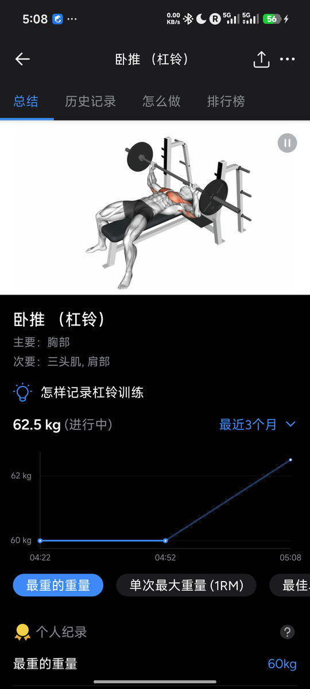
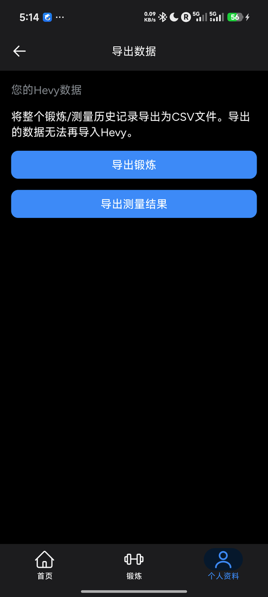
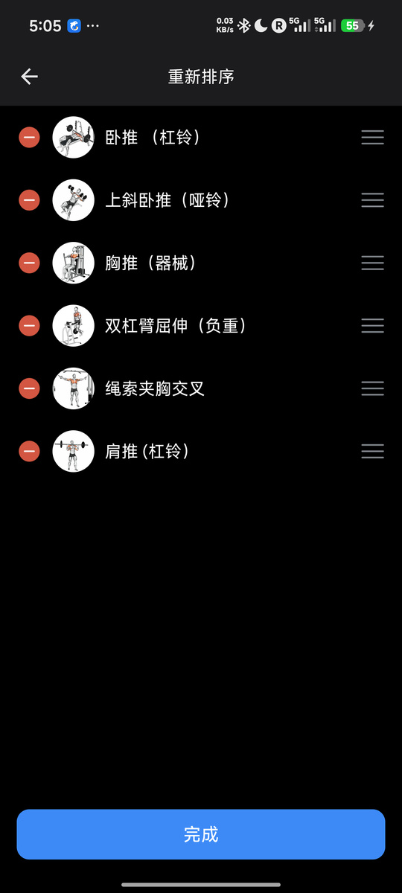
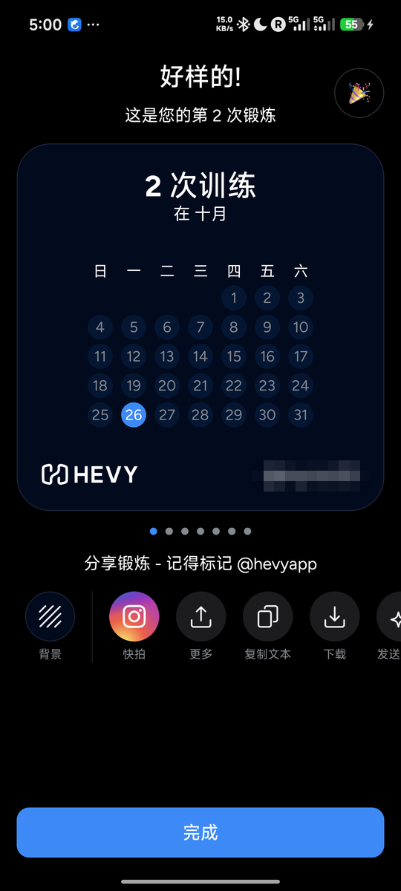

## 10. 补测（第二轮）

> 2026-10-26 在 **Android 模拟器**（emulator-5554，同为 1440×3200 @ 600 dpi，dp 尺寸可直接对比）上补测，同一账号、免费版。模拟器系统语言是英文，所以这一轮 Hevy 界面是英文（中文名下面附英文原文）。重新登录后直接进首页，T1/T3 训练和计划已同步，**没有出现新功能介绍、权限请求或引导页**。模拟器上 uiautomator 在训练页（计时在跳）常抓不到树，任务阶段的目标尺寸是截图量的。

**超级组 + 智能超级组翻页**（免费）。入口：动作 ⋮ → `Add To Superset` → 底部表单「Superset Bench Press (Barbell) with…」列出本场其它动作，点一个即成组，两张卡都出现紫色 `Superset` 标签。不能在添加动作页直接选「作为超级组添加」，只能先加再配对，搭一组超级组要 3 下（⋮ → 菜单项 → 选动作）。记录本身和普通组完全一样：有历史时每行已预填，**每组 1 下 ✓**，两轮（卧推 W/1 + 上斜 1/2）共 4 下。`Smart Superset Scrolling`（默认关）打开后，勾完一组列表会自动滚到超级组里下一个动作的对应组；实测只在目标行不完全可见时滚一小段，两张卡都在屏上时不动。不会自动高亮「下一个该做哪组」，也没有轮次计数。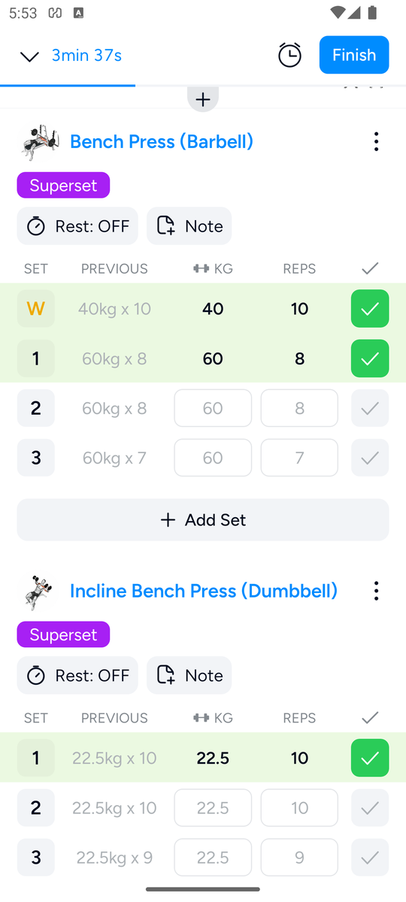

**内嵌定时器（时长类动作）**（免费，默认开）。平板支撑这类按时长记的动作，行内是 `▶ | mm:ss | ✓`：点 ▶（约 24 dp，偏小）开始秒表，格子里实时跳秒、图标变 ⏸；做完**直接点 ✓ 就停表并记下用时**（实测 00:28）。一组 2 下、不用键盘。只有正计时，没有目标时长倒数或到点提醒；也可以不点 ▶、直接在格子里手输 mm:ss。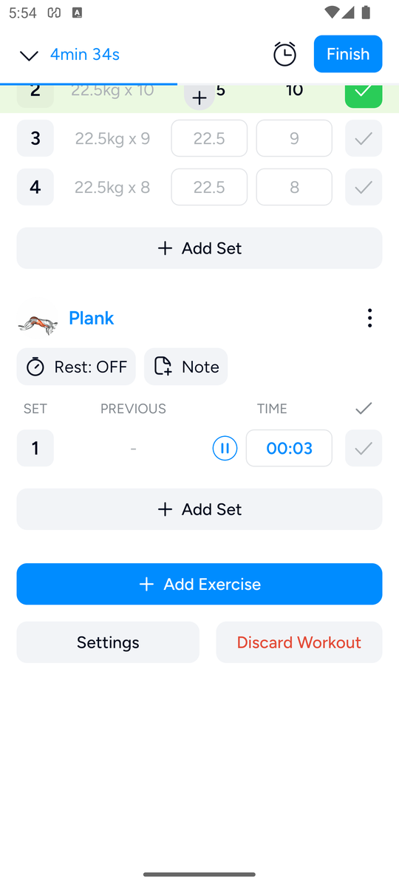

**屏幕常亮**（免费，默认关）。锻炼设置 `Keep Awake During Workout`。开后进行中的训练页窗口带 `KEEP_SCREEN_ON`（`dumpsys window` 验证），手机不会在两组之间锁屏。默认关意味着新用户休息时屏幕会灭、回来要先解锁，这是健身房场景的一个小坑；已关回默认。

**动作备注 / 训练描述 / 照片视频**（免费）。卡片上的 `Note` 点开是行内文本框（系统键盘），首次出现提示「Tap to change note type」；点左侧图标弹出两种类型：`Pinned Exercise Note`（以后每次记这个动作都显示，不进动态）和 `Workout Note`（只属于本场，**对好友和关注者可见**）。固定备注很适合写「座椅第 4 格」这类器械设置。没有单组备注。保存页有 `Description` 自由文本；`Add a photo / video` 弹出「Take Photo / Select Library Photo or Video」：拍照触发系统相机权限，拒绝后 app 再弹「We need permission… Open Settings」；图库走 Android 系统照片选择器（不需要权限，模拟器里没有照片），已取消。写的备注和描述都已删除 / 随训练丢弃。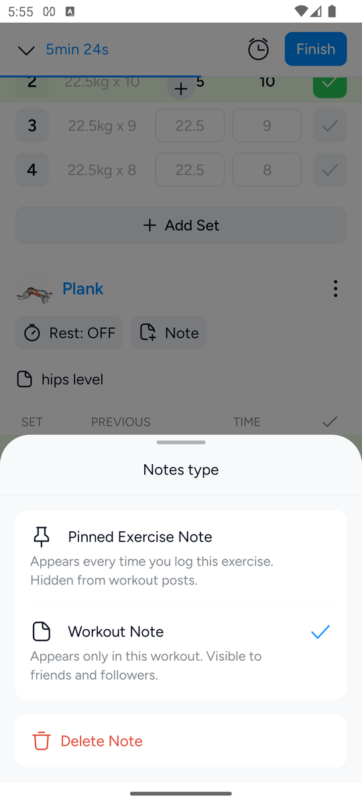

**保存页「健身房」**（新发现，免费）。`Gym → Select` 一点就先弹定位权限（已拒绝），之后页面只有「Use my location / Find gyms nearby」和建议项「Home gym（Private location）」。它只是给训练打一个地点标签（用于社交 / 动态），**不带任何器械、片子或单位信息**，和 fitlog 的按健身房器械档案不是一回事。

**计划文件夹 + 按住拖动**（免费）。锻炼页 `Routines` 右侧的文件夹+图标 → 「Create New Folder」命名框 → 出现可折叠的文件夹（空时显示「Add new routine」虚线框）。按住计划卡拖进文件夹或拖回 `My Routines` 都可以，一次 longdrag 成功；文件夹 ⋯ 菜单：Share Folder / Reorder Folders / Rename Folder / Add New Routine / Delete Folder（空文件夹删除时不确认）。测试文件夹 Push 已删，计划已移回。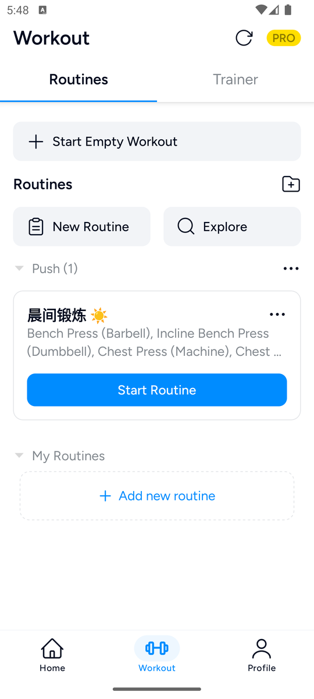

**指南 / 常见问题 / Hevy Coach**（免费）。设置底部：`Getting Started Guide` 和 `Routine Help` 是 app 内带示意图的静态说明页（开始空白训练 → 加动作 → 勾组；计划可预填重量次数或留空）。`Frequently Asked Questions` 是带「Search topics」搜索框的文章列表，文章在内嵌网页里打开（如「Sets per Muscle Group 怎么算」「自重 / 辅助 / 负重动作的区别」「与 Strava 训练量不一致」「导出数据」「Hevy 的 ChatGPT 应用」）。其中「Tracking Progress on Gym Machines (And Why It Can Be Inconsistent)」承认去多家健身房时器械数据对不上，给的办法是**固定用同一台器械，或给新器械建自定义动作**，正好说明 Hevy 没有器械 / 健身房层面的支持。`Learn About Hevy Coach` 先问「What best describes you?」（我是教练 / 我有教练 / 只是好奇，选了最后一项），之后是 Hevy Coach 介绍页：给私教用的桌面端工具（给客户排计划、跟进进度），底部 `Get Started` 未点（会去网页注册）。另有 Contact Us / Careers / About / Follow us 等常规链接，未展开。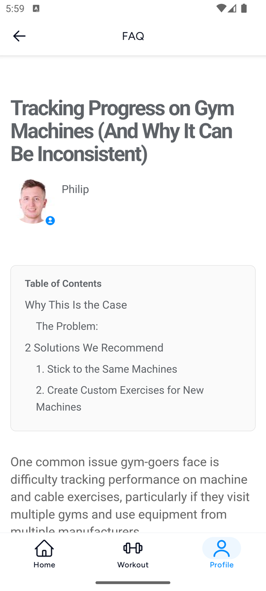

**对「极致轻量」的启示**：时长动作「▶ 开始、✓ 停表」两下记一组、不碰键盘，是低成本记录的好例子；固定动作备注适合记器械设置。超级组只是给两张卡打标签加自动滚动，没有减少点击次数。屏幕常亮默认关、▶ 和 ✓ 偏小，在健身房场景里都不够友好。

## 附录：`tally hevy` 原始输出

```
== hevy / phase explore
   ops: {'launch': 1, 'tap': 291, 'scroll': 15, 'key': 51, 'text': 14, 'swipe': 39}  typed chars: 83  voided: 0
   tap/long target min-side: {'unknown': 291}
   swipe distances (dp): [213, 142, 498, 498, 498, 498, 498, 498, 498, 498, 498, 427, 498, 498, 498, 142, 142, 142, 142, 142, 142, 142, 142, 171, 171, 171, 171, 171, 498, 498, 285, 48, 48, 48, 48, 48, 48, 355, 427]
   note: Warm-up calculator (PRO badge) opens paywall: monthly CA$3.99, yearly CA$31.99 (save 33%), lifetime CA$104.99; dismiss via X or 暂不. Pro appears NOT active despite trial claim
   note: keypad + key increments weight by 2.5 kg (barbell)
   note: add-set row shows previous set's values as grey placeholders; tapping check accepts them (2 taps for a repeat set)
   note: Explore: 首页 card ⋮ menu = 分享锻炼/保存为计划/复制锻炼/编辑锻炼/删除锻炼. 复制锻炼 starts workout with all 5 exercises x 4 sets prefilled (white values, W kept, 之前的锻炼 column). Adding single bench (with history) to blank workout pre-creates 4 sets with last numbers as grey placeholders incl. W; check accepts them
   note: After 2nd save, home feed shows banner 与健身房朋友一起玩Hevy更有趣 (与朋友联系 / 忽略)
   note: Pro NOT active in app: chart ranges 年/所有时间 open paywall '无限图表历史记录, 免费版限制: 3 个月'. Trial claimed by user is not reflected
   note: Paywall feature list: 无限图表历史记录(免费3个月), 无限训练计划, Hevy Trainer, 无限自定义训练动作, 高级统计, 跟踪所有测量数据, 热身计算器, 支持我们的小团队
   note: Measurements: free = 体重 + 腰围 only; 体脂/去脂/颈/肩/胸/二头/前臂... locked (PRO). Progress photo allowed. System numeric keyboard. Recorded 75 kg on 10/26 (onboarding had 85 kg on 10/25)
   note: Routine limit verified: 5th routine -> sheet 'Free accounts have a limit of 4 routines. Upgrade to Hevy Pro to create unlimited routines.' (继续/暂不)
   note: WARNING: chained tap accidentally pressed 接受并继续 on the Hevy Trainer medical disclaimer (健康条款和政策) — unintended; must be reported. Did not save the plan.
   note: Rest timer when set per exercise: non-blocking bottom bar (-15 / 00:43 / +15 / 跳过) after ✓, no modal
   note: Custom exercises: free limit shown '自定义训练 (1/7)' + 解锁更多. Create form: media, name, equipment (无/杠铃/杠铃片/壶铃/器械/悬挂带/哑铃/阻力带/...), primary muscle, other muscles, type (重量和次数/徒手次数/负重徒手+Kg/辅助徒手-Kg/时长/持续时间与重量/距离和时长/...)
   note: Per-exercise weight unit (默认/公斤/磅) in exercise ⋮ menu
   note: Volume of saved workout changed 9067.5 -> 8687.5 kg after I logged bodyweight 75 (was 85): weighted-dip volume = (latest bodyweight + added) x reps, recomputed retroactively (38 reps x 10 kg = 380)
== hevy / phase T1-start
   ops: {'tap': 1}  typed chars: 0  voided: 0
   tap/long target min-side: {'ge48dp': 1}
   note: Workout starts immediately on 开始空白锻炼: timer running, empty workout, no popup
== hevy / phase T1-E1-add
   ops: {'tap': 4, 'text': 1}  typed chars: 5  voided: 0
   tap/long target min-side: {'32-47dp': 2, 'lt32dp': 1, 'ge48dp': 1}
   note: Bench added with 1 empty set (0/0 grey placeholders), 之前的锻炼 shows '-' (no history). No prefill.
== hevy / phase T1-E1-s1
   ops: {'tap': 9}  typed chars: 0  voided: 0
   tap/long target min-side: {'32-47dp': 2, 'ge48dp': 7}
   note: Warm-up: tap set badge -> sheet 选择组类型 -> 热身组 (badge W). App keypad: arrow on weight jumps to reps; keypad's bottom-right key on reps is a green check that marks the set done and closes keypad. Rest timer default Off -> no popup after first check. Warm-up counted in 训练量 400kg
== hevy / phase T1-E1-s2
   ops: {'tap': 7}  typed chars: 0  voided: 0
   tap/long target min-side: {'32-47dp': 2, 'ge48dp': 5}
   note: 添加组 after warm-up creates a normal set (not W) with previous set's 40/10 as grey placeholders
== hevy / phase T1-E1-s3
   ops: {'tap': 2}  typed chars: 0  voided: 0
   tap/long target min-side: {'32-47dp': 2}
== hevy / phase T1-E1-s4
   ops: {'tap': 4}  typed chars: 0  voided: 0
   tap/long target min-side: {'32-47dp': 2, 'ge48dp': 2}
== hevy / phase T1-E2-add
   ops: {'tap': 4, 'text': 1}  typed chars: 7  voided: 0
   tap/long target min-side: {'32-47dp': 2, 'lt32dp': 1, 'ge48dp': 1}
   note: After adding exercise the list auto-scrolls so new card is visible
== hevy / phase T1-E2-s1
   ops: {'tap': 9}  typed chars: 0  voided: 0
   tap/long target min-side: {'32-47dp': 1, 'ge48dp': 8}
== hevy / phase T1-E2-s2
   ops: {'tap': 2}  typed chars: 0  voided: 0
   tap/long target min-side: {'32-47dp': 2}
== hevy / phase T1-E2-s3
   ops: {'tap': 4}  typed chars: 0  voided: 0
   tap/long target min-side: {'32-47dp': 2, 'ge48dp': 2}
== hevy / phase T1-E2-s4
   ops: {'tap': 4}  typed chars: 0  voided: 1
   tap/long target min-side: {'32-47dp': 2, 'ge48dp': 2}
== hevy / phase T1-E3-add
   ops: {'tap': 4, 'text': 1}  typed chars: 11  voided: 0
   tap/long target min-side: {'32-47dp': 2, 'lt32dp': 1, 'ge48dp': 1}
== hevy / phase T1-E3-s1
   ops: {'tap': 7}  typed chars: 0  voided: 0
   tap/long target min-side: {'32-47dp': 1, 'ge48dp': 6}
== hevy / phase T1-E3-s2
   ops: {'tap': 8}  typed chars: 0  voided: 0
   tap/long target min-side: {'32-47dp': 2, 'ge48dp': 6}
== hevy / phase T1-E3-s3
   ops: {'tap': 2}  typed chars: 0  voided: 0
   tap/long target min-side: {'32-47dp': 2}
== hevy / phase T1-E3-s4
   ops: {'tap': 4}  typed chars: 0  voided: 0
   tap/long target min-side: {'32-47dp': 2, 'ge48dp': 2}
== hevy / phase T1-E4-add
   ops: {'tap': 4, 'text': 1, 'swipe': 1}  typed chars: 3  voided: 0
   tap/long target min-side: {'32-47dp': 2, 'lt32dp': 1, 'ge48dp': 1}
   swipe distances (dp): [142]
   note: dip search: 双杠臂屈伸（负重） is 6th result, hidden behind system keyboard; swipe list to dismiss keyboard. Bodyweight variant 双杠臂屈伸 has reps only; weighted variant has +KG column. Used weighted variant with +KG 0 for BW sets
== hevy / phase T1-E4-s1
   ops: {'tap': 4}  typed chars: 0  voided: 0
   tap/long target min-side: {'32-47dp': 1, 'ge48dp': 3}
== hevy / phase T1-E4-s2
   ops: {'tap': 5}  typed chars: 0  voided: 0
   tap/long target min-side: {'32-47dp': 2, 'ge48dp': 3}
== hevy / phase T1-E4-s3
   ops: {'tap': 7}  typed chars: 0  voided: 0
   tap/long target min-side: {'32-47dp': 2, 'ge48dp': 5}
== hevy / phase T1-E4-s4
   ops: {'tap': 2}  typed chars: 0  voided: 0
   tap/long target min-side: {'32-47dp': 2}
== hevy / phase T1-E5-add
   ops: {'tap': 4, 'text': 1}  typed chars: 5  voided: 0
   tap/long target min-side: {'32-47dp': 2, 'lt32dp': 1, 'ge48dp': 1}
== hevy / phase T1-E5-s1
   ops: {'tap': 7}  typed chars: 0  voided: 0
   tap/long target min-side: {'32-47dp': 1, 'ge48dp': 6}
== hevy / phase T1-E5-s2
   ops: {'tap': 2}  typed chars: 0  voided: 0
   tap/long target min-side: {'32-47dp': 2}
== hevy / phase T1-E5-s3
   ops: {'tap': 10}  typed chars: 0  voided: 0
   tap/long target min-side: {'32-47dp': 2, 'ge48dp': 8}
== hevy / phase T1-E5-s4
   ops: {'tap': 2}  typed chars: 0  voided: 0
   tap/long target min-side: {'32-47dp': 2}
== hevy / phase T1-finish
   ops: {'tap': 5, 'key': 1}  typed chars: 0  voided: 0
   tap/long target min-side: {'32-47dp': 2, 'ge48dp': 3}
   note: Save screen: title (empty), duration/volume 9067.5kg/20 sets, add photo/video, description, date, gym, 可见性 default 所有人 (public). Changing visibility to private
   note: Visibility sheet does not close on selection; back key to close. 3 of the finish actions (open visibility, 私密, back) are only for privacy
   note: After save: celebration/share screen 好样的! 第1次锻炼 with share cards (Instagram, more, copy text, download); dismiss with 完成
== hevy / phase T3-start
   ops: {'tap': 2}  typed chars: 0  voided: 0
   tap/long target min-side: {'lt32dp': 1, 'ge48dp': 1}
   note: T3: all exercises pre-added by 复制锻炼 so no T3-En-add phases; values prefilled as real values (white) from last workout
== hevy / phase T3-E1-s1
   ops: {'tap': 1}  typed chars: 0  voided: 0
   tap/long target min-side: {'32-47dp': 1}
== hevy / phase T3-E1-s2
   ops: {'tap': 1}  typed chars: 0  voided: 0
   tap/long target min-side: {'32-47dp': 1}
== hevy / phase T3-E1-s3
   ops: {'tap': 1}  typed chars: 0  voided: 0
   tap/long target min-side: {'32-47dp': 1}
== hevy / phase T3-E1-s4
   ops: {'tap': 1}  typed chars: 0  voided: 0
   tap/long target min-side: {'32-47dp': 1}
== hevy / phase T3-E2-s1
   ops: {'tap': 1}  typed chars: 0  voided: 1
   tap/long target min-side: {'32-47dp': 1}
== hevy / phase T3-E2-s2
   ops: {'tap': 1}  typed chars: 0  voided: 0
   tap/long target min-side: {'32-47dp': 1}
== hevy / phase T3-E2-s3
   ops: {'swipe': 1, 'tap': 1}  typed chars: 0  voided: 1
   tap/long target min-side: {'32-47dp': 1}
   swipe distances (dp): [249]
== hevy / phase T3-E2-s4
   ops: {'tap': 1}  typed chars: 0  voided: 0
   tap/long target min-side: {'32-47dp': 1}
== hevy / phase T3-E3-s1
   ops: {'tap': 1}  typed chars: 0  voided: 0
   tap/long target min-side: {'32-47dp': 1}
== hevy / phase T3-E3-s2
   ops: {'tap': 1}  typed chars: 0  voided: 0
   tap/long target min-side: {'32-47dp': 1}
== hevy / phase T3-E3-s3
   ops: {'tap': 1}  typed chars: 0  voided: 1
   tap/long target min-side: {'32-47dp': 1}
   note: Checking a set near the bottom auto-scrolls the list by about one row to keep the next set in view (caused a mis-tap once; voided)
== hevy / phase T3-E3-s4
   ops: {'tap': 1}  typed chars: 0  voided: 0
   tap/long target min-side: {'32-47dp': 1}
== hevy / phase T3-E4-s1
   ops: {'swipe': 1, 'tap': 1}  typed chars: 0  voided: 0
   tap/long target min-side: {'32-47dp': 1}
   swipe distances (dp): [427]
== hevy / phase T3-E4-s2
   ops: {'tap': 1}  typed chars: 0  voided: 0
   tap/long target min-side: {'32-47dp': 1}
== hevy / phase T3-E4-s3
   ops: {'tap': 1}  typed chars: 0  voided: 0
   tap/long target min-side: {'32-47dp': 1}
== hevy / phase T3-E4-s4
   ops: {'tap': 1}  typed chars: 0  voided: 0
   tap/long target min-side: {'32-47dp': 1}
== hevy / phase T3-E5-s1
   ops: {'tap': 1}  typed chars: 0  voided: 0
   tap/long target min-side: {'32-47dp': 1}
== hevy / phase T3-E5-s2
   ops: {'tap': 1}  typed chars: 0  voided: 0
   tap/long target min-side: {'32-47dp': 1}
== hevy / phase T3-E5-s3
   ops: {'tap': 1}  typed chars: 0  voided: 0
   tap/long target min-side: {'32-47dp': 1}
== hevy / phase T3-E5-s4
   ops: {'tap': 1}  typed chars: 0  voided: 0
   tap/long target min-side: {'32-47dp': 1}
== hevy / phase T3-finish
   ops: {'tap': 5, 'key': 1}  typed chars: 0  voided: 0
   tap/long target min-side: {'32-47dp': 2, 'ge48dp': 3}
   note: Save screen again defaults 可见性=所有人 even though last workout was saved private (no memory of choice); 9067.5kg / 20 sets matches T1
== hevy / phase T4
   ops: {'tap': 4, 'swipe': 1}  typed chars: 0  voided: 0
   tap/long target min-side: {'32-47dp': 2, 'ge48dp': 2}
   swipe distances (dp): [213]
   note: Edit done set: tap weight (value preselected, keypad opens), + key adds 2.5 -> 62.5, hide-keypad key. Set stays checked, volume updates
   note: Delete set: swipe row left -> red 删除 -> tap. No confirmation, no undo toast/button anywhere (no undo in Hevy). Edited 62.5 set badge turns into a PR medal icon (live PR)
== hevy / phase T5
   ops: {'swipe': 7, 'tap': 9, 'text': 1, 'longdrag': 1}  typed chars: 14  voided: 1
   tap/long target min-side: {'32-47dp': 2, 'lt32dp': 3, 'ge48dp': 4, 'unknown': 1}
   swipe distances (dp): [498, 498, 498, 498, 498, 498, 498]
   note: After reorder 完成, view stays at bottom; moved exercise is at top -> needed scrolling back up (4 swipes, maybe 2 would do)
   note: 删除运动 via card ⋮: no confirmation (exercise had no done sets)
== hevy / phase T6
   ops: {'key': 1, 'launch': 2, 'tap': 1}  typed chars: 0  voided: 0
   tap/long target min-side: {'32-47dp': 1}
   note: Home+relaunch: workout screen intact, timer kept running (6min12s), edits retained
   note: Force-stop + relaunch: opens on 首页 with floating in-progress bar (锻炼 6min27s, current exercise, expand ^ and trash). Expanding shows everything intact incl. timer
== hevy / phase T7-in
   ops: {'tap': 2, 'key': 1}  typed chars: 0  voided: 0
   tap/long target min-side: {'lt32dp': 2}
   note: Last session numbers already visible inline in 之前的锻炼 column (0 taps)
   note: Exercise detail: tabs 总结/历史记录/怎么做/排行榜; chart includes in-progress value; chips 最重的重量/1RM(Epley-like 77.16)/最佳...; range 最近3个月 dropdown; 个人纪录 list
== hevy / phase T7-out
   ops: {'tap': 6, 'text': 1}  typed chars: 5  voided: 5
   tap/long target min-side: {'ge48dp': 4, 'lt32dp': 2}
   note: Library opens with 近期的训练 list where bench is first: search was optional (could skip 2 actions). 1RM 74.07 from saved workouts. 历史记录 tab lists past sessions with set lines
== hevy / phase T8
   ops: {'tap': 4, 'scroll': 1}  typed chars: 0  voided: 0
   tap/long target min-side: {'lt32dp': 2, 'ge48dp': 1, '32-47dp': 1}
   note: T8 (started from 个人资料 tab): gear -> scroll -> 导出和导入数据 -> 导出数据 -> 导出锻炼 -> system share sheet workout_data.csv. CSV only, free, no Pro badge. Separate 导出测量结果. Note: exported data cannot be re-imported into Hevy
```

### `tally hevy_s2`（第二轮，模拟器）

```
== hevy_s2 / phase explore
   ops: {'launch': 1, 'tap': 50, 'text': 4, 'longdrag': 2, 'key': 12, 'scroll': 16}  typed chars: 32  voided: 0
   tap/long target min-side: {'unknown': 52}
   note: emulator pass: fresh login landed straight on Home feed, no what's-new/permission/onboarding screen; UI language is English on emulator (system locale)
   note: routine folder: + folder icon -> name dialog -> folder with 'Add new routine'; long-press card drag into folder works; folder ⋯ = Share/Reorder Folders/Rename/Add New Routine/Delete; empty folder deleted with no confirm
   note: Workout Settings: Keep Awake default OFF -> turned on; Smart Superset Scrolling default OFF -> on; Inline Timer default ON; Live PR Notification default ON
   note: Keep Awake verified: during workout Hevy window has fl=KEEP_SCREEN_ON (dumpsys window), SCREEN_BRIGHT_WAKE_LOCK ws=com.hevy
   note: exercise Note: tap Note -> inline text field + system keyboard; tooltip 'Tap to change note type'; icon -> sheet Pinned Exercise Note (every time, hidden from posts) / Workout Note (this workout only, visible to friends/followers) / Delete Note
   note: photo/video: sheet Take Photo / Select Library Photo or Video. Take Photo -> system camera permission prompt -> Don't allow -> in-app 'We need permission' dialog (Open Settings/Cancel). Library -> Android system photo picker (no permission needed; emulator has no photos) -> cancelled
   note: Save page Gym > Select: opens location permission prompt immediately (declined) -> Gym page: Use my location (find gyms nearby) / Suggestions: Home gym (private location). Location tag only, no equipment/plates attached
   note: restored Keep Awake OFF and Smart Superset Scrolling OFF
   note: FAQ: in-app list with 'Search topics' + articles in webview (hevy blog). Article 'Tracking Progress on Gym Machines (And Why It Can Be Inconsistent)' recommends: stick to same machines / create custom exercises for new machines
   note: Learn About Hevy Coach: survey 'What best describes you?' (trainer / have a trainer / just curious) -> chose just curious -> 'Welcome to Hevy Coach' intro page (desktop tool for PTs: build programs, track clients) with Get Started (not followed, likely web sign-up). Getting Started Guide + Routine Help = static illustrated in-app pages
== hevy_s2 / phase X-superset
   ops: {'tap': 6}  typed chars: 0  voided: 0
   tap/long target min-side: {'ge48dp': 2, '32-47dp': 4}
   note: setup started in explore with 1 tap on exercise ⋮ (500,249, ~24x48dp icon) - add 1 tap to this phase
   note: round 1 done (bench W + incline 1) by 2 ✓ taps, values prefilled from history; no auto-scroll seen because both rows already on screen
   note: after bench set1 ✓ list auto-scrolled ~61px (screenshot px) so incline set 2 fully in view = smart superset scrolling
   note: 2 rounds of superset logged with 4 ✓ taps total; rows were prefilled from history (W/1 bench, 1/2 incline)
== hevy_s2 / phase X-duration
   ops: {'tap': 2}  typed chars: 0  voided: 0
   tap/long target min-side: {'lt32dp': 1, '32-47dp': 1}
   note: inline timer: ▶ (≈24dp) starts stopwatch in the TIME cell (turns to ⏸), tapping ✓ while running stops it and records elapsed 00:28 -> 2 taps per timed set, no keyboard. No countdown/target time; no sound checked
```
